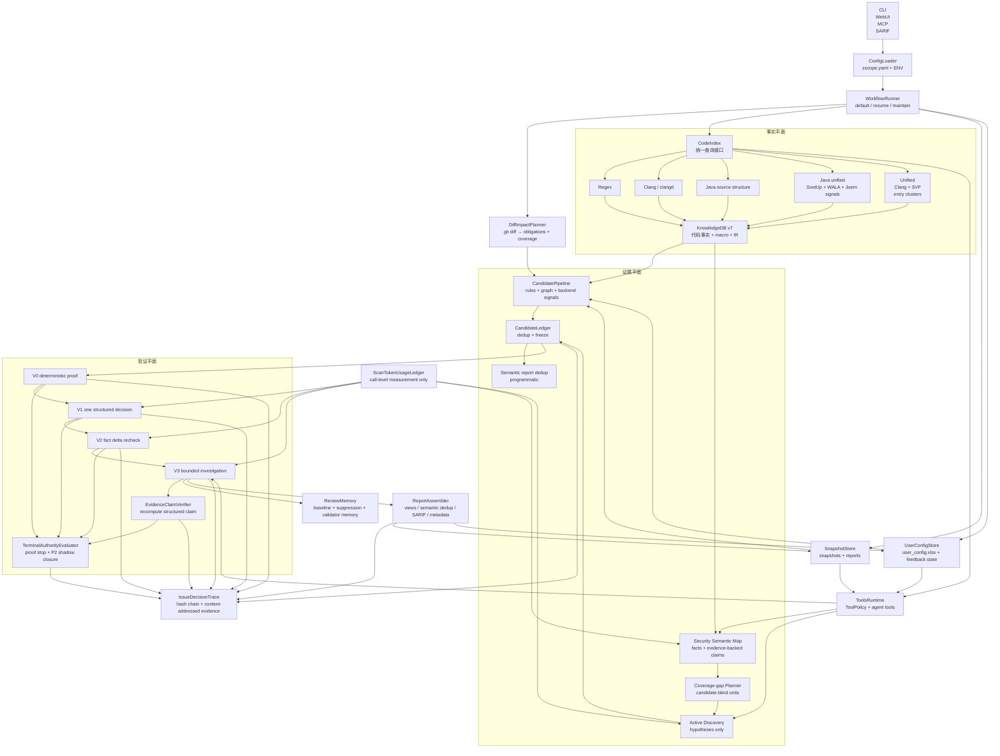

# Z-SCOPE 架构文档（v1.3.1）

## 1. 架构定位

Z-SCOPE 是面向大型 C/C++ 项目的证据优先静态分析平台，并提供 Java Preview。系统以结构化代码事实、程序分析后端信号、项目语义快照和多智能体验证为基础，构建可审计、可恢复、可扩展的缺陷发现流水线。

平台采用“静态事实先行、语义推理收敛”的架构原则。C/C++ 内存、资源生命周期和并发问题首先由 Regex、Clang、SVF/Saber 与规则产生证据；Java 由 source/java_unified 结构索引、SootUp/WALA/Joern 信号和 Java 规则产生证据。LLM Agent 负责在受控上下文中补全跨模块意图、判断业务约束、验证可利用性，并将结果收敛为可追踪报告。C/C++ Joern 在 1.x 中仅保留弃用兼容入口。

Z-SCOPE 的定位可以归纳为三个层面：

| 层面 | 定位 |
|------|------|
| 工具属性 | 面向 C/C++ 安全审计、提供 Java Preview 的本地化 SAST 与 AI 验证平台 |
| 架构属性 | 事实平面、证据平面、智能体平面、反馈平面分层解耦 |
| 使用属性 | 支持批量扫描、diff impact 变更审计、增量维护、断点续扫、SARIF 告警复核与导出、WebUI 与 MCP 接入 |

面向的主要问题域：

| 大类 | 典型问题 |
|------|----------|
| 内存安全 | 越界、整数溢出、UAF、double free、invalid free、栈逃逸、未初始化读 |
| 资源生命周期 | 内存泄漏、fd/socket/mmap stale、初始化/释放不匹配、跨 handler 所有权转移 |
| 并发安全 | 数据竞争、refcount 竞态、缺失解锁、死锁、条件变量误用、对象提前发布 |
| 输入与逻辑安全 | 格式串、命令构造、TOCTOU、空指针、失败返回未检查 |

## 2. 设计目标

Z-SCOPE 的架构目标可以概括为四句话：

1. **高检出**：多个来源并行产生候选，包括 Clang/SVF、Java 结构与信号提供器、通用规则、跨函数图候选、入口发现、diff impact 受影响入口、语义快照和 LLM 挖掘。
2. **低误报**：每个候选必须携带 source/sink、路径、对象或锁、正反证据、稳定去重键，并经过 Validator、评分、用户反馈和报告分层。
3. **可恢复**：所有关键中间产物和最终报告落地到 SQLite/JSON，支持断点续扫、增量维护和失败后的继续分析。
4. **可演进**：后端、Agent、Skill、Workflow、MCP 工具和 Web 反馈均是边界清晰的可插拔模块。

设计约束：

- 被扫描项目通常是大型 C 代码库，模块多、入口多、跨文件资源关系复杂。
- LLM 使用 OpenAI 兼容 API，支持本地模型、云端模型、多模型路由和多 endpoint 负载/限流。
- 分析必须能运行在批量模式、CI/CD、WebUI、MCP 客户端和 SARIF 验证场景中。
- Worker 预算只能限制“深入分析的数量”，不能成为覆盖率边界。

## 3. 总体架构

总体架构由事实、证据、验证和反馈四个主平面组成。事实平面负责代码索引和程序事实沉淀；证据平面保留确定性快车道，并在 balanced/deep 中用独立安全语义地图和 candidate-blind coverage gap 扩展主动发现；所有来源统一进入全局 Candidate Ledger。验证平面只让完整 proof，或经过程序验真的完整 evidence closure 改变终态；模型只能提交 Claim，不能直接创造事实或确认漏洞。反馈平面通过 SnapshotStore、Security Map sidecar、UserConfigStore、ReviewMemory 与 IssueDecisionTrace 保留中间产物、因果事件、最终报告和人工决策。LLMClient 的所有 profile 共享 scan-wide token 账本；ToolsRuntime 仅向 V3 调查和受控发现开放白名单内的只读查询。

跨语言规则治理在既有候选生命周期上增加严格预检：`project.language` 决定 C/C++ 与 Java 后端、规则、Skill 和语义 schema；包内目录、YAML pack、指定 provider、Skill 契约和 disabled IDs 组合为不可变 `EffectiveRuleSet`。重复 ID/alias、未知字段、语言错配、缺失 Skill 或能力错配在任何外部工具/LLM 启动前失败。`zscope.candidate.v3.3` 仍是内部候选协议，规则 provenance 以兼容字段追加，不改变稳定候选身份算法。

v1.2 没有替换 v1.1 的主平面；该版本的架构增量集中在性能、精度和可审计性：diff impact 从反向入口枚举收敛为语义义务与覆盖计划；Unified/SVF 增加入口聚类、互斥/共享 bitcode pool 与缓存 manifest；Clang/KnowledgeDB 强化增量缓存、macro 和删除文件处理；Validator、alert-verify 与 LLM 客户端增加并行、fast-path、endpoint 容量控制和成本统计。v1.0 已经把原来集中在 `Analyzer` 和 `zscope/core/*.py` 的职责拆成可测试模块：

| 模块 | 主要文件 | 职责 |
|------|----------|------|
| Analysis | `zscope/core/analysis/analyzer.py` | 顶层协调器，装配 pipelines、agents、tools、workflow、budget、snapshot 与 agent policy |
| Candidates | `zscope/core/candidates/` | regex、Clang AST/CFG、SVF/Saber、Java rules/signals、Graph、KnowledgeDB 后端信号和 candidate evidence |
| Rules | `zscope/rules/` | 内置目录、descriptor/alias、`EffectiveRuleSet`、YAML pack、Provider V2、预检与 provenance |
| Validation | `zscope/core/validation/` | Validator evidence pack、验证运行、suppression、baseline、score、`needs_review` 分流 |
| Reporting | `zscope/reporting/` | `FinalReport`、Finding-root v2 report views、JSON/Markdown、SARIF v2.1.0 |
| Identity | `zscope/common/issue_identity.py` | `canonical_issue_key`、`stable_issue_fingerprint`、source context fingerprint、根因级去重 |
| Review Memory | `zscope/memory/review_memory.py` | 人工 false-positive、finding baseline、Validator memory 的统一门面 |
| Semantics | `zscope/semantics/` | 内置默认 API 语义、项目 overlay、用户配置上下文、语义推断 |
| Orchestration | `zscope/orchestration/` | workflow、entry discovery、diff impact、risk budget、Candidate Ledger、history reconciler、parallel analyzer |
| Tools | `zscope/tools/` | LLM 工具运行时、参数校验、ToolPolicy、敏感路径 hook 和审计 |
| Web / MCP | `zscope/web/`、`zscope/mcp/` | Dashboard service layer、stdio/HTTP MCP、远程安全校验 |

### 3.1 配置边界：UserConfigV2 + RuntimeSpec

配置加载分为三层：

1. `UserConfigV2` 严格解析用户 YAML，只接受 LLM、项目/入口、审计重点、语言后端拓扑、SVF 规划、并发和规则扩展。
2. 打包的 `runtime_defaults.yaml` 解析为 `RuntimeSpec`，提供 Agent 启用状态/LLM 角色、分析预算、缓存、报告策略和稳定算法默认值。
3. loader 把两者组合为内部 `EffectiveConfig`，并把 RuntimeSpec 的版本、来源路径和 SHA-256 写入配置哈希、缓存身份与报告 metadata。

产品运行时只接受 `config_version: 2`，不保留 v1 别名。旧配置只能由独立的 `zscope-config migrate` 读取。开发者覆盖必须同时设置 `Z_SCOPE_DEVELOPER_MODE=1` 和绝对路径 `Z_SCOPE_RUNTIME_SPEC`；覆盖文件也执行重复键、未知键、类型和枚举校验。

`AGENT.md`、`SKILL.md` 和 workflow YAML 分别保持 Agent prompt、Skill/Tool 和流程契约，不复制进 RuntimeSpec。KnowledgeDB、snapshot 与默认 user-config 状态路径统一相对 `project.root`，避免跨目录运行污染进程工作目录。

## 4. 运行时主流程

### 4.1 默认扫描

默认工作流由 entry workflow 与 scan-level 收敛阶段共同组成：

1. `discover_entries`：当 `--discover-entries` 或 `project.entry_discovery.enabled` 启用时，发现公共 API、通信/IPC、线程入口和用户输入点，并把候选入口列表写入项目根目录 `entry_functions_list.json`。
2. `collect_candidates`：各入口收集规则、图与 backend signal，登记到共享 Candidate Ledger；发现层不得因 token 预算静默丢候选。
3. `semantic_and_gap_discovery`：fast 跳过；balanced/deep 先构建零 LLM Security Semantic Map 骨架，只对高风险 audit unit 做证据化 semantic delta，再运行 candidate-blind 主动发现并登记 hypothesis。coverage 使用 family + audit-unit + 函数集合 + subject/decision-region/source-sink 的哈希化局部身份；同 family 的另一函数已有候选不能抑制当前 candidate desert。
4. `freeze_ledger`：全部入口与主动发现结束后冻结全局 Ledger，按同一安全义务跨入口合并。
5. `validate_candidates`：稳定 bounded V0 proof → V1 结构化单次判定 → 按模型合法请求定向补证 → 有事实增量才执行一次 V2 → balanced 调查 high/critical 或外部可达的未闭合 cluster，deep 调查全部无完整反证的非 shadow 未闭合 cluster。Z-Scope 2.0 的 V1 前 fact-first 与 closure authority 当前只生成 shadow 对照，不改写产品 V1 输入或终态。
6. `persist_report`：无论完整或部分完成都保存报告、地图、usage、未覆盖区域，以及按 cluster 的 hash-chain decision trace；已启用阶段不完整时标记 partial。

当 `${snapshot_dir}/balanced_rollout_state.json` 存在时，配置生效边界在创建 usage 账本之前执行统一灰度策略。状态必须是由受保护控制面使用专用环境密钥生成的 HMAC-SHA256 信封，并通过 schema/policy/language/release identity、单调 sequence、签发时间、有效期和内部状态校验，才有权改变省略档位：telemetry/回退状态强制 fast，validator opt-in 不启用语义/发现，semantic shadow 运行候选盲发现但将其闭合为不进入用户视图的 `shadow_observation`，10/50/100 依据稳定 project-id bucket 做确定性 enrollment。CLI、Web、MCP 和报告均回显 requested/effective depth、rollout stage、bucket、认证状态与语义/发现可见性；无密钥、裸文件、篡改、过期或 identity 不匹配均视为 unmanaged，不能把省略档位切为 balanced，但不会阻断用户显式 `--scan-depth balanced|deep`。没有安装状态文件的开发/既有部署保持原配置行为。

Workflow 是 Python 编排层的执行计划，不作为大段提示词注入模型。CLI 选择运行模式：默认使用 `default`，`--resume` 切换到 `resume`，`--maintain` 切换到 `maintain`；C/C++ 的 `--mode ruledriven` 在 P1 被明确拒绝并指向默认 Candidate Ledger，Java 暂时保留该模式；`--mode alert-verify` 继续走专用入口并共享 call-level usage 账本和验证协议。每个声明 step 必须有 handler，并精确产生一条 `completed`、`skipped` 或 `failed` 进度记录；停止策略导致的后续 step 以明确原因记录为 skipped。`ScanSessionRunner` 会在 session 步骤后决定入口形态：显式 `entry_functions_list`、入口发现候选或 diff impact 候选进入批量模式，否则回退到 `entry_function` 单入口模式。public v2 不暴露 workflow 或 `analysis` 区块，扫描成本由报告计量而不是运行时 token 门限控制。

### 4.2 批量、断点续扫和增量维护

| 模式 | 入口 | 行为 |
|------|------|------|
| 默认单入口 | `project.entry_function` | 未配置 `entry_functions_list` 且入口发现无候选时，分析单个入口并生成 `report.json/md` |
| 默认批量 | `project.entry_functions_list` 或入口发现候选 | 多线程执行每个入口，汇总 `zscope_batch_report.json/md` |
| `--diff-base` / `--diff-head` | `entry_functions_diff.json` | 从 git diff 映射变更函数并反向寻找受影响入口；报告标注 diff relevance |
| `--resume` | `resume.yaml` | 从 `snapshots.db` 跳过已有成功 final report 且无 pending validation 的函数，最后合并跳过项报告 |
| `--maintain` | `maintain.yaml` | 比较源码/语义哈希，未变更函数零 Token 复用历史报告，变更函数先调和历史缺陷再重扫 |
| `--mode ruledriven` | Joern | Joern 规则扫描后交给 LLM 验证 |
| `--mode alert-verify` | SARIF | 将外部 SAST 告警归一化为 `ExternalAlert`，再由 LLM 二次确认 |
| `--export-sarif` | 完成后的 Z-SCOPE 报告 | 将本次扫描结果导出为 SARIF v2.1.0，供代码扫描平台消费 |

diff impact 模式由 CLI 的 `--diff-base` 启用，不能与 `--resume` 或 `--maintain` 同时使用；选根语义使用内置稳定策略，不暴露为 public YAML。它会生成项目根目录 `entry_functions_diff.json`，其中包含 `path_filters`、`changed_functions`、`analysis_obligations`、`coverage_summary`、`function_coverage` 和每个入口的 `diff_focus`。`--diff-repo-root` 可显式指定 git worktree，重复 `--diff-path` 可只纳入特定路径下的 changed files / changed functions；最终扫描 root 仍可位于路径外。

## 5. 核心分层

### 5.1 控制平面：CLI + Workflow

控制平面负责把用户意图变成可执行流程：

- `zscope/cli/cli.py` 处理运行模式、WebUI、MCP、SARIF 告警验证、SARIF 导出、索引预热、`--infer-user-config` 工作簿推断和 `--diff-base/--diff-head/--diff-repo-root/--diff-path` 差异影响扫描，并暴露 `--mode`、`--sarif`、`--dashboard-host/--dashboard-port`、`--mcp-http`、`--mcp-host/--mcp-port/--mcp-endpoint`、`--mcp-auth-token-env`、`--mcp-client-allowlist` 等服务边界参数。
- `zscope/orchestration/scan_session.py` 统一入口发现、diff impact 入口规划、发现/差异结果落盘、批量加载、断点续扫和报告备份。
- `zscope/orchestration/workflow_executor.py` 执行声明式 workflow step，并在报告 metadata 中记录进度。
- `zscope/orchestration/workflow_runner.py` 装配单入口运行态，负责 state factory、workflow executor、report build/persist/finalize 回调和已有报告返回路径；history reconciler 与 validation runner 仍由 `Analyzer` step handler 调用。

`--infer-user-config` 是独立的控制面命令：它构建 CodeIndex，运行 `infer_user_config_rows()`，再用默认 LLM profile 按 `concurrency.llm_max_inflight` 并行筛选、修订或丢弃候选行，把保留的语义行合并进 `user_config.xlsx`，然后退出。该命令不会触发漏洞扫描。

这种设计把“什么时候运行哪个阶段”从 Agent prompt 中拿出来，放到可测试、可审计的 Python 编排层。

### 5.2 事实平面：CodeIndex + Backends + KnowledgeDB

`CodeIndex` 是所有 Agent 和 MCP 工具看到的统一代码查询接口。底层后端可替换：

| 后端 | 主要能力 | 适用场景 |
|------|----------|----------|
| `regex` | 轻量函数提取和源码片段读取 | 用户显式选择的无外部依赖模式 |
| `clang` | clangd LSP 批量提取函数、类型、调用、宏、全局变量 | 常规结构化 C 索引路径 |
| `joern` | Java CPG 信号；C/C++ 仅 1.x 弃用兼容 | Java Preview 或旧配置迁移 |
| `unified` | ClangBackend + SVF/Saber，共享 KnowledgeDB | 需要间接调用、指针分析、内存缺陷后端信号的深度模式 |
| `java_source` | Java 源码结构、框架注解与方法索引 | 最小 Java Preview |
| `java_unified` | Java structure + SootUp/WALA/Joern provider evidence | Java Preview 默认深度模式 |

`KnowledgeDB` 当前 schema v14 不只保存传统代码事实，也保存 macro 与 Inspection IR：

- 代码事实：`functions`、`type_definitions`、`type_members`、`call_edges`、`global_variables`、`macro_definitions`、`include_edges`
- SVF/Saber 信号：`indirect_calls`、`taint_signatures`
- 证据 IR：`ir_statements`、`ir_resource_events`、`ir_lock_events`、`ir_shared_accesses`、`ir_path_slices`
- 语义契约：`function_contracts`

架构收益是明显的：LLM 的每次判断都可以回落到文件、行号、函数、路径切片、资源事件和锁事件，避免停留在自然语言印象。

当前 `CodeIndex.get_function_impl()` 还会查找函数声明和实现前的 C/C++ 注释块，并把这些 comment block 连同带绝对行号的实现源码一起返回。v1.2 进一步加入 per-run 源文件行缓存、函数实现缓存、函数文件解析缓存和 macro 定义查询，函数式宏可作为轻量实现返回。这样头文件中的 API 契约、所有权说明、锁要求、宏别名和参数语义可以在不额外检索文档的情况下进入 Agent 上下文，同时仍然保留文件与行号来源。

Clang 后端把增量缓存分成两层：基础 TU 事实只由源码哈希、真实 pending 状态、删除影响和基础 extractor 版本失效，`indexed + hash unchanged` 的 TU 不会因为派生格式变化重新执行 documentSymbol；`function_symbol_context` 与 `function_type_refs` 则用 schema v14 既有 metadata 记录独立的 `dirty/in_progress/current/failed` 生命周期。基础刷新以有界并发执行 clangd/源码收集，再由单个 SQLite writer 用每 TU SAVEPOINT 和每批一次提交原子发布；收集失败时旧事实保持完整。派生重建同样按文件有界并发执行源码与 clangd 查询，worker 只返回行和统计，调用线程作为唯一 SQLite writer 将结果分批写入 TEMP staging；事实替换与 `current` 状态仍在同一事务发布，因此进程中断后可保留旧完整结果并只恢复派生阶段。两类派生索引同时失效时使用每文件一次的 combined semantic pass；解析按 clangd symbol identity 合并重复声明，并以 references 坐标反向映射做常数时间匹配，只有无法消歧的位置才请求 definition。semantic/source/references 缓存均有容量边界和并发 single-flight，避免超大项目常驻全量 token 或对同一声明重复发起 RPC。删除文件仍会清理对应 TU、函数、类型、调用边和 macro，并按 include/callee 影响标记相关文件强制刷新。KnowledgeDB 使用 WAL 与线程本地 SQLite connection，并对直接/间接 callee 查询做版本化缓存，写入调用图或 SVF 数据时会自动失效。

Unified 后端的 SVF 路径支持入口裁剪和入口聚类。public v2 使用 `indexing.svf.scope`、`entry_depth`、`max_selected_tus`、`fallback`、`exclusive_pools` 和 `shared_pools` 表达项目规划。`EntryBitcodeSelector` 会从入口函数沿 KnowledgeDB 调用图选择翻译单元，再通过 `llvm-nm` 的 undefined symbol 闭包补齐依赖；pool 名称必须全局唯一、路径非空且冲突引用有效。每个 SVF 分组会写入裁剪计划、入口聚类布局和 bitcode/link manifest；这些布局及 RuntimeSpec provenance 一同参与缓存身份。

### 5.3 证据平面：CandidatePipeline + Backend Signals

v1.2 继续沿用证据候选层，并把候选收集、合并、统计和 IR 持久化集中到 `zscope/core/candidates/pipeline.py`。候选来源包括：

- `zscope/core/candidates/regex.py`：基于通用 C 模式生成内存、资源、并发、输入和逻辑候选。
- `zscope/core/candidates/clang_ast_cfg.py`：用本地 AST/CFG 视图补足结构化控制流、协议字段和 copy/size 证据。
- `zscope/core/candidates/graph.py`：基于调用图、锁区域、资源协议和生命周期形态生成跨函数候选。
- `zscope/core/candidates/svf_value_flow.py` 与 `backend_signals.py`：把 SVF/Saber、KnowledgeDB、Joern/CPG 等后端信号归一化为 candidate。
- 语义快照中的历史线索只作为有来源的事实或 observation 参与 Security Map/gap plan；候选必须经 CandidateRegistrar 进入 `CandidateLedger`，不能由旧的逐入口规划旁路确认。
- Agent 新发现和 `CandidatePipeline` 产生的 merged candidates 会在 vulnerability mining 后一起进入 `pending_new_issues`，再由 Validator 统一处理。

#### 确定性规则、后端信号与规则目录

`zscope/rules/builtin_catalog.yaml` 只保存规则元数据，不把 AST/CFG、Graph 或其他复杂算法搬进 YAML。每个 `RuleDescriptor` 定义 canonical ID、language、engine、defect class、CWE、Skill、severity、revision、status、title/summary、required capabilities 和 aliases。已有 ID 原样保留；新内置规则使用 `zscope.<language>.<engine>.<slug>`，外部扩展不得占用 `zscope.` 命名空间。

扫描前工厂依次加载目录、qualification registry、`SpecRegistry`、YAML packs 和显式选中的 Python provider descriptor，校验全局 ID/alias、Skill 语言、backend capability 与 `rules.enabled_ids`/`disabled_ids`，然后生成共享的不可变 `EffectiveRuleSet`/`RulePolicy`。Provider 在此阶段只被导入，不执行 `evaluate()`。CLI、config validate、doctor、Web、MCP 与批量扫描复用同一预检/序列化服务；Analyzer 仍保留防御性预检。

候选分为三种身份：

| `candidate_kind` | 来源与契约 | 规则目录约束 |
|------------------|------------|----------------|
| `deterministic_rule` | Regex、Clang CFG/matcher、Graph、Java local、YAML pack、Python provider | 必须有已登记 canonical `rule_id`，descriptor/qualification 决定默认状态，受 `enabled_ids`/`disabled_ids` 控制 |
| `backend_signal` | SVF/Saber、Joern、Java signal provider 等后端原生事实 | 不要求目录 ID，保留 `signal_source` 和 `native_rule_id`，由 `indexing` 控制 |
| `llm_observation` | LLM 主动审计新发现 | 受 active Skill 与 Validator 约束，不伪造确定性规则 ID |

Skill trigger 是主动发现/调查的路由依据，不是漏洞规则；finding suppression 是 ReviewMemory 中的人工决策，也不是规则开关。`disabled_ids` 优先于 `enabled_ids`，只停止指定确定性检测器，其他规则、backend signal 或 LLM 仍可独立发现等价问题。中央候选门禁会在 merge/ledger 前再校验 descriptor 一致性并丢弃已禁用候选，防止实现绕过引擎内部门禁。

目录原始字节与规范化内容、qualification、相关引擎源码、enabled/disabled IDs、pack/provider 内容与版本、当前语言/backend capability 共同形成 effective SHA-256。该哈希进入规则候选、gap plan、Validator environment fingerprint 和报告 provenance，但不参与既有 candidate/finding 稳定身份算法，也不会使独立程序事实或 Security Map 骨架缓存失效。

C/C++ 确定性引擎对外保留 `RegexCandidateGenerator`、`ClangAstCfgCandidateGenerator` 和 `GraphCandidateGenerator` 稳定 facade，内部按资源/生命周期、内存/边界/整数、并发/锁/共享状态、协议/所有权/逻辑四个领域调度 detector。每个 facade 只解析一次源码/图事实，共享只读 `RuleContext` 和 `CandidateEmitter`，并保持原规则顺序、候选身份、dedup key、evidence 与置信度。Graph 查询缓存/错误记录仍归 facade；旧模块路径仅作 re-export 兼容层。Worker 中的 `SKILL_TRIGGERS`/`JAVA_SKILL_TRIGGERS` 只是路由启发式，不参与规则目录。

`CandidatePipeline.collect_signal_candidates()` 输出 `CandidateSignalBatch`，分为 `local_candidates`、`graph_candidates`、`backend_candidates` 和 `merged_candidates`。这使上层只消费 evidence-only candidate，不再直接关心候选来自 regex、Clang、SVF、Graph 还是 Joern。

确定性候选生成器不再只依赖内置 API 名称表。v1.0 将本地模式语义收敛到 `zscope/semantics/`：`defaults.yaml` 提供 allocator/deallocator/reallocator/copy/lock/unlock/size type 等默认语义；`SemanticOverlayCompiler` 合并内置 defaults 与 `UserConfigStore` 中的工作簿/配置行，生成 checker-facing overlay；`LocalPatternSemanticBuilder` 再合并 typedef、用户配置、历史 snapshot 和函数名启发式，生成 local candidate generators 消费的 `LocalPatternSemantics`。项目私有 API 因而可以参与同一套候选规则。

语义配置的分层如下：

| 层级 | 作用 |
|------|------|
| `defaults.yaml` | 打包发布的默认 API role、type alias 和 checker role |
| user workbook | 项目私有 allocator、release、lock、dispatcher、module lifecycle、pointer target、function intent |
| state DB / legacy SQLite | 配置告警、finding suppression、baseline 和旧 SQLite 配置兼容 |
| local inference | typedef、宏别名、历史 snapshot 和函数命名启发式补充 |
| filtered context | `user_config_context.py` 按入口函数和文件 scope 注入 prompt 所需片段 |

图候选弥补单函数词法规则的边界，当前覆盖持锁调用会重入加锁的 helper、错误清理类型、线程参数生命周期、全局容器生命周期、对象发布后初始化、容器解链后释放、timer/pipe 等级联等待、锁顺序反转、协议状态机、字节序逻辑、fd 类型契约、shared-memory create-if-absent race、signal handler deadlock、callback self-destroy 以及 stale tree/list 链接等形态。图候选输出仍保持与其他 candidate 相同的数据形状，因此直接进入全局 Ledger 与分层 Validator，不形成旁路报告。

候选会被 `CandidateLedger` 统一登记、合并并关闭生命周期。验证组的冻结 outcome 是稳定终态的唯一输入；Finding-root v2 只把这些 outcome 投影为 primary/alias 展示关系，不取得 proof 或 terminal authority。live 单入口和批量报告不再执行 report-time LLM 判重，也不从 entry-local `issues[]` 补造 finding。`zscope/common/issue_identity.py` 中的确定性 identity helper 继续用于候选注册、历史兼容读取和审计字段，但不能越过 Ledger 改写终态。每个候选携带：

| 字段 | 作用 |
|------|------|
| `candidate_id` | 稳定候选 ID |
| `dedup_key` | 跨入口、跨信号源的兼容去重键 |
| `rule_id` / `rule_engine` / `rule_revision` | 确定性候选的 canonical descriptor 引用 |
| `rule_source` / `rule_catalog_sha256` | 规则来源与目录 provenance |
| `defect_class` | 缺陷类别到 Skill 的映射依据 |
| `source` / `sink` | 可验证的数据源与危险操作 |
| `positive_evidence` | 支持该候选的源码事实 |
| `negative_evidence` | 可能降低可信度的保护条件或未决事实 |
| `evidence_pack` | 结构化证据包，包含路径、对象、规则、证据引用 |
| `evidence_refs` | 指向 `ir_path_slices`、资源/锁/共享状态事件等 IR 表 |
| `validation_required` | 默认要求候选进入 Validator / ValidationPipeline，而不是由规则层直接报告 |

主动发现继续使用档位风险阈值、同 Skill 合并和 generated/vendor/test 排除，但 balanced/deep 不再用 audit unit 数量截断召回。单元函数数和初始上下文仍有界；无法执行的 audit unit 必须作为未覆盖区域留痕，已有候选仍保留在 Ledger。

### 5.4 Scan-wide token 计量

public v2 提供 `fast / balanced / deep`，档位决定启用的分析阶段、规划风险阈值和 V3 调查范围。产品运行时没有 scan-wide token 硬上限，也没有 `scan.max_llm_tokens`；2M/12M/30M 等数值只属于 Range Benchmark policy，在完整扫描结束后评价成本是否符合预期，绝不参与请求准入或提前终止。

`ScanTokenUsageLedger` 在每次真实 HTTP attempt 前登记安全估算，仅用于连接中断且 provider usage 缺失时保守计量。provider 返回后按原始 prompt+completion 结算，cached/reasoning 只作子项统计；重试、repair 和 fallback 分别计量。它不会缩短 completion allowance、拒绝新调用或取消在途请求。

每个 `LLMUsageEvent` 记录 agent、stage、candidate/cluster、model、finish reason、prompt/completion/cached/reasoning、provider/estimated、retry/repair、工具次数与新增事实数，不包含 prompt 或思维正文。报告按 agent/stage 聚合并验证 call 级守恒。Benchmark 再读取这些完成后的事实做成本门禁。

### 5.5 智能体平面：Agent + Skill + Tool

Z-SCOPE 不再默认逐入口复活旧式全量多 Agent fanout；LLM 职责围绕选择性语义、candidate-blind 发现和分层验证拆分：

| Agent | 职责 | 关键输入 | 关键输出 |
|-------|------|----------|----------|
| Semantic Map enrichment | 仅补全高风险 audit unit 的关键契约 | 零 LLM 骨架、代码/后端事实 | 带可解析 evidence ref 的 semantic delta |
| `active_discovery` | 对 coverage gap 做候选盲审 | audit unit、地图投影、Skill | hypothesis / observation，不能 confirmed |
| `validator_agent` V1/V2 | 单次结构化判定与新增事实复判 | 有界 evidence slice / evidence delta | verified / rejected / uncertain 模型意见 |
| `validator_agent` V3 | balanced 调查 high/critical 或外部可达未决项，deep 调查全部无反证且有可执行证明动作的非 shadow 未决项 | 一次连续会话、有限 EvidenceAction、证书、Skill | 带程序验真事实的 investigation synthesis |
| `history_maintenance_agent` | 仅在增量维护中复核历史缺陷是否仍可见 | 历史 issue、新代码 | advisory still_exists；缺失结论不能自行清除历史 finding |

Skill 是漏洞领域契约，用于约束分析目标和证据要求，不是检测规则。每个 `SKILL.md` 通过 frontmatter `languages` 声明适用于 `c_cpp`、`java` 或两者。`scan.task` 会被解析为 active skills，例如 `bounds_and_integer`、`resource_lifecycle`、`temporal_memory`、`shared_state_race` 等；空字符串启用当前语言全部适用 Skill，非空文本只表达审计重点。规则 descriptor 必须引用一个存在且支持相同语言的 Skill。

LLMClient 是所有 Agent 的 OpenAI-compatible 调用门面。它支持多 endpoint 容量选择、限流/cooldown、线程本地 session 和共享 scan token 计量。V1/V2 各只发起一次无工具调用：V1/V2 的 truncated 或 malformed 输出直接保持可复核并交给 V3 资格判断，不追加格式修复调用。V3 使用一个最长 50 次模型迭代的连续会话；多轮 reasoning metadata 可在会话内传递，但永不落入普通日志或报告。

ToolsRuntime 定义最多 12 个内置代码查询工具：

`get_function_impl`、`get_function_snapshot`、`list_known_functions`、`get_file_snippet`、`get_callers`、`get_type_info`、`get_call_graph`、`get_data_flow`、`find_function_pointers`、`query_indirect_callees`（旧名 `query_pointer_alias`）、`verify_taint_reachability`、`get_deep_call_context`。

Agent 实际能看到的工具不是固定 12 个。`Analyzer._get_tools()` 根据后端能力提供基础及高级查询，再由对应 `AGENT.md` 与 `ToolPolicy` 过滤。V1/V2 不开放工具；live V3 也不再把普通仓库查询直接暴露为证明能力，而只暴露 `FactCapabilityRegistry` 为当前开放 clause 生成的有限 `EvidenceAction`。普通工具仍可服务其他 Agent 与历史回放，但 call graph 只证明调用关系、indirect-callee 查询只证明可能目标、SVF bug-signature 查询只证明该专用后端信号，三者不能替代 CFG/HB/ownership 证书。active discovery 只接收预先构造的 candidate-blind 投影。MCP 侧复用 ToolsRuntime schema，但还会额外提供 `query_knowledge`、`discover_entries` 和 namespaced aliases，因此 MCP 工具集合与单个 Agent 的可见工具集合并不完全相同。

工具层还做了三类重要防护：

- 工具参数校验和文件路径存在性检查，避免模型反复调用无效路径。
- 绝对行号注入，缓解 LLM 通过相对偏移定位源码时的行号幻觉。
- `ToolPolicy` 约束工具、资源、文件读取和知识库查询，并通过敏感路径 hook 降低远程或自动化场景中的越界访问风险。

### 5.6 验证平面：ValidationRunner + ValidationPipeline

自 v1.0 起，验证逻辑已经从 `Analyzer` 主流程中拆出：

| 模块 | 职责 |
|------|------|
| `zscope/core/validation/evidence.py` | 构造 Validator input、evidence pack、漏洞类别特定验证要求和 retry/修正规则所需证据 |
| `zscope/core/validation/runner.py` | 运行 Validator，处理 entry-root dead-code retry、contract-scope rejection 修正和 ReviewMemory 写入 |
| `zscope/core/validation/pipeline.py` | 应用 suppression、baseline、history feedback、score、`validated`/`needs_review`/`uncertain`/`rejected` 分流 |

这层的设计目标是让所有候选都先保持“待验证证据”的形态，再由统一的验证门禁决定是否进入 `issues[]`、`metadata.audit_observations[]` 或被 suppression/baseline 拦截。高置信规则也不再绕过验证流水线；它们只能在证据完整、无反证且满足评分门槛时被自动接受。

验证阶段使用 bounded `ValidatorEvidenceSlice v3`：每个 cluster 只传 canonical occurrence、可读事实 payload、proof、必要路径/claim 与代码窗口，输入上限 12K tokens。当前产品先运行 bounded V0；完整且无冲突的正/反 proof 可立即终止。未闭合项进入 V1 单次无工具结构化判定；V1 只能提出一个新的合法请求，有真实 delta hash 变化才执行一次无历史 V2。`FunctionIRGraph v1`、四组证书 provider、V1 前 `RequiredFactPlan` 与严格 closure authority 已提供可审计 shadow 输出，但在设计包 P2 的通用 fixture、safe corpus 和证书重放门禁通过前，shadow 事实不能改写 V1 decision slice，shadow closure 也不能把既有 validation pipeline 已确认的 finding 降级。未闭合的 uncertain、无 proof rejected、证据不足 verified 和可恢复格式失败可进入 V3；balanced 不使用 top-K，调查 high/critical 或外部可达且 registry 具有可执行 action 的 cluster，deep 调查全部无完整反证、非 shadow 且有 action 的 cluster。V3 单会话最多50次模型迭代且只能选择固定 action ID；证书一旦形成完整正/反 proof，程序在当前工具轮直接终止。`model_verdict` 与最终 `policy_disposition` 分离；没有 proof 的模型 rejected 只能进入 needs-review。

### 5.7 持久化与反馈平面

Z-SCOPE 使用五类主要持久化区域：

| 存储 | 内容 | 作用 |
|------|------|------|
| `.zscope_knowledge/code_knowledge.db` | 代码事实、SVF 信号、Inspection IR | 全局代码知识图谱和候选证据审计 |
| `.zscope_snapshots/snapshots.db` | 语义快照索引、final report 索引 | `--resume`、`--maintain` 和函数级缓存 |
| `.zscope_snapshots/security_map.db` | 程序安全事实、semantic claim、unknown/conflict、audit unit | balanced/deep 的只读 Security Semantic Map sidecar |
| `.zscope_snapshots/user_config.xlsx` | 外部函数、配对函数、函数指针、dispatcher、模块生命周期、函数意图 | 人工可审阅的用户领域知识 |
| `.zscope_snapshots/user_config.state.db` 或 `user_config.db` | 抑制、baseline、配置告警和历史兼容数据 | 误报反馈与旧 SQLite 配置兼容 |
| `.zscope_bc/bitcode_scope_<group>.json` | SVF 入口裁剪计划 | 审计本次 SVF 分析实际纳入了哪些翻译单元；WSL `/mnt/...` 场景可能写入 Linux 原生临时 bitcode 目录 |

`UserConfigStore` 当前的人工配置工作簿 sheet：

| Sheet | 作用 |
|-------|------|
| `resource` | 描述 allocator、reallocator、deallocator、copy API 与多对多资源配对 |
| `lock` | 描述自定义 lock/unlock API 和锁配对 |
| `dispatcher` | 描述消息分发入口、message type、handler、handler kind、资源和分支配对 |
| `module_lifecycle` | 描述 init/finit、模块资源、错误路径清理和全局生命周期约束 |
| `pointer_targets` | 补充函数指针、ops 表、hook slot 的目标函数 |
| `function_intents` | 保存人工确认的函数设计意图和特殊约束 |

旧 SQLite 路径仍然保留 `external_functions`、`paired_functions`、`function_pointer_targets`、`function_intent`、`config_warnings`、`finding_suppressions` 和 `finding_baselines`。当配置路径指向 `.xlsx`，语义配置走工作簿，反馈状态写入同名 `.state.db`；当配置路径指向目录且存在 `user_config.xlsx`，目录模式也会自动优先使用工作簿。

快照策略不再只区分“完整 LLM 语义”和“跳过”。`zscope/snapshots/policy.py` 会为短函数构造 syntactic snapshot，并把协议版本过滤、fd 编码/类型契约、协议长度、状态恢复、error status 和 facade forwarding 等短函数风险放入 `suspicious_points`；常见宏和轻量 wrapper 可以生成 lightweight snapshot，避免为纯表达式宏或 guard macro 消耗 LLM，同时保留调用方审计线索。

人工反馈不会只是前端状态。Web 保存验证结果时会持久化 baseline 和 suppression，下一次扫描会在验证前参与过滤和评分。`ReviewMemory` 封装 false-positive suppression、finding baseline 查询与 Validator 记忆写入；`UserConfigStore.get_finding_baseline_for_issue()` 先按 `dedup_key` 精确命中，再按 `stable_fingerprint` 或回填后的稳定指纹命中，并把 `match_strategy` 写回结果，避免行号漂移后人工 rejected 失效。

Issue identity 由 `zscope/common/issue_identity.py` 统一提供。`canonical_issue_key` 适合单次报告内根因合并，`stable_issue_fingerprint` 用于长期 baseline、SARIF partial fingerprints 和 benchmark 匹配；可选的 `source_context_fingerprint` 从源码片段或 evidence snippet 生成第三层校验，双方都有上下文且冲突时会阻止过宽的 stable baseline 命中。

与 prompt 相关的用户配置上下文已经迁入 `zscope/semantics/user_config_context.py`。运行时会按当前函数源码标识符和文件 scope 过滤用户配置，只注入与当前入口相关的 resource、lock、pointer target、dispatcher、module lifecycle 和 function intent 片段。

报告层默认生成两类视图：`report_views.default` 只包含冻结 outcome 中的 confirmed Finding-root primary；`report_views.with_needs_review` 再加入 needs_review primary。alias 保持可审计终态，但不重复成为展示 finding。`ReportAssembler` 只接受 Candidate Ledger 的冻结 outcomes，并负责 Finding-root v2 投影、metadata、JSON/Markdown 与 snapshot 持久化；不存在 report-time semantic-dedup Agent 或 LLM cache。历史非 canonical 报告只能通过 `zscope.compat.reports` 做只读展示，不能回流 Candidate Ledger、Proof、promotion 或 live 扫描。报告 metadata 另外记录规则目录 schema/hash、enabled/disabled/unavailable IDs、扩展来源和按 engine/rule 聚合的已产生候选数。CLI 的 `--export-sarif` 输出 SARIF v2.1.0：`ruleId` 直接使用 canonical `rule_id`，CWE 进入 tags/properties，历史 `CWE:rule` 写入 `properties.legacyRuleId`，engine/revision/Skill/catalog hash 进入 rule descriptor；`partialFingerprints.zscopeStableIssueFingerprint` 与 finding 身份算法保持不变。

## 6. 架构优势

### 6.1 同类工具的架构参照系

Z-SCOPE 的优势更适合放在同类工具架构取向中理解。开源工具通常强调可验证的规则、查询语言或编译器级程序事实；商用工具通常强调平台化治理、规则库覆盖、企业流程集成和集中化误报管理。Z-SCOPE 的架构重点是把这些能力中最有价值的信号转化为统一候选，再通过多智能体和反馈闭环完成二次验证。

| 类型 | 代表工具 | 架构重心 | 常见优势 | Z-SCOPE 的补强方向 |
|------|----------|----------|----------|--------------------|
| 编译器/路径分析型开源工具 | Clang Static Analyzer、Cppcheck | AST、CFG、路径约束、规则检查 | 本地运行、结果可复核、工程依赖少 | 引入跨入口语义快照、用户领域知识和 LLM 可利用性验证 |
| CPG/查询型开源工具 | CodeQL、Joern | 代码数据库、查询语言、数据流/控制流建模 | 适合沉淀漏洞模式和变体查询 | 将查询结果进入候选、去重、评分、验证和报告同一链路 |
| 规则/策略型工具 | Semgrep、各类自定义规则引擎 | 模式匹配、污点规则、策略分发 | 编写规则快，适合 CI 和团队规范 | 用 KnowledgeDB IR 与 Agent 验证补足 C 指针、资源和并发语义 |
| 商用 SAST 平台 | SonarQube、Checkmarx、Coverity、Fortify、Snyk Code | 规则库、数据流引擎、集中治理、告警流转 | 语言覆盖广，治理能力成熟，集成生态完善 | 本地可审计证据库、MCP 开放接口、SARIF 二次验证和可解释反馈闭环 |
| AI 代码审查工具 | 通用 LLM 审查、AI SAST | 自然语言语义理解、修复建议、交互式解释 | 对业务语义和修复建议友好 | 由静态证据约束模型输入，降低凭语感判断的风险 |

### 6.2 静态证据驱动的智能体分析

Z-SCOPE 将 LLM 放在“选择性语义补全、候选盲主动发现、证据闭合”三个受控位置，而非事实抽取的起点。Clang、Joern、SVF/Saber、确定性规则和 KnowledgeDB 先提供可定位、可复核的程序事实；LLM 只为带风险和 coverage gap 的审计单元补语义或提出 hypothesis，再由统一 Ledger 与 Validator 收敛。这样既不把召回上限锁死在既有规则，也不恢复逐入口全量多 Agent 的重复上下文成本。

### 6.3 多源候选提高召回上限

单一引擎通常受限于自身抽象：规则型工具依赖规则表达力，CPG/查询型工具依赖查询和库模型，商用工具依赖内置规则和配置，AI 审查工具依赖上下文质量。Z-SCOPE 同时接收：

- clangd/Clang 提供的函数、类型、宏、全局变量和直接调用事实。
- SVF/Saber 提供的间接调用和内存缺陷信号。
- Joern/CPG 和 SARIF 外部告警提供的规则或第三方工具信号。
- 通用 C 确定性规则提供的本地高信号候选。
- 图候选提供跨函数协议、锁顺序、生命周期和 liveness 信号。
- 语义模型快照提供的函数职责、状态变化和跨调用摘要。
- LLM Agent 提供的项目语义、跨 handler 生命周期和业务约束理解。

多源候选统一进入 `CandidateLedger` 后再做去重、合并、验证和评分，使召回能力不绑定到单个后端或单个提示词。

### 6.4 分层验证降低误报

Z-SCOPE 将“hypothesis/候选”“模型 verdict”“policy disposition”“确认漏洞”分为不同层级。候选先由 `CandidateLedger` 根因合并，再经过 V0–V3 分层验证、`issues`/`audit_observations` 分层输出，以及用户 baseline/suppression 历史反馈。确定性 proof、模型判定和人工决策具有独立 attribution；这种设计既把降噪前移到证据闭合阶段，也保留模型拒绝但无反证的可复查线索。

### 6.5 工程化运行与开放集成

每个函数的语义快照、最终报告、批量汇总、候选 IR 和用户反馈都有落地点。大规模扫描中断后可以 `--resume`，代码小改后可以 `--maintain`，旧报告覆盖前有自动备份。MCP Server 还暴露 `zscope://config`、`zscope://knowledge/stats`、`zscope://knowledge/functions`、`zscope://snapshots/list` 等资源，并在 `ToolPolicy` 过滤后提供 `query_knowledge`、`discover_entries`、代码查询工具和 namespaced aliases，使 Z-SCOPE 可以作为本地代码知识底座接入外部 AI IDE。

## 7. 业界领先或差异化特性

Z-SCOPE 的差异化不在单个算法，而在“程序事实、候选证据、智能体验证、人工反馈”闭环的组合能力。

| 能力维度 | 同类工具常见方式 | Z-SCOPE 的差异化实现 | 读者直观印象 |
|----------|------------------|----------------------|--------------|
| AI 与静态分析结合 | AI 工具偏语义解释；传统 SAST 偏规则和数据流 | `evidence_pack`、`evidence_refs`、IR path/resource/lock/shared-access 证据共同约束 LLM | 模型判断具有证据锚点，可降低开放式代码点评风险 |
| C/C++ 深度语义 | 开源工具各有优势但信号分散；商用工具多为封闭引擎 | Clang、Joern、SVF/Saber、确定性规则信号统一进入候选层 | 多个后端的强项可以在同一报告里汇合 |
| 告警复核 | 商用平台依赖人工 triage；开源工具通常输出原始告警 | SARIF `alert-verify` 将外部告警转成 `ExternalAlert` 并复用 Validator | 可作为其他 SAST 的二次确认器 |
| 不确定性处理 | 一些工具以热点、严重级别或人工状态区分风险 | `verified` / `rejected` / `uncertain` 三态，加 `needs_review` 审计观察项 | 低证据问题不阻断 CI，但也不丢失 |
| 大规模扫描 | 商用平台治理强；开源工具常需自行拼接缓存和恢复 | `snapshots.db`、`--resume`、`--maintain`、批量报告备份内建 | 大型项目能长期维护扫描状态 |
| 可解释反馈 | 商用平台支持误报状态；AI 工具常依赖对话记忆 | `finding_suppressions` 与 `finding_baselines` 落在 SQLite，可查、可删、可过期 | 审计经验成为可治理数据 |
| AI IDE 集成 | 多数 SAST 以报告或平台页面为主 | MCP 暴露配置、知识库、快照和代码查询工具 | 扫描器同时也是本地代码知识服务 |
| 回归纪律 | 工具通常发布规则集，项目侧难以度量本地变化 | benchmark v4 + formal v3 跟踪双视图、归因、成本、隔离 evidence 和五轮稳定性，qualification 绑定规则 revision | 新规则需通过跨项目与变形门禁，Range 仅作开发回归 |

## 8. 高检出如何实现

高检出来自“入口覆盖、事实覆盖、候选覆盖、分析覆盖”四层叠加。与只运行规则集或只分析外部告警相比，Z-SCOPE 会主动扩大入口、事实和候选来源，再通过 Agent 和 Validator 收敛结果。

### 8.1 检出链路对比

| 环节 | 开源工具常见能力 | 商用工具常见能力 | Z-SCOPE 实现 |
|------|------------------|------------------|--------------|
| 入口发现 | 通常依赖配置、构建数据库或查询入口 | 依赖扫描配置、仓库集成和语言前端 | `entry_functions_list` + `--discover-entries` / `project.entry_discovery.enabled` 落盘 + `entry_discovery.search_root` |
| 代码事实 | AST/CFG/CPG/规则匹配，各工具侧重点不同 | 专有前端和数据流引擎 | `CodeIndex` 统一 Clang、Joern、Regex、Unified 后端 |
| 跨函数关系 | 依赖数据流查询、库模型或指针分析能力 | 专有模型和框架配置 | SVF Andersen、Saber、调用图、语义快照共同补强 |
| 候选生成 | 查询或规则命中即输出告警 | 内置规则和数据流引擎输出告警 | 确定性规则、后端信号、candidate-blind hypothesis、外部 SARIF 统一入 ledger |
| 深度验证 | 主要依赖规则精度和人工复核 | 平台化 triage 与审计流转 | V0 proof + V1/V2 结构化复判 + 高风险 V3 短调查 |

### 8.2 入口覆盖

- 显式支持批量入口 `entry_functions_list`。
- `--discover-entries` 或 `project.entry_discovery.enabled` 能扫描头文件公共 API、网络/IPC、线程创建、文件/环境/标准输入等入口。
- 自动发现结果会写入 `entry_functions_list.json`，包含 exposure、reasons、confidence 和入口级审计提示，可由人工继续编辑后复用。
- `entry_discovery.search_root` 可把入口发现限制到指定绝对目录，适合只审计大型仓库中的某个模块。
- handler、allocator、release、dispatch 等项目语义由 `user_config.xlsx` 与 `--infer-user-config` 承担，不再通过批量 prompt autofill 注入。

### 8.3 事实覆盖

- Clang 后端提供稳定的函数、类型、调用、宏和全局变量事实。
- Unified 后端叠加 SVF Andersen 间接调用和 Saber 内存缺陷信号。
- Joern 后端可用于规则驱动模式和 CPG 查询。
- Regex 后端保证最小依赖下仍可检索源码。
- KnowledgeDB schema v7 将函数事实、调用边、污点签名、IR statement、资源事件、锁事件、共享访问和路径切片沉淀到统一数据层。

### 8.4 候选覆盖

`RegexCandidateGenerator` 和 `ClangAstCfgCandidateGenerator` 覆盖一批 C 项目高频高价值模式，包括 size arithmetic before allocation/copy、same-function resource leak、direct `realloc` assignment、double free / invalid free、stack address escape、missing unlock、callback under lock、recursive lock risk、`pthread_cond_wait` with `if`、signed-to-unsigned length conversion、off-by-one、uninitialized read、alignment cast、null dereference after unchecked result、shared global race、refcount race、object publication、non-literal format string、system command、path TOCTOU、fd close without invalidation、mmap stale pointer、ignored protocol version、state not restored、raw/encoded fd mismatch、reliable fd/raw fd contract mismatch、recv retry without budget、protocol unit/byte limit mismatch、macro-guarded lock no-op、file type validation、byte-order logic、state machine mismatch 等。规则保持通用 C 语义，不依赖 benchmark 专有函数名。

`GraphCandidateGenerator` 负责跨函数和协议形态，包括 cross-function recursive lock、lock order inversion、wrong cleanup contract、thread argument lifetime、global container lifecycle、object publication ordering、runtime/protocol state contract、fd type contract、lost wakeup、shared-memory race、signal deadlock、callback self-destroy、timer cascade wait 和 stale tree/list liveness。它与确定性规则共享候选形状和去重链路，因此不会形成一套旁路报告体系。

### 8.5 分析覆盖

- Security Semantic Map 先以零 LLM 骨架覆盖入口、调用边、危险事件、globals/types 与 backend coverage，只在高风险 audit unit 补语义。
- Coverage-gap planner 按 known variant、diff、外部可达敏感路径、candidate desert、动态边/alias 缺口、backend 降级、跨模块协议和 semantic unknown/conflict 打分。其中 candidate desert 只消费事件家族级的覆盖 presence/count，不读取候选 ID、source/sink、位置、规则名或结论；这些候选内容也不会进入主动发现 Prompt。
- Balanced/deep 不再按 audit unit 数量截断；风险阈值继续分别过滤规划结果。每单元最多 16 个函数、24K 初始上下文，重合至少 60% 且同 Skill 的单元合并。
- Active worker 看不到 candidate/rule/truth/verdict，只能提出有位置、路径、正反证据和缺失事实的 hypothesis；缺证据内容保留为 observation。
- SARIF 和 ruledriven 模式复用统一 Ledger、归因、token 账本和分层 Validator。

## 9. 低误报如何实现

低误报依赖可解释的证据门禁、分层输出和可治理反馈。与传统规则工具“调规则”、商用平台“人工 triage”、AI 工具“让模型解释”相比，Z-SCOPE 将降噪机制内置到候选生命周期中。

### 9.1 误报控制对比

| 机制 | 同类工具常见做法 | Z-SCOPE 做法 |
|------|------------------|--------------|
| 告警前置条件 | 规则命中、查询命中或数据流路径命中 | 候选必须尽量具备 source、sink、路径、对象/锁身份、正反证据和稳定去重键 |
| 不确定结果 | 作为告警、热点、低严重级别或人工待审 | `uncertain` 与 `needs_review` 默认进入 `metadata.audit_observations` |
| 误报过滤 | 规则关闭、注释、平台状态或 suppression | `finding_suppressions` 在验证前过滤，并可按 scope、rule、过期时间治理 |
| 历史经验 | 平台状态或外部审计记录 | `finding_baselines` 参与 `history_feedback` 评分分量 |
| 重复报告 | 按规则 ID、文件行或平台实例 ID 合并 | issue identity / `deduplicate_issues()` 按类别、scope、root cause、source/sink 和文本证据合并 |
| 可解释性 | 报告引用代码位置或数据流路径 | 报告引用 `evidence_pack`、IR path/resource/lock/shared-access 证据和 Validator 理由 |

### 9.2 候选证据结构化

候选需要尽量提供 source、sink、路径完整性、对象/锁身份、正向证据和反向证据。证据会被写入 `evidence_pack` 和 KnowledgeDB IR，供 Security Map、Validator、报告和人工复查复用。结构化证据使误报控制可以基于事实判断，减少对告警文本或模型解释的单点依赖。

### 9.3 三态 Validator

Validator 可以返回：

| verdict | 含义 | 默认处理 |
|---------|------|----------|
| `verified` | source-to-sink 路径、可控性、保护缺失可以闭合 | 根据 `final_score` 进入 `issues` 或 `needs_review` |
| `rejected` | 源码保护、所有权转移、不可达路径等证据否决候选 | 丢弃或记录为抑制反馈 |
| `uncertain` | 候选有价值但缺少决定性证据 | 进入 `metadata.audit_observations` |

### 9.4 综合评分

`ValidationPipeline` 当前使用五个分量计算 `final_score`：

| 分量 | 权重 | 作用 |
|------|------|------|
| `rule_confidence` | 0.25 | 规则或后端信号本身可信度 |
| `path_completeness` | 0.25 | source/sink/path 是否闭合 |
| `contract_consistency` | 0.20 | 是否被用户配置、保护条件或反证削弱 |
| `validation_confidence` | 0.20 | Validator 的置信度 |
| `history_feedback` | 0.10 | baseline 中的历史反馈 |

Validator 启用时，`verified` 且满足 policy 才默认进入 `issues`；未决项进入审计观察。只有完整确定性反 proof 或未来的 dynamic/human 决策能安全地隐藏 rejected；单独的 LLM `rejected` 必须保留为 `needs_review`。V4 `DynamicReproductionRequest/Result` 和 `decision_level=V4` 只定义数据接口，本里程碑不调度 PoC、ASan 或沙箱执行。

### 9.5 人工反馈与报告分层

WebUI 保存验证状态时，`rejected` 会写入 `finding_suppressions`，后续扫描在验证前过滤；`validated`、`needs_review`、`uncertain` 会写入 `finding_baselines`，后续参与评分。最终报告区分 `issues[]`、`metadata.audit_observations[]`、`report_views.default`、`report_views.with_needs_review`、`metadata.candidate_signal_summary` 和 `metadata.candidate_ledger_summary`，既保留审计覆盖，又避免不确定候选阻断流水线。

### 9.6 同类工具公开资料参照

本章对比基于同类工具的公开官方资料，仅用于说明架构取向。

| 工具 | 参照资料 |
|------|----------|
| CodeQL | [代码数据库和查询机制](https://docs.github.com/en/code-security/concepts/code-scanning/codeql/about-code-scanning-with-codeql) |
| Joern | [Code Property Graph](https://docs.joern.io/code-property-graph/) |
| Clang Static Analyzer | [C/C++ 静态分析](https://clang.llvm.org/docs/ClangStaticAnalyzer.html) |
| Semgrep | [SAST/taint 规则](https://semgrep.dev/docs/writing-rules/data-flow/taint-mode/overview) |
| SonarQube | [规则体系](https://docs.sonarsource.com/sonarqube-server/user-guide/rules/overview)、[security hotspot/taint 模型](https://docs.sonarsource.com/sonarqube-server/user-guide/rules/security-related-rules) |
| Snyk Code | [语义 AI SAST](https://docs.snyk.io/scan-using-snyk/snyk-code) |
| Checkmarx SAST | [内部代码图和数据流分析](https://docs.checkmarx.com/en/34965-324470-sast-scanner.html) |
| Coverity Scan | [路径缺陷发现能力](https://scan.coverity.com/) |

## 10. 运维与伸缩性

| 能力 | 架构机制 |
|------|----------|
| 大批量入口 | `ParallelAnalyzer` 线程池并发执行入口分析 |
| 变更审计 | `DiffImpactPlanner` 从 git diff 映射变更函数、语义义务、路径过滤和覆盖计划，报告保留 diff relevance 与 coverage |
| 中断恢复 | `--resume` 基于 final report 和 pending 状态跳过已完成项 |
| 增量维护 | `--maintain` 比较 code/semantic hash，未变更函数零 Token 复用 |
| Token 控制 | call-level usage 计量、稳定 system/schema 前缀、选择性 semantic delta、candidate-blind audit unit、V1 单次、V2 delta-only、V3 证据缺口驱动的最长 50 轮会话；成本阈值由 Benchmark 后置评价 |
| SVF 伸缩 | 入口裁剪 bitcode、入口聚类、符号闭包补齐、互斥/共享 pool、分组 link variant、manifest 缓存和 full/skip 回退 |
| 报告安全 | 覆盖批量 JSON 前自动备份，标准 SARIF 导出不改写主报告 |
| Benchmark v4 / formal v3 | 记录双视图、候选漏斗、发现×决策归因、raw/effective FP、usage 守恒、隔离 evidence、成本和五轮稳定性；policy v1 是唯一门禁源 |
| 多模型策略 | `llms` 多 profile + Agent 级 `llm_ref` + 模型列表回退 + profile 内多 `base_urls` 容量控制 |
| 代理模型兼容 | 流式调用、JSON 修复、XML tool-call fallback、自动续写 |

## 11. 对外接口

### 11.1 CLI

| 命令 | 用途 |
|------|------|
| `zscope -c zscope.yaml` | 默认扫描或批量扫描 |
| `zscope -c zscope.yaml --scan-depth balanced` | 覆盖本轮扫描档位；不设置 scan-wide token 上限 |
| `zscope -c zscope.yaml --resume` | 断点续扫 |
| `zscope -c zscope.yaml --maintain` | 增量维护 |
| `zscope -c zscope.yaml --discover-entries` | 自动入口发现 |
| `zscope -c zscope.yaml --plan-entries` | 构建索引并预览/写出入口计划，不调用 LLM |
| `zscope -c zscope.yaml --diff-base origin/main --diff-head HEAD` | 差异影响扫描，生成 `entry_functions_diff.json` 并标注 diff relevance |
| `zscope -c zscope.yaml --diff-base origin/main --diff-head HEAD --diff-repo-root /repo --diff-path src/net` | 指定 git worktree 并只纳入特定路径下的变更函数；必要扫描 root 可位于路径外 |
| `zscope -c zscope.yaml --infer-user-config` | 推断或刷新 `user_config.xlsx` 后退出 |
| `zscope -c zscope.yaml --build-index` | 仅构建索引（`--build-cpg` 为弃用别名） |
| `zscope -c zscope.yaml --dashboard` | 启动 Web 仪表盘 |
| `zscope -c zscope.yaml --mcp-stdio` | 启动 MCP stdio server |
| `zscope -c zscope.yaml --mcp-http --mcp-host 127.0.0.1 --mcp-port 8765` | 启动实验性 Streamable HTTP MCP server |
| `zscope -c zscope.yaml --export-sarif zscope-results.sarif` | 扫描完成后导出 SARIF v2.1.0 |
| `zscope-rules list --config zscope.yaml [--language/--engine/--status] [--json]` | 查看规则 descriptor、来源与 effective status |
| `zscope-rules show RULE_ID --config zscope.yaml [--json]` | 查看单条规则、启停原因与 capability |
| `zscope-rules validate|test PACK...` | 验证 YAML pack 或执行其正反例 |
| `zscope --mode ruledriven -c zscope.yaml` | Joern 规则驱动模式 |
| `zscope --mode alert-verify --sarif alerts.sarif -c zscope.yaml` | SARIF 告警验证 |

### 11.2 WebUI

当前 Web 后端由 `zscope/web/server.py` 负责路由，业务逻辑委托给 `zscope/web/services.py`：

| Service | 职责 |
|---------|------|
| `ConfigService` | `zscope.yaml` 文本与结构化配置读写 |
| `WorkbookService` | `user_config.xlsx` 读取、保存、导入和下载 |
| `UserConfigService` | warnings、external functions、paired functions、pointer targets、function intents 等 CRUD |
| `CpgService` | CPG/索引状态查询和异步构建触发 |
| `SourceSnippetService` | 报告位置到源码片段的安全读取 |
| `ReportFeedbackService` | `/api/save_findings` 的验证状态更新、snapshot 更新、feedback 持久化和报告保存 |
| `RuleService` | 复用扫描预检/序列化服务，提供与 CLI `--json` 相同 schema 的只读规则目录与筛选 |

主要 HTTP API：

| API | 用途 |
|-----|------|
| `GET /api/findings` | 读取当前报告中的 findings |
| `GET /api/version` | 返回当前 Z-SCOPE 版本和展示字符串 |
| `POST /api/save_findings` | 保存验证状态并持久化 feedback |
| `GET/POST /api/config` | 读取和保存 `zscope.yaml` |
| `GET/POST /api/config/structured` | 读取和保存结构化配置 |
| `GET /api/rules?language=&engine=&skill=&status=&q=` | 查询规则目录、汇总与 effective status（只读） |
| `GET /api/cpg_status` | 查询索引构建状态 |
| `POST /api/build_cpg` | 触发索引构建 |
| `GET /api/source_snippet` | 读取报告位置附近源码片段 |
| `GET /api/user_config/warnings` | 读取配置告警 |
| `POST /api/clear_warnings` | 清理配置告警 |
| `GET/POST /api/user_config/workbook` | 读取或保存用户配置工作簿 |
| `POST /api/user_config/workbook/import` | 导入用户配置工作簿 |
| `GET /api/user_config/workbook/download` | 下载当前用户配置工作簿 |
| `GET/POST/DELETE /api/user_config/<resource>` | 用户配置 CRUD |

### 11.3 MCP

MCP 暴露三类能力，并统一经过 `ToolPolicy` 过滤：

- Resources：`zscope://config`、`zscope://knowledge/stats`、`zscope://knowledge/functions`、`zscope://snapshots/list`
- Prompts：`zscope.entry_discovery`、`zscope.resource_lifecycle_audit`、`zscope.concurrency_audit`
- Tools：ToolsRuntime 的 12 个 raw schema，外加 `query_knowledge`、`discover_entries`，并为 raw 工具提供 `zscope.code.*`、`zscope.graph.*`、`zscope.knowledge.query` 和 `zscope.entries.discover` aliases

stdio MCP 适合作为本地 IDE/Agent 接入。HTTP MCP 是显式开启的远程实验入口：默认绑定 loopback；当绑定非 loopback 地址时，CLI 会强制要求 `--mcp-auth-token-env` 和至少一个 `--mcp-client-allowlist`，HTTP 层再做 Bearer token 与客户端 IP allowlist 校验。

## 12. 扩展点

| 扩展目标 | 推荐入口 |
|----------|----------|
| 新增代码分析后端 | 实现 `CodeBackend` ABC，并在 `CodeIndex` 工厂中注册 |
| 新增漏洞类型 | 新建或扩展 `zscope/skills/<skill>/SKILL.md`，并补充 task-to-skill 映射 |
| 新增本地候选规则 | 扩展对应 Regex/Clang/Java detector，同步 `builtin_catalog.yaml` descriptor/revision、正反例和目录校验 |
| 新增跨函数图规则 | 扩展 `GraphCandidateGenerator`，经公共 emitter 输出 canonical ID 和完整 evidence，同步目录/测试 |
| 新增外部确定性规则 | 简单正则使用 YAML pack；复杂算法使用严格 Provider V2，见 `docs/rule-development.md` |
| 新增用户配置推断 | 扩展 `infer_user_config_rows()` 或 `UserConfigWorkbook` sheet 映射，保持人工行不被覆盖 |
| 新增后端信号归一化 | 扩展 `zscope/core/candidates/backend_signals.py` 或 `adapters.py`，由 `CandidatePipeline` 汇总 |
| 新增预算信号 | 扩展 `RiskBudgetPlanner` 的打分维度，继续保留硬上限与 metadata 可解释性 |
| 新增工作流 | 添加 `zscope/workflows/*.yaml`，并实现对应 handler |
| 新增报告导出 | 在 `zscope/reporting/` 下新增 exporter，复用 `report_views`、稳定 issue identity 与去重后的 issue shape |
| 新增 MCP 能力 | 扩展 `ZScopeMcpProvider.list_tools/read_resource/get_prompt` |
| 新增领域知识源 | 引入手册、接口规范、设计文档、受限使用说明等非代码知识，并映射为可检索领域契约 |
| 新增回归场景 | 在外部 benchmark fixture、`tests/` 或独立 harness 中增加源码、ground truth 和评测脚本；新单轮输出 `zscope.benchmark.v4`，五轮正式输出 formal v3 |

## 13. 当前边界与后续方向

Z-SCOPE 已经具备证据优先、多后端、自适应语义发现、分层三态验证和反馈闭环，但仍有清晰的演进空间：

- 跨函数 alias/ownership 证明还可以进一步结构化，减少当前图候选依赖启发式的边界。
- 锁顺序图和线程上下文已经进入局部图候选，后续可扩展为项目级全局图。
- 更多 SVF/Saber/Joern 输出可以从查询信号升级为稳定候选 IR。
- V4 动态复现只预留契约；PoC、sanitizer harness 与隔离执行仍是后续独立里程碑。
- Range 只保留分布内回归定位；生产泛化依赖 public external、独立 sealed vulnerable/fixed pairs 与真实项目 shadow scan。

### 13.1 下一阶段：领域知识引导

下一阶段的重点演进方向是增强用户领域内部知识对 Z-SCOPE 的分析引导能力。大型 C 项目的真实安全约束往往并不完全体现在源码中，许多约束存在于接口手册、开发规范、设计文档、运维手册、受限使用说明、历史审计结论和团队约定中。例如，某个 API 只能在初始化阶段调用，某个回调在持锁状态下禁止重入，某个长度参数包含结尾符，某个对象释放权在特定状态机转换后转移，某类输入在生产部署中来自受信边界。

这些非代码知识会被规划为独立的领域知识层，作为现有 `UserConfigStore` 和 KnowledgeDB 的上层补充：

| 知识类型 | 示例 | 对分析的价值 |
|----------|------|--------------|
| 接口调用约束 | 前置条件、后置条件、调用顺序、错误码语义 | 发现违反调用契约的隐藏缺陷 |
| 生命周期约束 | acquire/release 配对、所有权转移、对象状态机 | 提升泄漏、UAF、double free、stale pointer 检出率 |
| 并发约束 | 持锁要求、禁止重入、线程亲和性、回调上下文 | 降低锁误报并发现跨线程真实风险 |
| 受限使用场景 | 初始化期限定、单线程假设、可信输入边界、部署开关 | 区分真实漏洞、受限风险和可接受行为 |
| 安全规范与手册 | 禁用 API、敏感参数要求、边界检查规范 | 将组织内部安全规则转化为候选生成依据 |
| 历史审计知识 | 已确认误报、真实漏洞根因、团队修复约定 | 复用人工经验，避免重复 triage |

### 13.2 规划中的架构形态

领域知识引导能力可以按四个阶段演进：

1. **文档摄取**：支持 Markdown、HTML、PDF、Word、纯文本等内部资料，按项目、模块、版本、来源和适用范围建立索引。
2. **契约归一化**：从自然语言文档中抽取 API 契约、状态机、资源所有权、并发约束、输入边界和禁止用法，形成结构化 `domain_contracts`。
3. **检索注入**：在 Security Map enrichment、coverage-gap discovery、候选生成和 V3 调查阶段，按函数名、类型名、文件路径、模块标签和调用关系检索相关领域契约。
4. **证据治理**：每条领域契约保留来源文档、章节、版本、适用范围、更新时间和置信度。文档知识作为可解释证据参与判断，但不直接覆盖源码事实。

在实现上，领域知识层应避免把整份手册直接塞入 LLM 上下文，而是将文档约束切分为可检索、可引用、可评分的最小契约单元。这样既能让 Agent 获得项目内部语义，又能保证报告中的判断可以追溯到具体文档来源。

### 13.3 对检出率和误报率的影响

领域知识会同时提升检出率和降低误报率：

| 目标 | 作用机制 |
|------|----------|
| 提升检出率 | 文档中的调用顺序、状态机、所有权转移和受限 API 规则可以生成新的候选来源，发现源码局部分析难以识别的契约违背 |
| 降低误报率 | 文档中的部署边界、初始化期限制、可信输入假设和线程模型可以作为反证或降权依据，减少把受限场景误判为通用漏洞 |
| 提升可解释性 | 报告不仅引用代码路径，也能引用内部手册章节和领域契约，使审计结论更容易被研发团队接受 |
| 提升持续治理能力 | 当手册或设计约束变化时，相关契约可以重新索引并影响后续扫描，实现“代码事实 + 领域约束”的持续同步 |

这一方向本质上是把 Z-SCOPE 从代码事实驱动的 AI SAST，进一步演进为“代码事实 + 用户领域知识”共同驱动的安全审计平台。代码仍然是最终事实基础，领域文档提供项目语义和使用边界，两者共同进入候选、验证、评分和反馈链路，以持续提高高检出、低误报能力。

架构上，这些增强都可以沿用主线分层：继续把事实、候选、验证、反馈拆开，用结构化证据驱动 LLM，降低模型独自承担静态分析本体的风险。
