# Z-SCOPE Architecture v0.7

本文档描述 v0.7 当前架构。重点是 evidence-first 候选层、运行时权限治理、并行 Deep Worker、benchmark v3、MCP/SARIF 集成面，以及最近 range structured FN closure 带来的结构化候选增强。

## 1. 总体流水线

```mermaid
flowchart LR
    A["Config / user_config.xlsx"] --> B["Entry discovery"]
    B --> C["CodeIndex backend"]
    C --> D["Semantic overlay"]
    D --> E["Candidate evidence layer"]
    E --> F["CandidateLedger"]
    F --> G["RiskBudgetPlanner"]
    G --> H["Deep Worker tickets"]
    H --> I["Validator Agent"]
    I --> J["issue_dedup"]
    J --> K["Report views / SARIF / benchmark"]
```

核心规则：

- CodeIndex 和各后端负责抽取事实，不直接输出最终漏洞。
- Semantic overlay 把用户配置注入候选层、工具上下文和 Validator 证据包。
- Candidate evidence layer 把 regex、Clang、SVF/Saber、Joern、Graph 事实统一成 evidence-only candidate。
- CandidateLedger 在 Deep Worker 前做根因级合并，保留多来源证据。
- RiskBudgetPlanner 按入口复杂度和候选风险分配递归、premodel、graph 和 subagent 预算。
- Deep Worker 只做聚焦深挖，支持并行、timeout、trace 和失败隔离。
- Validator 独立审核，输出 `verified`、`needs_review` / `uncertain` 或 `rejected`。
- 报告层默认只展示可报告问题，Web、benchmark 和 report view 可切换包含 `needs_review` 的视图。

## 2. 后端分工

| backend | 事实来源 | 候选层职责 |
| --- | --- | --- |
| `regex` | 源码文本、函数体、用户配置语义 | 低依赖本地模式匹配，输出 `regex_local_rule` |
| `clang` | clangd/CodeIndex 函数、调用边、类型、宏、clang tooling evidence、KnowledgeDB | 输出 `clang_ast_cfg`、`clang_ast_matcher` 和 `clang_knowledgedb_call_edges` |
| `unified` | Clang + SVF/Saber + KnowledgeDB | 同时输出 Clang 候选、SVF value-flow 候选和后端信号 |
| `joern` | Joern CPG、`run.scan`、CPG data-flow、semantic sink/operator 规则、用户配置 | 输出 `joern_cpg` 候选 |

`unified` 的含义是 Clang 与 SVF/Saber 同时参与候选生成，不是额外的 YAML 模式。

## 3. Semantic Overlay

用户配置由 `SemanticOverlayCompiler` 编译成统一 overlay：

- `resource_models`：allocator、deallocator、reallocator、resource acquire/release、copy sink。
- `lock_models`：lock/unlock。
- `macro_models`：内存申请释放宏、copy 宏等。
- `pointer_target_models`：函数指针目标。
- `dispatcher_models`：消息分发器和 handler。
- `lifecycle_models`：模块初始化和清理。
- `function_intent_models`：外部 API、通信边界、线程边界、并发约束。

候选层使用 overlay 扩展项目私有语义，例如把 `VOS_MemAlloc` 当作 allocator、把 `VOS_MemFree` 当作 deallocator、把 `SHM_FileMngFileCreate(..., &fd)` 当作出参资源获取。

## 4. Candidate Evidence Layer

候选层只产生 evidence-only candidate。所有候选都必须满足：

- 有稳定 `candidate_id` 和 `dedup_key`。
- 有 `candidate_source`、`evidence_checker`、source/sink、正向证据和反向/待验证说明。
- 有 `evidence_pack`，保留后端、路径、用户配置、AST/CFG 事件、原始 row 或 graph 事实。
- 设置 `validation_required=true`，不允许直接作为最终漏洞。

当前候选来源：

- `regex_local_rule`
- `clang_ast_cfg`
- `clang_ast_matcher`
- `clang_knowledgedb_call_edges`
- `svf_value_flow`
- `joern_cpg`
- `graph/protocol`

v0.7 的重要变化是结构化候选优先进入后续合并：当同一根因同时有长自由文本和 Clang/Graph/SVF evidence，`issue_dedup` 会优先保留结构化证据更强的版本。

## 5. Clang AST/CFG Candidates

`ClangAstCfgCandidateGenerator` 使用 clangd/CodeIndex 返回的函数体构造本地 statement/CFG 事实。它还不是完整 libclang visitor，但已经具备结构化证据：

- declaration table：局部声明、类型、指针层级、初始化状态。
- condition guards：`if` / `while` / `for` 条件。
- scope summary：basic block、return line、branch line。
- event stream：acquire、release、deref、return、lock、unlock、out-param use、protocol parse 等。
- cfg_path：候选触发路径上的关键行号。

基础 checker：

- `clang_cfg_same_object_released_twice`
- `clang_cfg_use_after_release`
- `clang_cfg_acquire_without_release_on_exit`
- `clang_cfg_return_with_lock_held`
- `clang_cfg_alloc_result_deref_without_null_guard`
- `clang_cfg_realloc_lost_original`
- `clang_cfg_out_param_used_before_success_check`

v0.7 structured FN closure 新增/强化的候选族包括：

- unchecked `strchr` result dereference。
- registry unlink/free-after-unlock race。
- role-specific release literal mismatch。
- raw fd 传入 encoded-fd validator。
- syscall/validation 失败后 global state 未恢复。
- parsed protocol version 被显式忽略。
- wide count read 缺少 magic/signature guard。
- fixed byte limit 与 spec count check 不一致。
- recv retry loop 缺少 timeout/backoff/budget。
- global dynamic array resize/free 缺少锁保护。
- log-error path allocation leak。
- unchecked insert after ownership handoff。
- protocol-derived length reaches copy without packet bound。
- probe/error branch returns success status。
- shared resource free 缺少 refcount protocol。

成员身份也更细：`node->payload`、`node->name`、`node->children` 不再被粗略合并为父对象 `node`。

## 6. Graph / Protocol Candidates

`GraphCandidateGenerator` 补足单函数规则看不到的跨函数和协议形状：

- recursive lock / callback under lock。
- cleanup contract type mismatch。
- heap thread argument not released。
- global/container registration missing cleanup。
- container unlink without release。
- nested mutex / child list cleanup omitted。
- self-referential list link。
- log inside poisoned traversal。
- full-key lookup with truncated insert。
- insert failure leaves stale tree node。
- paired global registration cleanup omitted。
- timer cascade wait。
- cross-function lock-order inversion。

Graph 候选会携带 reachable views、call/path evidence 和 protocol/source context，再进入同一套 CandidateLedger、Validator 和 report view。

## 7. SVF/Saber Value Flow

SVF/Saber 输出写入 KnowledgeDB 的 `taint_signatures`。`SvfValueFlowCandidateGenerator` 将其转为 `svf_value_flow` 候选，保留：

- bug type：如 `NeverFree`、`DoubleFree`、UAF。
- source function / sink function。
- 文件、行号、函数范围、函数签名。
- `svf_group` 和原始 backend row。

该候选默认 `complete_in_function=false`，因为 Validator 需要把 LLVM/SVF 层面的事实和 C 源码所有权语义重新对齐。

## 8. Joern CPG Candidates

Joern 后端候选包括：

- `run.scan` 内置规则。
- user_config paired-function 检查。
- user_config `function_intents` 到危险 sink 的 CPG data-flow。
- semantic sink 批量规则：copy/string、format、command/exec、file path、allocation size。
- semantic operator 规则：division/modulo divisor、shift amount、pointer dereference。

Joern 命中的结果统一转为 `joern_cpg` candidate，然后进入同一套去重和验证流程。

## 9. Risk Budget And Deep Worker

`RiskBudgetPlanner` 把配置中的 `max_*` 视为硬上限，再按入口风险生成 effective budget：

- 控制流/协议/dispatcher 信号提高 recursion 和 graph depth。
- indirect call、callback、thread signal、user_config protocol context 提高 premodel 和 subagent budget。
- graph/backend 候选会触发更深的跨函数追踪。
- 历史 issue 和 candidate ledger summary 会影响 subagent ticket 数。

Deep Worker ticket 由 `SubAgentOrchestrator` 生成，v0.7 支持：

- `ThreadPoolExecutor` 受控并行。
- per-ticket timeout、trace、duration、stop_reason。
- spawn allowlist，默认只允许 `deep_worker`。
- nested spawn 禁止。
- per-ticket model/effort 解析。
- read-only/worktree isolation 预留。
- 单 ticket failed/timeout 不阻断主分析。

## 10. ToolPolicy And MCP

`ToolPolicy` 是 v0.7 的运行时权限边界：

- tool/resource/prompt 支持 allow/ask/deny。
- strict schema 拒绝多余字段、错误类型和模糊参数。
- PreToolUse/PostToolUse hooks 可做敏感路径阻断、审计和后置校验。
- 审计事件写入 credential-safe JSONL，args/result summary 会脱敏 token、API key、authorization、session secret。
- agent 和 skill 的 allowlist 会合并成 effective policy。

MCP provider 共享同一策略：

- resources：`zscope://config`、`zscope://knowledge/stats`、`zscope://knowledge/functions`、`zscope://snapshots/list`。
- prompts：`zscope.entry_discovery`、`zscope.resource_lifecycle_audit`、`zscope.concurrency_audit`。
- tools：CodeIndex/runtime tools、`query_knowledge`、`discover_entries`。
- namespaced aliases：`zscope.code.*`、`zscope.graph.*`、`zscope.knowledge.*`、`zscope.entries.*`。
- 大输出有 hard limit、分页和 `_meta["anthropic/maxResultSizeChars"]`。

CLI 提供两种 transport：

- `--mcp-stdio`：本地 stdio JSON-RPC。
- `--mcp-http`：实验性 Streamable HTTP，支持 POST JSON-RPC 与 SSE 响应，但没有内置认证。

## 11. Reports, Dedup And SARIF

报告分三层合并：

- `CandidateLedger`：候选进入 Deep Worker 前按根因、source/sink、路径和资源对象合并。
- `issue_dedup`：最终报告前合并 LLM finding、候选、Worker 结果和历史反馈。
- `report_views`：生成 default 与 with-needs-review 两套视图。

重要行为：

- `rejected` 不再作为宽泛 future baseline。
- 同根因 `needs_review` 会附着到 default issue 的 `related_needs_review_observations`。
- 只有独立复核项会增加 with-needs-review issue count。
- category 归一化覆盖 memory、concurrency、protocol、fd、refcount、state、log amplification 等 v0.7 类别。

SARIF 集成：

- `--export-sarif` 把 Z-SCOPE report 输出为 SARIF v2.1.0。
- `--mode alert-verify --sarif alerts.sarif` 把外部 SARIF alert 交给 Z-SCOPE Validator 复核。

## 12. Benchmark v3

`zscope/benchmarking/protocol.py` 定义 `zscope.benchmark.v3`。核心能力：

- 条件：`candidate_layer`、`pure_llm_entry_source`、`pure_llm_repo_context`、`full_zscope_pipeline`。
- 视图：`default` 与 `with_needs_review`。
- 匹配：primary/secondary function anchors、`entry_function`、`sink_function`、`call_path`、category/CWE aliases、placeholder line。
- 输出：`summary.json`、`evaluation.json`、`evaluation_views.json`、`matrix_summary.json`。
- 指标：precision/recall/F1、matched_pairs、cost、trajectory references、grader、multi-trial mean/stdev、issue Jaccard、TP/FP overlap。

外部 harness 支持：

- Juliet memory selection。
- SV-COMP MemSafety/Concurrency selection。
- Magma target source / patch metadata selection。

## 13. Validator Boundary

Validator 必须审核：

- 入口是否真实可达。
- source 是否受外部、线程、通信或上层 API 控制。
- sink 是否危险且可触发。
- CFG/data-flow 路径是否闭合。
- 用户配置是否说明了所有权转移、借用、释放、锁协议或 suppression。
- 是否存在反证，例如失败路径已返回、资源已转移给 caller、清理在上层完成。

规则命中、SVF 命中、Joern 命中和 graph 命中都不是最终漏洞结论。

## 14. 当前差距

- Clang AST/CFG 仍基于 clangd 函数体重建局部事实，尚未接入完整 libclang visitor 或真实 CFG dump。
- SVF/Saber 已有 `svf_value_flow` 候选，但还没有完整 source-level path reconstruction。
- Joern 已有配置驱动 data-flow、semantic sink 和 operator 规则，但跨函数 Joern 查询和规则库仍可扩展。
- HTTP MCP 是可信网络早期集成入口，生产化还需要 HTTPS/OAuth audience/resource/scope validation。
- benchmark v3 已覆盖多条件、多 trial 和 trajectory，但 patch-level benchmark 仍待落地。
