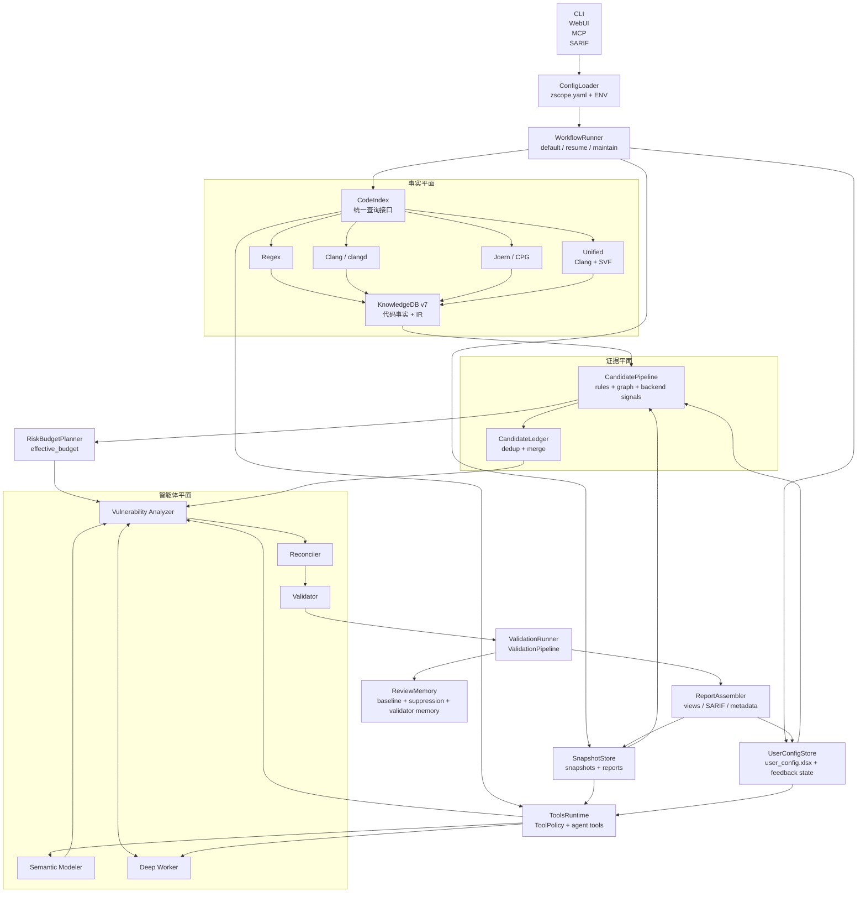

# Z-SCOPE 架构文档（v1.0）

## 1. 架构定位

Z-SCOPE 是面向大型 C 项目的证据优先静态分析平台。系统以结构化代码事实、程序分析后端信号、项目语义快照和多智能体验证为基础，构建可审计、可恢复、可扩展的缺陷发现流水线。

平台采用“静态事实先行、语义推理收敛”的架构原则。C 语言内存、资源生命周期和并发问题首先由索引、规则、SVF/Saber、Joern 等确定性或半确定性机制产生可复核证据；LLM Agent 负责在受控上下文中补全跨模块意图、判断业务约束、验证可利用性，并将结果收敛为可追踪报告。

Z-SCOPE 的定位可以归纳为三个层面：

| 层面 | 定位 |
|------|------|
| 工具属性 | 面向 C/C++ 安全审计的本地化 SAST 与 AI 验证平台 |
| 架构属性 | 事实平面、证据平面、智能体平面、反馈平面分层解耦 |
| 使用属性 | 支持批量扫描、增量维护、断点续扫、SARIF 告警复核与导出、WebUI 与 MCP 接入 |

面向的主要问题域：

| 大类 | 典型问题 |
|------|----------|
| 内存安全 | 越界、整数溢出、UAF、double free、invalid free、栈逃逸、未初始化读 |
| 资源生命周期 | 内存泄漏、fd/socket/mmap stale、初始化/释放不匹配、跨 handler 所有权转移 |
| 并发安全 | 数据竞争、refcount 竞态、缺失解锁、死锁、条件变量误用、对象提前发布 |
| 输入与逻辑安全 | 格式串、命令构造、TOCTOU、空指针、失败返回未检查 |

## 2. 设计目标

Z-SCOPE 的架构目标可以概括为四句话：

1. **高检出**：多个来源并行产生候选，包括 Clang/Joern/SVF 后端事实、通用 C 规则、跨函数图候选、入口发现、语义快照和 LLM 挖掘。
2. **低误报**：每个候选必须携带 source/sink、路径、对象或锁、正反证据、稳定去重键，并经过 Validator、评分、用户反馈和报告分层。
3. **可恢复**：所有关键中间产物和最终报告落地到 SQLite/JSON，支持断点续扫、增量维护和失败后的继续分析。
4. **可演进**：后端、Agent、Skill、Workflow、MCP 工具和 Web 反馈均是边界清晰的可插拔模块。

设计约束：

- 被扫描项目通常是大型 C 代码库，模块多、入口多、跨文件资源关系复杂。
- LLM 使用 OpenAI 兼容 API，支持本地模型、云端模型和多模型路由。
- 分析必须能运行在批量模式、CI/CD、WebUI、MCP 客户端和 SARIF 验证场景中。
- Worker 预算只能限制“深入分析的数量”，不能成为覆盖率边界。

## 3. 总体架构

总体架构由四个主平面组成。事实平面负责代码索引和程序事实沉淀；证据平面负责候选生成、去重、合并和风险预算输入；智能体平面负责语义建模、漏洞挖掘、聚焦深挖、问题调和和三态验证；反馈平面通过 SnapshotStore、UserConfigStore 与 ReviewMemory 保留语义快照、最终报告、人工抑制、baseline 和 Validator 记忆。UserConfigStore 当前既能读取历史 SQLite 配置，也能以 `user_config.xlsx` 作为人工可审阅的主配置界面，并用旁路 state DB 保存反馈状态。LLM Agent 通过受 ToolPolicy 约束的 ToolsRuntime 访问被索引、被切片、被缓存、被配置增强过的事实，分析过程与底层代码库保持可追踪边界。

v1.0 的主要架构边界不是替换上述平面，而是把原来集中在 `Analyzer` 和 `zscope/core/*.py` 的职责拆成可测试模块：

| 模块 | 主要文件 | 职责 |
|------|----------|------|
| Analysis | `zscope/core/analysis/analyzer.py` | 顶层协调器，装配 pipelines、agents、tools、workflow、budget、snapshot 与 agent policy |
| Candidates | `zscope/core/candidates/` | regex、Clang AST/CFG、SVF/Saber、Graph、Joern/KnowledgeDB 后端信号和 candidate evidence |
| Validation | `zscope/core/validation/` | Validator evidence pack、验证运行、suppression、baseline、score、`needs_review` 分流 |
| Reporting | `zscope/reporting/` | `FinalReport`、JSON/Markdown、report views、SARIF v2.1.0 |
| Identity | `zscope/common/issue_identity.py` | `canonical_issue_key`、`stable_issue_fingerprint`、source context fingerprint、根因级去重 |
| Review Memory | `zscope/memory/review_memory.py` | 人工 false-positive、finding baseline、Validator memory 的统一门面 |
| Semantics | `zscope/semantics/` | 内置默认 API 语义、项目 overlay、用户配置上下文、语义推断 |
| Orchestration | `zscope/orchestration/` | workflow、entry discovery、risk budget、subagent、history reconciler、parallel analyzer |
| Tools | `zscope/tools/` | LLM 工具运行时、参数校验、ToolPolicy、敏感路径 hook 和审计 |
| Web / MCP | `zscope/web/`、`zscope/mcp/` | Dashboard service layer、stdio/HTTP MCP、远程安全校验 |

## 4. 运行时主流程

### 4.1 默认扫描

默认工作流来自 `zscope/workflows/default.yaml`：

1. `discover_entries`：按需发现公共 API、通信/IPC、线程入口和用户输入点，并把候选入口列表写入项目根目录 `entry_functions_list.json`。
2. `premodel_reachable_callees`：为可达子函数提前构建语义快照。
3. `model_entry`：为入口函数构建语义快照。
4. `focused_subagent_planning`：从启发式、语义快照、确定性规则、图候选和后端信号中规划聚焦工单，并刷新本入口的 `effective_budget`。
5. `vulnerability_mining`：主漏洞挖掘 Agent 基于 active skills、候选和工具继续分析。
6. `validate_findings`：Validator 做三态验证和可利用性判断。
7. `persist_report`：写入最终报告、SQLite 快照和元数据。

Workflow 是 Python 编排层的执行计划，不作为大段提示词注入模型。CLI 选择运行模式：默认使用 `default`，`--resume` 切换到 `resume`，`--maintain` 切换到 `maintain`。v1.0 中 `Analyzer.run()` 已收敛为调用 `WorkflowRunner.run()`；运行态 state 创建、workflow step 执行、已有报告返回分流和最终持久化由 `zscope/orchestration/workflow_runner.py` 负责。`analysis.workflow_name` 是运行时内部字段，写入 `zscope.yaml` 会被 `ConfigLoader` 拒绝。

### 4.2 批量、断点续扫和增量维护

| 模式 | 入口 | 行为 |
|------|------|------|
| 默认批量 | `project.entry_functions_list` 或自动发现生成的 `entry_functions_list.json` | 多线程执行每个入口，汇总 `zscope_batch_report.json/md` |
| `--resume` | `resume.yaml` | 从 `snapshots.db` 跳过已有成功 final report 且无 pending validation 的函数，最后合并跳过项报告 |
| `--maintain` | `maintain.yaml` | 比较源码/语义哈希，未变更函数零 Token 复用历史报告，变更函数先调和历史缺陷再重扫 |
| `--mode ruledriven` | Joern | Joern 规则扫描后交给 LLM 验证 |
| `--mode alert-verify` | SARIF | 将外部 SAST 告警归一化为 `ExternalAlert`，再由 LLM 二次确认 |
| `--export-sarif` | 完成后的 Z-SCOPE 报告 | 将本次扫描结果导出为 SARIF v2.1.0，供代码扫描平台消费 |

批量报告覆盖前会自动将旧 JSON 备份到 `.zscope_knowledge/backups/`。

## 5. 核心分层

### 5.1 控制平面：CLI + Workflow

控制平面负责把用户意图变成可执行流程：

- `zscope/cli/cli.py` 处理运行模式、WebUI、MCP、SARIF 告警验证、SARIF 导出、索引预热和 `--infer-user-config` 工作簿推断，并暴露 `--dashboard-host/--dashboard-port`、`--mcp-auth-token-env`、`--mcp-client-allowlist` 等服务边界参数。
- `zscope/orchestration/scan_session.py` 统一入口发现、发现结果落盘、批量加载、断点续扫和报告备份。
- `zscope/orchestration/workflow_executor.py` 执行声明式 workflow step，并在报告 metadata 中记录进度。
- `zscope/orchestration/workflow_runner.py` 装配单入口运行态，负责 state factory、workflow executor、report build/persist/finalize 回调和已有报告返回路径；history reconciler 与 validation runner 仍由 `Analyzer` step handler 调用。

`--infer-user-config` 是独立的控制面命令：它构建 CodeIndex，运行 `infer_user_config_rows()`，把推断出的 resource/lock/dispatcher/module lifecycle/pointer target/function intent 行合并进 `user_config.xlsx`，然后退出。该命令不会触发漏洞扫描，适合在首次接入项目或接口语义变化后让人工先审阅配置。

这种设计把“什么时候运行哪个阶段”从 Agent prompt 中拿出来，放到可测试、可审计的 Python 编排层。

### 5.2 事实平面：CodeIndex + Backends + KnowledgeDB

`CodeIndex` 是所有 Agent 和 MCP 工具看到的统一代码查询接口。底层后端可替换：

| 后端 | 主要能力 | 适用场景 |
|------|----------|----------|
| `regex` | 轻量函数提取和源码片段读取 | 无外部依赖的回退模式 |
| `clang` | clangd LSP 批量提取函数、类型、调用、宏、全局变量 | 默认推荐的结构化 C 索引路径 |
| `joern` | CPGQL 查询与 Joern 规则扫描 | 规则驱动模式和 CPG 查询 |
| `unified` | ClangBackend + SVF/Saber，共享 KnowledgeDB | 需要间接调用、指针分析、内存缺陷后端信号的深度模式 |

`KnowledgeDB` 当前 schema v7 不只保存传统代码事实，也保存 Inspection IR：

- 代码事实：`functions`、`type_definitions`、`type_members`、`call_edges`、`global_variables`、`macro_definitions`、`include_edges`
- SVF/Saber 信号：`indirect_calls`、`taint_signatures`
- 证据 IR：`ir_statements`、`ir_resource_events`、`ir_lock_events`、`ir_shared_accesses`、`ir_path_slices`
- 语义契约：`function_contracts`

架构收益是明显的：LLM 的每次判断都可以回落到文件、行号、函数、路径切片、资源事件和锁事件，避免停留在自然语言印象。

当前 `CodeIndex.get_function_impl()` 还会查找函数声明和实现前的 C/C++ 注释块，并把这些 comment block 连同带绝对行号的实现源码一起返回。这样头文件中的 API 契约、所有权说明、锁要求和参数语义可以在不额外检索文档的情况下进入 Agent 上下文，同时仍然保留文件与行号来源。

Unified 后端的 SVF 路径现在支持入口裁剪。`svf_scope=auto|entry` 时，`EntryBitcodeSelector` 会从入口函数沿 KnowledgeDB 调用图选择相关翻译单元，再通过 `llvm-nm` 的 undefined symbol 闭包补齐依赖；如果没有选中 bitcode 或超过 `svf_max_selected_tus`，按 `svf_fallback=full|skip` 保守处理。每个 SVF 分组会在 `.zscope_bc/bitcode_scope_<group>.json` 写入裁剪计划，包括入口、可达函数、选中的源码和 `.bc`、符号闭包补齐项与回退原因。

### 5.3 证据平面：CandidatePipeline + Backend Signals

v1.0 继续沿用证据候选层，并把候选收集、合并、统计和 IR 持久化集中到 `zscope/core/candidates/pipeline.py`。候选来源包括：

- `zscope/core/candidates/regex.py`：基于通用 C 模式生成内存、资源、并发、输入和逻辑候选。
- `zscope/core/candidates/clang_ast_cfg.py`：用本地 AST/CFG 视图补足结构化控制流、协议字段和 copy/size 证据。
- `zscope/core/candidates/graph.py`：基于调用图、锁区域、资源协议和生命周期形态生成跨函数候选。
- `zscope/core/candidates/svf_value_flow.py` 与 `backend_signals.py`：把 SVF/Saber、KnowledgeDB、Joern/CPG 等后端信号归一化为 candidate。
- 语义快照中的历史候选会在 focused subagent planning 阶段进入 `CandidateLedger`，用于 Deep Worker 工单规划。
- Agent 新发现和 `CandidatePipeline` 产生的 merged candidates 会在 vulnerability mining 后一起进入 `pending_new_issues`，再由 Validator 统一处理。

`CandidatePipeline.collect_signal_candidates()` 输出 `CandidateSignalBatch`，分为 `local_candidates`、`graph_candidates`、`backend_candidates` 和 `merged_candidates`。这使上层只消费 evidence-only candidate，不再直接关心候选来自 regex、Clang、SVF、Graph 还是 Joern。

确定性候选生成器不再只依赖内置 API 名称表。v1.0 将本地模式语义收敛到 `zscope/semantics/`：`defaults.yaml` 提供 allocator/deallocator/reallocator/copy/lock/unlock/size type 等默认语义；`SemanticOverlayCompiler` 合并内置 defaults 与 `UserConfigStore` 中的工作簿/配置行，生成 checker-facing overlay；`LocalPatternSemanticBuilder` 再合并 typedef、用户配置、历史 snapshot 和函数名启发式，生成 local candidate generators 消费的 `LocalPatternSemantics`。项目私有 API 因而可以参与同一套候选规则。

语义配置的分层如下：

| 层级 | 作用 |
|------|------|
| `defaults.yaml` | 打包发布的默认 API role、type alias 和 checker role |
| user workbook / state DB | 项目私有 allocator、release、lock、dispatcher、module lifecycle、function intent |
| local inference | typedef、宏别名、历史 snapshot 和函数命名启发式补充 |
| filtered context | `user_config_context.py` 按入口函数和文件 scope 注入 prompt 所需片段 |

图候选弥补单函数词法规则的边界，当前覆盖持锁调用会重入加锁的 helper、错误清理类型、线程参数生命周期、全局容器生命周期、timer/pipe 等级联等待、锁顺序反转以及 stale tree/list 链接等形态。图候选输出仍保持与其他 issue/candidate 相同的数据形状，因此可以直接进入 ledger、Deep Worker、Validator、报告和 benchmark 流水线。

候选会被 `CandidateLedger` 统一去重和合并。验证和报告层还会复用 `zscope/common/issue_identity.py` 中的 `deduplicate_issues()` / `canonical_issue_key()` 对 LLM finding、规则候选、图候选和 Worker 结果做根因级合并，避免跨入口或跨信号源重复报告同一个问题。去重综合 defect class、resource kind、source、sink、root cause key 和 call path，避免仅按行号合并。每个候选携带：

| 字段 | 作用 |
|------|------|
| `candidate_id` | 稳定候选 ID |
| `dedup_key` | 跨入口、跨 Worker 的去重键 |
| `defect_class` | 缺陷类别到 Skill 的映射依据 |
| `source` / `sink` | 可验证的数据源与危险操作 |
| `positive_evidence` | 支持该候选的源码事实 |
| `negative_evidence` | 可能降低可信度的保护条件或未决事实 |
| `evidence_pack` | 结构化证据包，包含路径、对象、规则、证据引用 |
| `evidence_refs` | 指向 `ir_path_slices`、资源/锁/共享状态事件等 IR 表 |
| `validation_required` | v1.0 默认要求候选进入 Validator / ValidationPipeline，而不是由规则层直接报告 |

Worker 预算仅限制本轮深挖数量，不限定候选覆盖边界。`max_subagent_tickets` 决定实际启动多少 Deep Worker，未执行候选仍会作为 `subagent_unassigned_candidates` 回流给主 `vulnerability_analyzer`。

### 5.4 风险自适应预算

配置中的 `max_recursion_depth`、`max_premodel_depth`、`max_premodel_callees` 和 `max_subagent_tickets` 是硬上限，不代表每个入口都会消耗满额资源。`RiskBudgetPlanner` 会在多个阶段根据入口源码、调用扇出、用户配置上下文、确定性候选、图候选、后端候选、候选来源多样性和历史缺陷计算本入口的 `EffectiveBudget`。

预算会拆成四个维度：

| 预算项 | 作用 |
|--------|------|
| `recursion_depth` | 主分析可继续追踪的调用深度 |
| `premodel_depth` / `premodel_callees` | 语义预建模向下展开的深度和宽度 |
| `graph_depth` / `graph_functions` | 图候选生成可遍历的调用范围 |
| `subagent_tickets` | 本轮实际启动的 Deep Worker 数量 |

这种设计把“覆盖率”和“深挖成本”拆开：候选会尽量全量保留，低风险入口减少预建模、图遍历和 Worker 消耗；高风险入口才接近硬上限。报告 metadata 会记录 `effective_budget`、`budget_hard_caps`、`budget_scores` 和 `budget_reasons`，便于解释某个入口为什么被深挖或为什么被轻量处理。

### 5.5 智能体平面：Agent + Skill + Tool

Z-SCOPE 的多智能体采用职责分离设计：

| Agent | 职责 | 关键输入 | 关键输出 |
|-------|------|----------|----------|
| `semantic_modeler` | 抽取函数职责、副作用、状态转换、调用语义 | 源码、调用图、类型信息 | 语义快照 |
| `vulnerability_analyzer` | 按 active skills 做主漏洞挖掘并消费候选 | 快照、候选、工具、用户 task | issue candidates |
| `deep_worker` | 聚焦一个 source/sink/path 问题做深挖 | 切片代码、结构化 evidence、Skill 契约 | worker_report |
| `issue_reconciler_agent` | 增量维护中判断历史缺陷仍存在还是已修复 | 历史 issue、新代码 | still_exists / fixed |
| `validator_agent` | 做可利用性和证据闭合验证 | 候选证据、源码上下文、调用关系 | verified / rejected / uncertain |

Skill 是漏洞领域契约，用于约束分析目标和证据要求。`vulnerability_analyzer.task` 会被解析为 active skills，例如 `bounds_and_integer`、`resource_lifecycle`、`temporal_memory`、`shared_state_race` 等。当前选择器先用本地关键词、否定词和范围词做快速判断；当本地置信度不足时，可调用同一 Agent 模型做语义路由。语义路由低置信或与本地结果冲突时会保守放宽到全量 Skill，避免老配置和含糊任务漏扫。

ToolsRuntime 提供 12 个内置 Agent 工具：

`get_function_impl`、`get_function_snapshot`、`list_known_functions`、`get_file_snippet`、`get_callers`、`get_type_info`、`get_call_graph`、`get_data_flow`、`find_function_pointers`、`query_pointer_alias`、`verify_taint_reachability`、`get_deep_call_context`。

工具层还做了三类重要防护：

- 工具参数校验和文件路径存在性检查，避免模型反复调用无效路径。
- 绝对行号注入，缓解 LLM 通过相对偏移定位源码时的行号幻觉。
- `ToolPolicy` 约束工具、资源、文件读取、知识库查询和 subagent spawn allowlist，并通过敏感路径 hook 降低远程或自动化场景中的越界访问风险。

### 5.6 验证平面：ValidationRunner + ValidationPipeline

v1.0 将验证逻辑从 `Analyzer` 主流程中拆出：

| 模块 | 职责 |
|------|------|
| `zscope/core/validation/evidence.py` | 构造 Validator input、evidence pack、漏洞类别特定验证要求和 retry/修正规则所需证据 |
| `zscope/core/validation/runner.py` | 运行 Validator，处理 entry-root dead-code retry、contract-scope rejection 修正和 ReviewMemory 写入 |
| `zscope/core/validation/pipeline.py` | 应用 suppression、baseline、history feedback、score、`validated`/`needs_review`/`uncertain`/`rejected` 分流 |

这层的设计目标是让所有候选都先保持“待验证证据”的形态，再由统一的验证门禁决定是否进入 `issues[]`、`metadata.audit_observations[]` 或被 suppression/baseline 拦截。高置信规则也不再绕过验证流水线；它们只能在证据完整、无反证且满足评分门槛时被自动接受。

### 5.7 持久化与反馈平面

Z-SCOPE 使用五类主要持久化区域：

| 存储 | 内容 | 作用 |
|------|------|------|
| `.zscope_knowledge/code_knowledge.db` | 代码事实、SVF 信号、Inspection IR | 全局代码知识图谱和候选证据审计 |
| `.zscope_snapshots/snapshots.db` | 语义快照索引、final report 索引 | `--resume`、`--maintain` 和函数级缓存 |
| `.zscope_snapshots/user_config.xlsx` | 外部函数、配对函数、函数指针、dispatcher、模块生命周期、函数意图 | 人工可审阅的用户领域知识 |
| `.zscope_snapshots/user_config.state.db` 或 `user_config.db` | 抑制、baseline、配置告警和历史兼容数据 | 误报反馈与旧 SQLite 配置兼容 |
| `.zscope_bc/bitcode_scope_<group>.json` | SVF 入口裁剪计划 | 审计本次 SVF 分析实际纳入了哪些翻译单元 |

`UserConfigStore` 当前的人工配置工作簿 sheet：

| Sheet | 作用 |
|-------|------|
| `resource` | 描述 allocator、reallocator、deallocator、copy API 与多对多资源配对 |
| `lock` | 描述自定义 lock/unlock API 和锁配对 |
| `dispatcher` | 描述消息分发入口、message type、handler、handler kind、资源和分支配对 |
| `module_lifecycle` | 描述 init/finit、模块资源、错误路径清理和全局生命周期约束 |
| `pointer_targets` | 补充函数指针、ops 表、hook slot 的目标函数 |
| `function_intents` | 保存人工确认的函数设计意图和特殊约束 |

旧 SQLite 路径仍然保留 `external_functions`、`paired_functions`、`function_pointer_targets`、`function_intent`、`config_warnings`、`finding_suppressions` 和 `finding_baselines`。当配置路径指向 `.xlsx`，语义配置走工作簿，反馈状态写入同名 `.state.db`；当配置路径指向目录且存在 `user_config.xlsx`，目录模式也会自动优先使用工作簿。

人工反馈不会只是前端状态。Web 保存验证结果时会持久化 baseline 和 suppression，下一次扫描会在验证前参与过滤和评分。`ReviewMemory` 封装 false-positive suppression、finding baseline 查询与 Validator 记忆写入；`UserConfigStore.get_finding_baseline_for_issue()` 先按 `dedup_key` 精确命中，再按 `stable_fingerprint` 或回填后的稳定指纹命中，并把 `match_strategy` 写回结果，避免行号漂移后人工 rejected 失效。

Issue identity 由 `zscope/common/issue_identity.py` 统一提供。`canonical_issue_key` 适合单次报告内根因合并，`stable_issue_fingerprint` 用于长期 baseline、SARIF partial fingerprints 和 benchmark 匹配；可选的 `source_context_fingerprint` 从源码片段或 evidence snippet 生成第三层校验，双方都有上下文且冲突时会阻止过宽的 stable baseline 命中。

与 prompt 相关的用户配置上下文已经迁入 `zscope/semantics/user_config_context.py`。运行时会按当前函数源码标识符和文件 scope 过滤用户配置，只注入与当前入口相关的 resource、lock、pointer target、dispatcher、module lifecycle 和 function intent 片段。

报告层默认生成两类视图：`report_views.default` 只包含可报告的确认问题；`report_views.with_needs_review` 会把 `needs_review` 审计观察项也并入列表，供人工复核或 WebUI 切换查看。`ReportAssembler` 负责最终 report、views、metadata、JSON/Markdown 和 snapshot 持久化。CLI 的 `--export-sarif` 读取完成后的 JSON 报告并输出 SARIF v2.1.0，保留 rule、level、位置、codeFlows、`partialFingerprints.zscopeStableIssueFingerprint` 和 Z-SCOPE 私有证据属性，便于接入 GitHub code scanning 或其他 SARIF 消费端。

## 6. 架构优势

### 6.1 同类工具的架构参照系

Z-SCOPE 的优势更适合放在同类工具架构取向中理解。开源工具通常强调可验证的规则、查询语言或编译器级程序事实；商用工具通常强调平台化治理、规则库覆盖、企业流程集成和集中化误报管理。Z-SCOPE 的架构重点是把这些能力中最有价值的信号转化为统一候选，再通过多智能体和反馈闭环完成二次验证。

| 类型 | 代表工具 | 架构重心 | 常见优势 | Z-SCOPE 的补强方向 |
|------|----------|----------|----------|--------------------|
| 编译器/路径分析型开源工具 | Clang Static Analyzer、Cppcheck | AST、CFG、路径约束、规则检查 | 本地运行、结果可复核、工程依赖少 | 引入跨入口语义快照、用户领域知识和 LLM 可利用性验证 |
| CPG/查询型开源工具 | CodeQL、Joern | 代码数据库、查询语言、数据流/控制流建模 | 适合沉淀漏洞模式和变体查询 | 将查询结果进入候选、去重、评分、验证和报告同一链路 |
| 规则/策略型工具 | Semgrep、各类自定义规则引擎 | 模式匹配、污点规则、策略分发 | 编写规则快，适合 CI 和团队规范 | 用 KnowledgeDB IR 与 Agent 验证补足 C 指针、资源和并发语义 |
| 商用 SAST 平台 | SonarQube、Checkmarx、Coverity、Fortify、Snyk Code | 规则库、数据流引擎、集中治理、告警流转 | 语言覆盖广，治理能力成熟，集成生态完善 | 本地可审计证据库、MCP 开放接口、SARIF 二次验证和可解释反馈闭环 |
| AI 代码审查工具 | 通用 LLM 审查、AI SAST | 自然语言语义理解、修复建议、交互式解释 | 对业务语义和修复建议友好 | 由静态证据约束模型输入，降低凭语感判断的风险 |

### 6.2 静态证据驱动的智能体分析

Z-SCOPE 将 LLM 放在验证和收敛环节，而非事实抽取的起点。Clang、Joern、SVF/Saber、确定性规则和 KnowledgeDB 先提供可定位、可复核、可去重的候选证据；LLM Agent 再基于受控上下文判断路径闭合、调用约束、对象生命周期和可利用性。这种组合兼顾了传统静态分析的确定性和智能体对项目语义的解释能力。

### 6.3 多源候选提高召回上限

单一引擎通常受限于自身抽象：规则型工具依赖规则表达力，CPG/查询型工具依赖查询和库模型，商用工具依赖内置规则和配置，AI 审查工具依赖上下文质量。Z-SCOPE 同时接收：

- clangd/Clang 提供的函数、类型、宏、全局变量和直接调用事实。
- SVF/Saber 提供的间接调用和内存缺陷信号。
- Joern/CPG 和 SARIF 外部告警提供的规则或第三方工具信号。
- 通用 C 确定性规则提供的本地高信号候选。
- 图候选提供跨函数协议、锁顺序、生命周期和 liveness 信号。
- 语义模型快照提供的函数职责、状态变化和跨调用摘要。
- LLM Agent 提供的项目语义、跨 handler 生命周期和业务约束理解。

多源候选统一进入 `CandidateLedger` 后再做去重、合并、验证和评分，使召回能力不绑定到单个后端或单个提示词。

### 6.4 分层验证降低误报

Z-SCOPE 将“候选”“审计观察项”和“确认漏洞”分为不同层级。候选会经过 `CandidateLedger` 根因合并、Deep Worker 聚焦验证、Validator 三态判断、`final_score` 综合评分、`issues`/`audit_observations` 分层输出，以及用户 baseline/suppression 历史反馈。相较于只依赖规则严重级别或人工标记误报的流程，这种设计把降噪前移到证据闭合阶段，同时保留可复查的审计线索。

### 6.5 工程化运行与开放集成

每个函数的语义快照、最终报告、批量汇总、候选 IR 和用户反馈都有落地点。大规模扫描中断后可以 `--resume`，代码小改后可以 `--maintain`，旧报告覆盖前有自动备份。MCP Server 还暴露 `zscope://config`、`zscope://knowledge/stats`、`zscope://snapshots/list` 等资源，并提供 `query_knowledge`、`discover_entries` 和全部代码查询工具，使 Z-SCOPE 可以作为本地代码知识底座接入外部 AI IDE。

## 7. 业界领先或差异化特性

Z-SCOPE 的差异化不在单个算法，而在“程序事实、候选证据、智能体验证、人工反馈”闭环的组合能力。

| 能力维度 | 同类工具常见方式 | Z-SCOPE 的差异化实现 | 读者直观印象 |
|----------|------------------|----------------------|--------------|
| AI 与静态分析结合 | AI 工具偏语义解释；传统 SAST 偏规则和数据流 | `evidence_pack`、`evidence_refs`、IR path/resource/lock/shared-access 证据共同约束 LLM | 模型判断具有证据锚点，可降低开放式代码点评风险 |
| C/C++ 深度语义 | 开源工具各有优势但信号分散；商用工具多为封闭引擎 | Clang、Joern、SVF/Saber、确定性规则信号统一进入候选层 | 多个后端的强项可以在同一报告里汇合 |
| 告警复核 | 商用平台依赖人工 triage；开源工具通常输出原始告警 | SARIF `alert-verify` 将外部告警转成 `ExternalAlert` 并复用 Validator | 可作为其他 SAST 的二次确认器 |
| 不确定性处理 | 一些工具以热点、严重级别或人工状态区分风险 | `verified` / `rejected` / `uncertain` 三态，加 `needs_review` 审计观察项 | 低证据问题不阻断 CI，但也不丢失 |
| 大规模扫描 | 商用平台治理强；开源工具常需自行拼接缓存和恢复 | `snapshots.db`、`--resume`、`--maintain`、批量报告备份内建 | 大型项目能长期维护扫描状态 |
| 可解释反馈 | 商用平台支持误报状态；AI 工具常依赖对话记忆 | `finding_suppressions` 与 `finding_baselines` 落在 SQLite，可查、可删、可过期 | 审计经验成为可治理数据 |
| AI IDE 集成 | 多数 SAST 以报告或平台页面为主 | MCP 暴露配置、知识库、快照和代码查询工具 | 扫描器同时也是本地代码知识服务 |
| 回归纪律 | 工具通常发布规则集，项目侧难以度量本地变化 | `scripts/external_benchmark.py` 与 `zscope.benchmark.v3` 跟踪双视图指标、stable identity、cost、trajectory 和 multi-trial stability | 新规则需要接受本地基准约束 |

## 8. 高检出如何实现

高检出来自“入口覆盖、事实覆盖、候选覆盖、分析覆盖”四层叠加。与只运行规则集或只分析外部告警相比，Z-SCOPE 会主动扩大入口、事实和候选来源，再通过 Agent 和 Validator 收敛结果。

### 8.1 检出链路对比

| 环节 | 开源工具常见能力 | 商用工具常见能力 | Z-SCOPE 实现 |
|------|------------------|------------------|--------------|
| 入口发现 | 通常依赖配置、构建数据库或查询入口 | 依赖扫描配置、仓库集成和语言前端 | `entry_functions_list` + `--discover-entries` 落盘 + `entry_discovery.search_root` |
| 代码事实 | AST/CFG/CPG/规则匹配，各工具侧重点不同 | 专有前端和数据流引擎 | `CodeIndex` 统一 Clang、Joern、Regex、Unified 后端 |
| 跨函数关系 | 依赖数据流查询、库模型或指针分析能力 | 专有模型和框架配置 | SVF Andersen、Saber、调用图、语义快照共同补强 |
| 候选生成 | 查询或规则命中即输出告警 | 内置规则和数据流引擎输出告警 | 确定性规则、后端信号、语义快照、外部 SARIF 统一入 ledger |
| 深度验证 | 主要依赖规则精度和人工复核 | 平台化 triage 与审计流转 | Deep Worker + Validator 对高风险候选做二次闭合 |

### 8.2 入口覆盖

- 显式支持批量入口 `entry_functions_list`。
- `--discover-entries` 能扫描头文件公共 API、网络/IPC、线程创建、文件/环境/标准输入等入口。
- 自动发现结果会写入 `entry_functions_list.json`，包含 exposure、reasons、confidence 和入口级审计提示，可由人工继续编辑后复用。
- `entry_discovery.search_root` 可把入口发现限制到指定绝对目录，适合只审计大型仓库中的某个模块。
- handler、allocator、release、dispatch 等项目语义由 `user_config.xlsx` 与 `--infer-user-config` 承担，不再通过批量 prompt autofill 注入。

### 8.3 事实覆盖

- Clang 后端提供稳定的函数、类型、调用、宏和全局变量事实。
- Unified 后端叠加 SVF Andersen 间接调用和 Saber 内存缺陷信号。
- Joern 后端可用于规则驱动模式和 CPG 查询。
- Regex 后端保证最小依赖下仍可检索源码。
- KnowledgeDB schema v7 将函数事实、调用边、污点签名、IR statement、资源事件、锁事件、共享访问和路径切片沉淀到统一数据层。

### 8.4 候选覆盖

`RegexCandidateGenerator` 和 `ClangAstCfgCandidateGenerator` 覆盖一批 C 项目高频高价值模式，包括 size arithmetic before allocation/copy、same-function resource leak、direct `realloc` assignment、double free / invalid free、stack address escape、missing unlock、callback under lock、recursive lock risk、`pthread_cond_wait` with `if`、signed-to-unsigned length conversion、off-by-one、uninitialized read、alignment cast、null dereference after unchecked result、shared global race、refcount race、object publication、non-literal format string、system command、path TOCTOU、fd close without invalidation、mmap stale pointer、ignored protocol version、state not restored 等。规则保持通用 C 语义，不依赖 benchmark 专有函数名。

`GraphCandidateGenerator` 负责跨函数和协议形态，包括 cross-function recursive lock、lock order inversion、wrong cleanup contract、thread argument lifetime、global container lifecycle、timer cascade wait 和 stale tree/list liveness。它与确定性规则共享候选形状和去重链路，因此不会形成一套旁路报告体系。

### 8.5 分析覆盖

- 风险自适应预算让递归预建模、图遍历和 Worker 数量随入口复杂度调整。
- 递归预建模让主入口分析可引用深层子函数语义。
- Deep Worker 对高风险候选做聚焦深挖。
- 超过 Worker 预算的候选会传回主 Agent，避免因深挖预算耗尽造成覆盖缺口。
- SARIF 和 ruledriven 模式能复用第三方工具或 Joern 规则的外部告警。

## 9. 低误报如何实现

低误报依赖可解释的证据门禁、分层输出和可治理反馈。与传统规则工具“调规则”、商用平台“人工 triage”、AI 工具“让模型解释”相比，Z-SCOPE 将降噪机制内置到候选生命周期中。

### 9.1 误报控制对比

| 机制 | 同类工具常见做法 | Z-SCOPE 做法 |
|------|------------------|--------------|
| 告警前置条件 | 规则命中、查询命中或数据流路径命中 | 候选必须尽量具备 source、sink、路径、对象/锁身份、正反证据和稳定去重键 |
| 不确定结果 | 作为告警、热点、低严重级别或人工待审 | `uncertain` 与 `needs_review` 默认进入 `metadata.audit_observations` |
| 误报过滤 | 规则关闭、注释、平台状态或 suppression | `finding_suppressions` 在验证前过滤，并可按 scope、rule、过期时间治理 |
| 历史经验 | 平台状态或外部审计记录 | `finding_baselines` 参与 `history_feedback` 评分分量 |
| 重复报告 | 按规则 ID、文件行或平台实例 ID 合并 | issue identity / `deduplicate_issues()` 按类别、scope、root cause、source/sink 和文本证据合并 |
| 可解释性 | 报告引用代码位置或数据流路径 | 报告引用 `evidence_pack`、IR path/resource/lock/shared-access 证据和 Validator 理由 |

### 9.2 候选证据结构化

候选需要尽量提供 source、sink、路径完整性、对象/锁身份、正向证据和反向证据。证据会被写入 `evidence_pack` 和 KnowledgeDB IR，供 Deep Worker、Validator、报告和人工复查复用。结构化证据使误报控制可以基于事实判断，减少对告警文本或模型解释的单点依赖。

### 9.3 三态 Validator

Validator 可以返回：

| verdict | 含义 | 默认处理 |
|---------|------|----------|
| `verified` | source-to-sink 路径、可控性、保护缺失可以闭合 | 根据 `final_score` 进入 `issues` 或 `needs_review` |
| `rejected` | 源码保护、所有权转移、不可达路径等证据否决候选 | 丢弃或记录为抑制反馈 |
| `uncertain` | 候选有价值但缺少决定性证据 | 进入 `metadata.audit_observations` |

### 9.4 综合评分

`ValidationPipeline` 当前使用五个分量计算 `final_score`：

| 分量 | 权重 | 作用 |
|------|------|------|
| `rule_confidence` | 0.25 | 规则或后端信号本身可信度 |
| `path_completeness` | 0.25 | source/sink/path 是否闭合 |
| `contract_consistency` | 0.20 | 是否被用户配置、保护条件或反证削弱 |
| `validation_confidence` | 0.20 | Validator 的置信度 |
| `history_feedback` | 0.10 | baseline 中的历史反馈 |

Validator 启用时，`verified` 且 `final_score >= 0.8` 才默认进入 `issues`；`0.6 <= final_score < 0.8` 会标记为 `needs_review` 并进入审计观察项。确定性候选本身不会绕过验证流水线；Validator 禁用时，候选会标记为 `unvalidated` 并保留其评分与证据，供人工或后续流程复核。

### 9.5 人工反馈与报告分层

WebUI 保存验证状态时，`rejected` 会写入 `finding_suppressions`，后续扫描在验证前过滤；`validated`、`needs_review`、`uncertain` 会写入 `finding_baselines`，后续参与评分。最终报告区分 `issues[]`、`metadata.audit_observations[]`、`report_views.default`、`report_views.with_needs_review`、`metadata.candidate_signal_summary` 和 `metadata.candidate_ledger_summary`，既保留审计覆盖，又避免不确定候选阻断流水线。

### 9.6 同类工具公开资料参照

本章对比基于同类工具的公开官方资料，仅用于说明架构取向。

| 工具 | 参照资料 |
|------|----------|
| CodeQL | [代码数据库和查询机制](https://docs.github.com/en/code-security/concepts/code-scanning/codeql/about-code-scanning-with-codeql) |
| Joern | [Code Property Graph](https://docs.joern.io/code-property-graph/) |
| Clang Static Analyzer | [C/C++ 静态分析](https://clang.llvm.org/docs/ClangStaticAnalyzer.html) |
| Semgrep | [SAST/taint 规则](https://semgrep.dev/docs/writing-rules/data-flow/taint-mode/overview) |
| SonarQube | [规则体系](https://docs.sonarsource.com/sonarqube-server/user-guide/rules/overview)、[security hotspot/taint 模型](https://docs.sonarsource.com/sonarqube-server/user-guide/rules/security-related-rules) |
| Snyk Code | [语义 AI SAST](https://docs.snyk.io/scan-using-snyk/snyk-code) |
| Checkmarx SAST | [内部代码图和数据流分析](https://docs.checkmarx.com/en/34965-324470-sast-scanner.html) |
| Coverity Scan | [路径缺陷发现能力](https://scan.coverity.com/) |

## 10. 运维与伸缩性

| 能力 | 架构机制 |
|------|----------|
| 大批量入口 | `ParallelAnalyzer` 线程池并发执行入口分析 |
| 中断恢复 | `--resume` 基于 final report 和 pending 状态跳过已完成项 |
| 增量维护 | `--maintain` 比较 code/semantic hash，未变更函数零 Token 复用 |
| Token 控制 | 语义快照、平凡函数旁路、active skill 注入、风险自适应预算、Deep Worker 切片 |
| SVF 伸缩 | 入口裁剪 bitcode、符号闭包补齐、分组链接和 full/skip 回退 |
| 报告安全 | 覆盖批量 JSON 前自动备份，标准 SARIF 导出不改写主报告 |
| Benchmark v3 | 记录 default / with-needs-review 双视图、matched pairs、stable identity、cost、trajectory、grader 和稳定性统计 |
| 多模型策略 | `llms` 多 profile + Agent 级 `llm_ref` + 模型列表回退 |
| 代理模型兼容 | 流式调用、JSON 修复、XML tool-call fallback、自动续写 |

## 11. 对外接口

### 11.1 CLI

| 命令 | 用途 |
|------|------|
| `zscope -c zscope.yaml` | 默认扫描或批量扫描 |
| `zscope -c zscope.yaml --resume` | 断点续扫 |
| `zscope -c zscope.yaml --maintain` | 增量维护 |
| `zscope -c zscope.yaml --discover-entries` | 自动入口发现 |
| `zscope -c zscope.yaml --infer-user-config` | 推断或刷新 `user_config.xlsx` 后退出 |
| `zscope -c zscope.yaml --build-cpg` | 仅构建索引 |
| `zscope -c zscope.yaml --dashboard` | 启动 Web 仪表盘 |
| `zscope -c zscope.yaml --mcp-stdio` | 启动 MCP stdio server |
| `zscope -c zscope.yaml --export-sarif zscope-results.sarif` | 扫描完成后导出 SARIF v2.1.0 |
| `zscope --mode ruledriven -c zscope.yaml` | Joern 规则驱动模式 |
| `zscope --mode alert-verify --sarif alerts.sarif -c zscope.yaml` | SARIF 告警验证 |

### 11.2 WebUI

当前 Web 后端由 `zscope/web/server.py` 负责路由，业务逻辑委托给 `zscope/web/services.py`：

| Service | 职责 |
|---------|------|
| `ConfigService` | `zscope.yaml` 文本与结构化配置读写 |
| `WorkbookService` | `user_config.xlsx` 读取、保存、导入和下载 |
| `UserConfigService` | warnings、external functions、paired functions、pointer targets、function intents 等 CRUD |
| `CpgService` | CPG/索引状态查询和异步构建触发 |
| `SourceSnippetService` | 报告位置到源码片段的安全读取 |
| `ReportFeedbackService` | `/api/save_findings` 的验证状态更新、snapshot 更新、feedback 持久化和报告保存 |

主要 HTTP API：

| API | 用途 |
|-----|------|
| `GET /api/findings` | 读取当前报告中的 findings |
| `GET /api/version` | 返回当前 Z-SCOPE 版本和展示字符串 |
| `POST /api/save_findings` | 保存验证状态并持久化 feedback |
| `GET/POST /api/config` | 读取和保存 `zscope.yaml` |
| `GET/POST /api/config/structured` | 读取和保存结构化配置 |
| `GET /api/cpg_status` | 查询索引构建状态 |
| `POST /api/build_cpg` | 触发索引构建 |
| `GET /api/source_snippet` | 读取报告位置附近源码片段 |
| `GET /api/user_config/warnings` | 读取配置告警 |
| `POST /api/clear_warnings` | 清理配置告警 |
| `GET/POST /api/user_config/workbook` | 读取或保存用户配置工作簿 |
| `POST /api/user_config/workbook/import` | 导入用户配置工作簿 |
| `GET /api/user_config/workbook/download` | 下载当前用户配置工作簿 |
| `GET/POST/DELETE /api/user_config/<resource>` | 用户配置 CRUD |

### 11.3 MCP

MCP 暴露三类能力，并统一经过 `ToolPolicy` 过滤：

- Resources：`zscope://config`、`zscope://knowledge/stats`、`zscope://knowledge/functions`、`zscope://snapshots/list`
- Prompts：`zscope.entry_discovery`、`zscope.resource_lifecycle_audit`、`zscope.concurrency_audit`
- Tools：12 个 ToolsRuntime 工具，外加 `query_knowledge` 和 `discover_entries`

stdio MCP 适合作为本地 IDE/Agent 接入。HTTP MCP 是显式开启的远程实验入口：默认绑定 loopback；当绑定非 loopback 地址时，CLI 会强制要求 `--mcp-auth-token-env` 和至少一个 `--mcp-client-allowlist`，HTTP 层再做 Bearer token 与客户端 IP allowlist 校验。

## 12. 扩展点

| 扩展目标 | 推荐入口 |
|----------|----------|
| 新增代码分析后端 | 实现 `CodeBackend` ABC，并在 `CodeIndex` 工厂中注册 |
| 新增漏洞类型 | 新建或扩展 `zscope/skills/<skill>/SKILL.md`，并补充 task-to-skill 映射 |
| 新增本地候选规则 | 扩展 `RegexCandidateGenerator` 或 `ClangAstCfgCandidateGenerator`，输出完整 `evidence_pack`、`dedup_key` 和 `validation_required=true` |
| 新增跨函数图规则 | 扩展 `GraphCandidateGenerator`，保持输出与普通候选相同的数据形状 |
| 新增用户配置推断 | 扩展 `infer_user_config_rows()` 或 `UserConfigWorkbook` sheet 映射，保持人工行不被覆盖 |
| 新增后端信号归一化 | 扩展 `zscope/core/candidates/backend_signals.py` 或 `adapters.py`，由 `CandidatePipeline` 汇总 |
| 新增预算信号 | 扩展 `RiskBudgetPlanner` 的打分维度，继续保留硬上限与 metadata 可解释性 |
| 新增工作流 | 添加 `zscope/workflows/*.yaml`，并实现对应 handler |
| 新增报告导出 | 在 `zscope/reporting/` 下新增 exporter，复用 `report_views`、稳定 issue identity 与去重后的 issue shape |
| 新增 MCP 能力 | 扩展 `ZScopeMcpProvider.list_tools/read_resource/get_prompt` |
| 新增领域知识源 | 引入手册、接口规范、设计文档、受限使用说明等非代码知识，并映射为可检索领域契约 |
| 新增回归场景 | 在外部 benchmark fixture、`tests/` 或独立 harness 中增加源码、ground truth 和评测脚本，输出保持 `zscope.benchmark.v3` |

## 13. 当前边界与后续方向

Z-SCOPE 已经具备证据优先、多后端、多智能体、三态验证和反馈闭环，但仍有清晰的演进空间：

- 跨函数 alias/ownership 证明还可以进一步结构化，减少当前图候选依赖启发式的边界。
- 锁顺序图和线程上下文已经进入局部图候选，后续可扩展为项目级全局图。
- 更多 SVF/Saber/Joern 输出可以从查询信号升级为稳定候选 IR。
- 高置信内存候选可以自动生成 sanitizer harness 或最小复现路径。
- benchmark fixture 应继续扩展真实项目形态，如 RCU/epoch、ring buffer、callback cancellation、custom allocator。

### 13.1 下一阶段：领域知识引导

下一阶段的重点演进方向是增强用户领域内部知识对 Z-SCOPE 的分析引导能力。大型 C 项目的真实安全约束往往并不完全体现在源码中，许多约束存在于接口手册、开发规范、设计文档、运维手册、受限使用说明、历史审计结论和团队约定中。例如，某个 API 只能在初始化阶段调用，某个回调在持锁状态下禁止重入，某个长度参数包含结尾符，某个对象释放权在特定状态机转换后转移，某类输入在生产部署中来自受信边界。

这些非代码知识会被规划为独立的领域知识层，作为现有 `UserConfigStore` 和 KnowledgeDB 的上层补充：

| 知识类型 | 示例 | 对分析的价值 |
|----------|------|--------------|
| 接口调用约束 | 前置条件、后置条件、调用顺序、错误码语义 | 发现违反调用契约的隐藏缺陷 |
| 生命周期约束 | acquire/release 配对、所有权转移、对象状态机 | 提升泄漏、UAF、double free、stale pointer 检出率 |
| 并发约束 | 持锁要求、禁止重入、线程亲和性、回调上下文 | 降低锁误报并发现跨线程真实风险 |
| 受限使用场景 | 初始化期限定、单线程假设、可信输入边界、部署开关 | 区分真实漏洞、受限风险和可接受行为 |
| 安全规范与手册 | 禁用 API、敏感参数要求、边界检查规范 | 将组织内部安全规则转化为候选生成依据 |
| 历史审计知识 | 已确认误报、真实漏洞根因、团队修复约定 | 复用人工经验，避免重复 triage |

### 13.2 规划中的架构形态

领域知识引导能力可以按四个阶段演进：

1. **文档摄取**：支持 Markdown、HTML、PDF、Word、纯文本等内部资料，按项目、模块、版本、来源和适用范围建立索引。
2. **契约归一化**：从自然语言文档中抽取 API 契约、状态机、资源所有权、并发约束、输入边界和禁止用法，形成结构化 `domain_contracts`。
3. **检索注入**：在语义建模、候选生成、Deep Worker 验证和 Validator 评分阶段，按函数名、类型名、文件路径、模块标签和调用关系检索相关领域契约。
4. **证据治理**：每条领域契约保留来源文档、章节、版本、适用范围、更新时间和置信度。文档知识作为可解释证据参与判断，但不直接覆盖源码事实。

在实现上，领域知识层应避免把整份手册直接塞入 LLM 上下文，而是将文档约束切分为可检索、可引用、可评分的最小契约单元。这样既能让 Agent 获得项目内部语义，又能保证报告中的判断可以追溯到具体文档来源。

### 13.3 对检出率和误报率的影响

领域知识会同时提升检出率和降低误报率：

| 目标 | 作用机制 |
|------|----------|
| 提升检出率 | 文档中的调用顺序、状态机、所有权转移和受限 API 规则可以生成新的候选来源，发现源码局部分析难以识别的契约违背 |
| 降低误报率 | 文档中的部署边界、初始化期限制、可信输入假设和线程模型可以作为反证或降权依据，减少把受限场景误判为通用漏洞 |
| 提升可解释性 | 报告不仅引用代码路径，也能引用内部手册章节和领域契约，使审计结论更容易被研发团队接受 |
| 提升持续治理能力 | 当手册或设计约束变化时，相关契约可以重新索引并影响后续扫描，实现“代码事实 + 领域约束”的持续同步 |

这一方向本质上是把 Z-SCOPE 从代码事实驱动的 AI SAST，进一步演进为“代码事实 + 用户领域知识”共同驱动的安全审计平台。代码仍然是最终事实基础，领域文档提供项目语义和使用边界，两者共同进入候选、验证、评分和反馈链路，以持续提高高检出、低误报能力。

架构上，这些增强都可以沿用主线分层：继续把事实、候选、验证、反馈拆开，用结构化证据驱动 LLM，降低模型独自承担静态分析本体的风险。
