# 目标架构

## 架构目标

Z-SCOPE 2.0把项目安全分析分为四个相互约束的平面：

1. **事实平面**：AST、Clang CFG、调用图、Joern、SVF、类型和项目配置。
2. **规格平面**：自动提取、程序校验且可由用户审视的`SecuritySpec v2`。
3. **假设平面**：从攻击面与局部coverage gap产生可证伪的`SecurityHypothesis v2`。
4. **证明平面**：把候选转为Proof Obligation，以可重放证书产生终态。

```mermaid
flowchart LR
    Code["AST / CFG / Joern / SVF"] --> Mine["Security Spec Mining"]
    Mine --> Spec["SecuritySpec v2"]
    Spec --> Review["WebUI Spec Review Center"]
    Review --> Compiler["SecuritySpecCompiler"]
    Compiler --> Facts["Program Facts / Function Summaries"]
    Facts --> Planner["Attack-surface Planner"]
    Planner --> Hunter["Hypothesis Hunter"]
    Hunter --> Hypothesis["SecurityHypothesis v2"]
    Hypothesis --> ShadowLedger["P4 Shadow Ledger + Freeze"]
    ShadowLedger --> Proof["Proof Engine shadow"]
    Facts --> Proof
    Proof --> ShadowDecision["shadow proof decision"]
    Facts --> LiveLedger["Stable Candidate Ledger + Freeze"]
    LiveLedger --> Terminal["stable product terminal"]
    ShadowDecision -. refs only .-> Trace["Decision Trace"]
    Terminal --> Trace["Decision Trace"]
    Terminal --> Score["Benchmark v5"]
```

## Security Spec Mining

Security Spec是声明式分析数据，不是机器学习模型。编译器只接受有限DSL：

- `source`、`sink`、`propagate`、`sanitize`
- `acquire`、`release`、`transfer`
- `lock`、`unlock`
- `state_transition`、`sentinel`
- `callback_retains`、`caller_contract`

优先从程序事实确定性提取。LLM只能对无法从代码直接确定的项目语义提出`proposed`规格。
规格必须经过schema、证据、scope和冲突校验后才能激活。

生命周期为：

`observation -> proposed -> verified_scoped -> project_active -> stable`

异常状态为：`conflicting / rejected / quarantined`。

## Hypothesis-driven Hunting

旧`VulnerabilityAnalyzer`不进入2.0。主动挖掘由`Hypothesis Hunter`承担：

- Planner只从攻击面、语义unknown/conflict、动态调用缺口和局部candidate desert触发。
- Hunter输出defect family、subject、decision region、正反clause和可执行EvidenceAction。
- Hunter不得读取truth、score、规则结论、candidate ID或完整Candidate Ledger。
- Hunter不得直接写confirmed；严格选择先经Proof Checker重算，只有完整确认proof才可由CandidateRegistrar写入独立shadow Ledger并freeze；其他结果只写coverage observation。
- `fast`不运行Hunter；`balanced/deep`按coverage gap运行。
- P5前shadow Ledger不连接live ValidationRunner、promotion、Finding-root或默认报告；alert-verify只离线加载并复验已有artifact。

## Proof Engine

Proof Engine是终态唯一权威。核心对象为：

- `ProgramProofIR v2`
- `FunctionSecuritySummary`
- `ProofObligation`
- `EvidenceAction`
- `EvidenceCertificate v2`
- `ProofCheckResult`

模型只能选择系统给出的EvidenceAction。程序分析provider重算事实并生成绑定代码、IR、subject、
region、路径/出口集合和分析假设的证书。独立Proof Checker重新校验证书。

终态规则：

- 完整正proof：立即`confirmed`并停止后续LLM/tool调用。
- 完整反proof：立即`rejected`。
- proof冲突：程序化比较scope、路径、量词和依赖；无法消解则`needs_review`。
- 模型verified但存在open clause：`needs_review`。
- 模型rejected但没有完整反proof：`needs_review`。
- V3最多50轮，只能执行只读EvidenceAction；连续两轮无有效证书增量即停止。

## 可追溯性

所有阶段按validation cluster追加Decision Trace事件。报告必须能离线解释：

- 候选由谁产生、哪些信号合并；
- Security Spec和hypothesis如何影响obligation；
- 每个EvidenceAction、证书及checker结果；
- 最先产生终态权威的事件；
- finding进入default、with-needs-review或被排除的原因；
- 每阶段模型、工具和token成本。

## 非目标

- 首版不实现自动PoC生成、任意代码执行或通用符号执行器。
- 不以Range truth生成规则、Prompt、规格或proof predicate。
- 不允许用户审批直接绕过Proof Engine。
- 不恢复scan-wide token硬预算。
