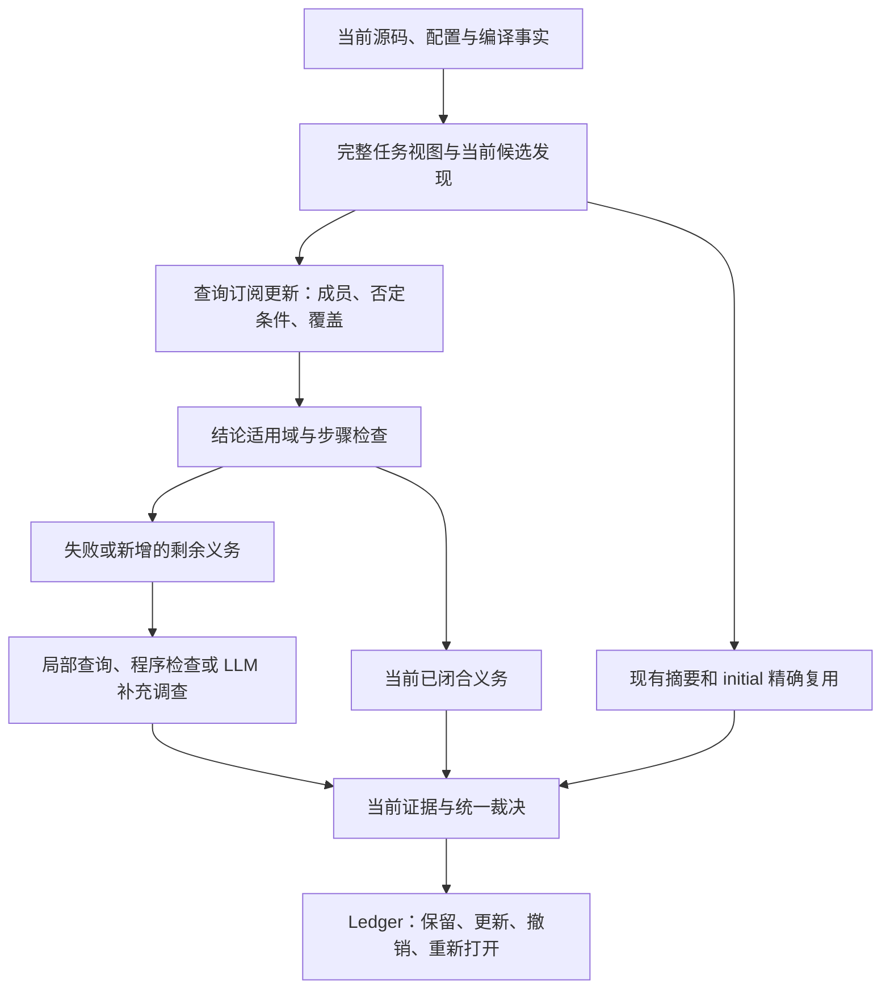

# Z-Scope 持续安全推理：面向代码演进的结论维护与局部修复

日期：2026-11-11。性质：基于论文调研与现有实现的创新孵化方案；新增机制尚待实现和验证。

实施更新：同日已完成查询计划保存、当前构建重放和报告计量的首版切片，并补充 Range 局部修改开关对照。整合后的创新机制、商业价值与实测边界见[更新提交版](2026-11-11-incremental-security-reasoning-submission.md)与[完整实验记录](../../artifacts/query-reuse-20261111/README.md)。下文保留原始研究设计与当时的收益假设；其中 30%—40% 情景测算不作为当前实测成果或收益承诺。

本方案将原有“跨版本摘要与初始裁决复用”扩展为**持续维护安全结论及其成立条件**：事实改变后，判断哪些结论仍成立、哪些需要补充调查、哪些应撤销或重新打开。创新重点是结论适用域、反证查询订阅与剩余证明义务的联合维护。

## 一、摘要

面向大型 C/C++ 代码仓的高频提交，构建由当前程序事实验证的安全结论适用域、覆盖新增反证的查询订阅和局部证明义务修复机制，在保持候选发现与当前证据核验的前提下，复用仍然有效的分析成果与调查步骤，减少重复 LLM 推理，并持续更新漏洞、修复和复发状态。

## 二、创新方案描述

### 2.1 核心思路

将一次安全分析沉淀为可持续维护的结构化记录：**结论是什么、在什么条件下成立、哪些查询可能推翻它、如何用当前事实重新检查、还有哪些问题没有解决。**

新提交到达后，系统先更新当前事实和候选，再维护这些记录。输入完全一致时沿用现有缓存；事实有所变化时，检查结论成立所需的条件；部分条件失效时，只补做受影响的查询和证明义务。LLM 负责提出调查方向、解释业务语义和处理剩余问题，程序检查器负责其能力范围内的证据验证与证明生成。

### 2.2 三项核心创新

| 创新点 | 具体机制 | 解决的痛点 |
| --- | --- | --- |
| **结论适用域** | 把某一结论成立的充分条件表示为可执行检查。例如，相关事实发生变化后，指定资源路径仍满足该缺陷的全部验证义务，就可以重新生成当前证明 | 源码或事实变化不必然改变安全结论；仅比较输入一致性容易过度重算 |
| **反证查询订阅** | 除记录已引用的事实，还记录“没有其他写入者”“未发现释放”等判断所依据的查询、范围与覆盖状态；新增匹配事实会重新打开相关结论 | 新调用、新别名、新访问者可能推翻旧结论，却不修改任何被旧结论引用的事实 |
| **剩余证明义务修复** | 保存结构化查询与检查步骤，重放仍适用的部分，将失败或新增的子义务交给现有 provider、检查器或 LLM | 一处前提变化往往导致整轮调查重来，摘要复用的收益被后续验证消耗抵消 |

三者组成同一维护算法：查询订阅定位可能变化的条件，适用域检查决定结论能否继续成立，局部修复只解决当前尚未闭合的义务。维护对象包含被确认的问题、被排除的候选及未决假设，防止只缓存已有 Finding 而忽略新问题。

### 2.3 创新性、商业价值与可行性

**创新性：**研究重点从“受影响产物是否重算”推进到“变化后如何继续利用原有安全论证”。差异化集中在 C/C++ 的对象身份、调用与别名范围、否定性证据覆盖、当前构建证明和 LLM 调查之间的联合维护，而非单独宣称依赖图、摘要修复或工具缓存为原创。

**商业价值与效率：**将复用收益扩展到多轮调查与验证，降低连续扫描的边际成本；同时提供问题为何持续成立、为何撤销、为何重新打开的可解释记录，减少重复排查。产品价值可从一次扫描服务扩展到持续安全分析订阅。

**可行性：**Z-Scope 已有完整任务视图、跨构建摘要复用、结构化 initial 缓存、Candidate Ledger、证据补齐和当前 claim replay。首批可在已有检查器能闭合的资源生命周期义务上增加查询订阅与步骤重放，随后扩展到调用目标、别名和并发访问。通用跨层图和 SVF 内部增量求解无需成为首批交付前提。

## 三、创意价值呈现

### 3.1 目标用户与变现路径

| 目标用户 | 获得的价值 | 对应业务增长路径 |
| --- | --- | --- |
| 大型 C/C++ 项目的研发平台与安全团队 | 相同分析预算覆盖更多提交，缩短安全反馈等待 | 企业版持续扫描订阅、CI 集成模块，提高试点转付费与续费吸引力 |
| 驱动、嵌入式、网络基础设施等长期维护团队 | 保留有效调查结论，及时识别前提失效与缺陷复发 | 面向长生命周期项目的私有部署与维护服务 |
| Z-Scope 托管服务运营方 | 降低每次有效扫描的模型成本与重复调查成本 | 在价格不变时改善毛利，或将节约投入更多项目与用户 |
| 已有静态分析平台的集成方 | 将扫描结果转为可跨版本维护的安全义务 | 后续提供集成接口或组件授权；以首批客户验证为前提 |

### 3.2 量化收益与对比基准

**已有实测：**当前摘要复用在一个真实模型小样本中，相比同版本独立 AI 分析，摘要阶段 Token 减少 **35.88%**，整轮 Token 减少 **2.80%**，耗时减少 **3.09%**。这些是现有能力的样本结果，不是本升级方案的实测效果。

**待验证收益：**针对低至中等语义影响、存在重复调查的连续提交，按第八节的明确假设，整轮 Token 节约空间约 **30%—40%**；当 LLM 预算为主要约束且单位 Token 成本不变时，对应同预算扫描容量约 **1.43—1.67 倍**。这是用于选择试点的情景测算，不是统一性能承诺。端到端加速需实测程序检查和事实更新成本，不能从 Token 比例直接换算。

**质量目标：**支持场景中，因增量复用导致的新增 Finding 漏报和失效 Finding 残留均为 0。通过当前证据和候选维护实现该目标；有限样本通过不等于任意 C/C++ 程序上的完备性证明。

**对比基准：**同时对比同版本独立扫描、现有 Z-Scope 摘要/initial 复用，以及第一条创意的“依赖传播＋有效性判定＋失效重算”实现。第一条尚无可核验的统一实验实现，本方案现阶段可以比较机制与研究价值，不能宣称已实测胜出。

## 四、论文检索如何改变方案

本次围绕增量静态分析、验证结果复用、摘要修复、增量视图维护、LLM 结果与工具缓存检索了原始论文及作者、会议、出版机构页面。下表列出直接影响设计的 10 项工作；检索截至 2026-11-11。预印本与正式发表工作分开标注，未复现论文实验。

| 工作与来源 | 已有贡献及适用边界 | 对本方案的影响 |
| --- | --- | --- |
| [Incremental Static Program Analysis through Reified Computational Dependencies](https://cris.vub.be/ws/portalfiles/portal/117322281/Jens_Van_der_Plas_PhD_thesis.pdf)，Van der Plas，2024 博士论文 | 显式计算依赖支持程序分析增量化。本次核对摘要与研究概述 | 依赖显式化作为基础设施，不能作为主要原创点 |
| [IceBear: A Fine-Grained Incremental Scheduler for C/C++ Static Analyzers](https://conf.researchr.org/details/fse-2025/fse-2025-demonstrations/17/IceBear-A-Fine-Grained-Incremental-Scheduler-for-C-C-Static-Analyzers)，FSE 2025 Demonstrations | 通过细粒度变更定位和函数级调度减少重复分析；核对会议摘要 | 底层调度可借鉴，但不等于 AI 调查结果已可跨版本维护 |
| [IncSFS: Incremental Full-Sparse Flow-Sensitive Pointer Analysis for C/C++](https://arxiv.org/html/2608.24391v1)，2026 预印本 | 交错处理指向集合增减；终止及最小不动点结论带 object-acyclic 前提。核对算法、定理和实验范围 | 删除、环和别名传播需由明确算法处理，不能用普通依赖图遍历替代 |
| [Maintaining Views Incrementally](https://www.cs.umd.edu/projects/hermes/publications/abstracts/mvi.html)，SIGMOD 1993 | 研究含否定、聚合和递归的视图更新；包含替代推导计数及 DRed。核对作者机构摘要 | 将“空结果”和查询结果集合也作为依赖；多个支撑之一失效时，其他支撑可能仍有效 |
| [Conditional Model Checking: A Technique to Pass Information between Verifiers](https://research-explorer.ista.ac.at/record/1384)，FSE 2012 | 用条件描述已验证的状态空间，将剩余部分交给后续验证器。核对论文摘要与发表信息 | 明确已闭合与剩余义务，避免把部分成功误记为整项完成 |
| [SMT-based verification of program changes through summary repair](https://link.springer.com/article/10.1007/s10703-023-00423-0)，Formal Methods in System Design，2023 在线发表 | UpProver 验证并修复函数摘要；正确性相对于固定循环展开界限。核对正文与正确性章节 | “先检查、再局部修复”已有理论基础；本方案应聚焦混合 AI 分析的跨产物义务，而非重述摘要修复 |
| [Generative Caching for Structurally Similar Prompts and Responses](https://www.microsoft.com/en-us/research/publication/generative-caching-for-structurally-similar-prompts-and-responses/)，NeurIPS 2025 | GenCache 复用响应生成模式，处理结构相似而变量不同的请求。核对作者机构页面 | 调查步骤或生成模板复用本身已有先例；需增加程序语义检查与覆盖条件 |
| [Tvcache: A Tool-Value Cache for Post-Training LLM Agents](https://proceedings.mlr.press/v306/kumar26d.html)，ICML 2026 | 在 Agent 后训练场景，基于完整工具历史前缀匹配维护状态相关缓存。核对正式论文摘要 | 工具返回值依赖环境；本方案用当前程序事实解释步骤，不能只按工具名和参数命中 |
| [FinCacheServe: Dependency-Consistent Answer Reuse for Cost-Efficient RAG Serving over Mutable Enterprise Documents](https://arxiv.org/abs/2607.26076)，2026 预印本 | 在可变文档 RAG 中约束答案的文档、证据、工具与模型依赖。核对摘要 | “带依赖契约的 AI 答案缓存”也已有研究；区别应落在安全结论适用域、否定义务与当前证明生成 |
| [The Hitchhiker’s Guide to Program Analysis, Part III: Mostly Harmless LLMs](https://arxiv.org/abs/2606.15122)，2026 预印本，10 月修订 | Evident 由 LLM 构造局部分析上下文，验证器与 Frama-C/Eva 支持告警过滤。核对摘要与方法概述 | LLM 提供分析方案，确定性检查承担其能力范围内的结论授权，不能把模型认可当作排除证明 |

**调研判断：**已有文献分别覆盖依赖追踪、条件验证、摘要修复和 Agent 缓存。更值得孵化的研究问题是：**如何把开放式 AI 分析中可验证的部分转化为持续维护的安全义务，同时覆盖新增反证与新候选，并只重新求解剩余部分。**这是基于上述工作的设计推论，尚不能据此宣称全球首次或已具备专利新颖性。

论文中的加速数字不直接移植到 Z-Scope。例如，IncSFS 的实验时间不包含 LLVM IR 生成、源码到 IR 映射和增量 VFG 维护，因此其指针求解加速不能等同于产品端到端加速。[实验口径原文](https://arxiv.org/html/2608.24391v1)

## 五、为什么当前方案需要升级

### 5.1 已有能力与实测瓶颈

当前产品已经具备完整模型任务视图、稳定逻辑引用与当前实例映射。自由文本中的已知逻辑别名保留原文，通过 `reference_bindings` 解释；它们不再因构建实例变化而一律阻止摘要复用。已有 initial 缓存只省去符合条件的初始模型调用，后续证据检查和裁决继续运行。

实现边界见[执行与编排](../modules/execution-orchestration.md)和[分析流水线](../modules/analysis-pipeline.md)。这些能力是本方案的起点，不代表下文的语义适用域和调查步骤修复已经实现。

2026-11-06 的真实 `deepseek-v4-flash` 小样本使用含资源泄漏的小型 C 项目及两种编译变体，在同一编译单元中修改无关函数。结果如下：

| 指标 | 初始执行 | 修改后增量执行 | 修改后同版本独立 AI 执行 |
| --- | ---: | ---: | ---: |
| 摘要物理调用数 | 13 | 8 | 13 |
| 摘要 Token | 175,357 | 96,737 | 150,868 |
| Validator 物理调用数 | 9 | 10 | 9 |
| Validator Token | 171,834 | 195,274 | 149,553 |
| 整轮物理调用数 | 22 | 18 | 22 |
| 整轮 Token | 347,191 | 292,011 | 300,421 |
| 端到端耗时／秒 | 565.632 | 438.983 | 452.957 |

数据来源：[成本原始记录](../../artifacts/artifact-reuse-followup-20261106/run-20261106-210510/cost-summary.json)、[观测结论](../../artifacts/artifact-reuse-followup-20261106/run-20261106-210510/observed-comparison-summary.json)。同版本独立执行保留相同 native 事实基础，隔离 AI 缓存并关闭新增复用，因此该对照衡量 AI 复用收益，不能解释成所有底层事实均从零构建的成本对照。

增量执行的 6 个摘要查询中，两个未变函数实例跨构建命中；initial 缓存未命中。相比同版本独立执行，摘要节省 54,131 Token，Validator 多消耗 45,721 Token，整轮净节省 8,410 Token。候选数量和模型输出差异参与了后续成本变化，不能认定这次 Validator 增长完全由缓存机制导致。

两轮最终确认的两个 Finding 在问题身份、终态及核心 fact/edge 证据上相同；一项引用列表包含额外有效定位证据，候选总数为 7 对 6，存在尚未确认的模型假设差异。因此，实测支持“复用生效、当前绑定正确、确认问题一致”，不支持“所有输出严格相等”或普遍零漏报的结论。

### 5.2 升级要回答的问题

继续优化摘要命中率有价值，但新增研究应覆盖更大的成本来源：**当构建、证据集合或部分语义发生变化时，是否能以当前检查替代重复的整轮模型调查，并保留真正未解决的问题？**

## 六、技术方案

### 6.1 与主线的关系



图中所有路径仍受当前候选、证据和统一裁决约束。对未被已闭合义务覆盖的分析内容，继续执行原流程。

### 6.2 结论适用域：允许事实变化，要求当前理由成立

对一条结构化结论 `C`，保存可检查的充分条件 `ΓC`、分析范围和验证步骤。`ΓC` 描述结论在哪些当前事实状态下成立，不要求所有相关事实与旧版本逐项相等。

例如，已确认的资源泄漏依赖某一资源对象、分配成功条件、可行退出路径及该路径上未解除的所有权义务。提交改变了无关日志或其他分支，但当前检查仍完整支持这条漏洞路径时，可以生成当前证明，省去重新解释同一缺陷的模型调用。

如果某个检查器只验证引用存在或角色齐备，就只能复用相应子义务；它不能因此获得证明完整路径可行性的能力。模型提出的条件也须转换为已有检查器支持的检查项；未被检查的业务假设继续显式保留。

开放式函数/模块摘要仍采用现有“完整可读任务视图一致”原则。不能从自然语言摘要里抽取几个条件，就允许整份摘要在其他输入变化后继续使用。

### 6.3 反证查询订阅：依赖包含尚未出现的事实

历史引用只记录“曾读到什么”，不能完整表达“查遍哪些范围后，没有发现什么”。为此，对参与结论的封闭查询记录：

| 记录内容 | 示例 |
| --- | --- |
| 查询语义与对象 | 查询资源 `R` 在指定路径上的释放；查询对象 `O` 的潜在并发访问 |
| 查询范围及其生成规则 | 当前函数、调用闭包、链接组、相关编译变体；范围本身也可能因新增关系改变 |
| 集合与否定依赖 | 现有成员、空结果、是否存在阻断反证、是否覆盖所有相关访问者 |
| 覆盖信息 | 是否完整、存在何种间接调用或别名缺口、是否被分页或截断 |

新调用、新别名、新对象访问、新编译变体既可能改变查询结果，也可能扩大查询范围。二者均需要更新订阅，不能只监听旧结果中的事实 ID。后端暂不支持可靠结果增量时，直接重新执行相应查询或分析范围。

**例子：**旧版本两个访问均持有同一把锁，某个竞态候选因此被排除。新版本增加未持锁访问，即便旧访问事实完全未变，也必须重新打开候选；如果增加的访问同样受锁保护，查询结果虽变，检查器可能更新已闭合义务而无需 LLM 重判。这里只能在访问范围、别名与并发关系均具备所需覆盖时作排除判断。

首版使用少量有明确语义的 provider 查询模板。自由搜索、Top-K 检索、只读取第一页等行为不构成“没有其他反证”的证明。查询订阅借鉴增量视图维护，但覆盖完整性仍由程序分析后端与当前任务契约提供。

### 6.4 局部修复：复用调查步骤，重新生成当前证据

保存显式的结构化操作：查询哪个对象、取得哪些角色的证据、调用哪个已有检查器、结果解决了哪条义务。保存的是工具与检查步骤，不是模型隐藏推理过程，也不是可恢复授权的历史 Proof。

变化后按以下顺序处理：

1. 将逻辑对象和步骤参数绑定到当前构建实例，更新相应查询结果与覆盖信息。
2. 对仍满足前提的步骤执行当前检查；当前检查通过的义务进入已闭合集合。
3. 对失败步骤及新出现的义务保留未决项，必要时更新与它们直接相关的下游步骤。
4. 先使用能够闭合义务的现有 provider/检查器；需要安全语义理解时，向 LLM 提供当前问题、已有有效证据和剩余缺口。
5. 用当前结果进入原统一裁决；无法局部闭合时，继续原候选调查或扩大必要分析范围。

这里的目标是缩小剩余工作量，不声称能对任意 C/C++ 程序求得全局最小重算集合。局部 LLM 请求也必须保留解决该义务所需的上下文；不能只发送 diff 并默认其他输入无关。

**修复场景：**新增 `free` 使旧泄漏路径不再成立时，该历史见证立即退出当前支持集合。系统继续检查其他相关路径，只有当前义务足以支持“问题已修复”时才撤销 Finding；旧见证失败本身不证明漏洞消失。若另一个独立见证仍有效，可保留问题并更新证据。

### 6.5 一个明确的维护算法

对每次变更，先建立当前事实 `Fnew` 和当前任务要求的义务 `Onew`。用查询订阅和已记录的依赖定位需要检查的旧记录，对它们进行当前检查与局部修复。

```text
已闭合义务 = 当前检查成功且适用范围匹配的义务
剩余义务   = 当前全部所需义务 − 已闭合义务
本轮工作   = 处理剩余义务 + 完成新候选发现 + 更新当前裁决
```

`Onew` 由当前任务、规则与发现流程形成，不能仅取旧记录中的义务集合。首版继续运行现有项目级候选发现；以后只有在对应候选枚举查询能正确处理新增、删除和范围变化时，才做该部分增量化。

对结构化、可验证的子任务，语义复用需要满足：

```text
适用范围与契约匹配
且 当前查询及覆盖条件满足任务要求
且 当前检查器支持该结论所需的全部义务
```

检查结果可以是成立、不成立或未决。不成立触发相关修复，未决进入正常调查；二者均不能简单解释成整个程序安全或不安全。递归依赖不得用相互引用自证成立，首版涉及此类循环时沿用后端原有范围求解。

### 6.6 最小数据结构与存储位置

在现有产物和证据上下文上增加必要字段即可，不先建设新的通用缓存平台。

| 字段组 | 用途 |
| --- | --- |
| 结论与范围 | 缺陷机制、对象/函数逻辑身份、构建变体、任务边界 |
| 正向支撑与查询订阅 | 当前支撑关系、查询参数、范围、集合/否定条件、覆盖缺口 |
| 适用条件与检查步骤 | 支持的条件类型、provider/checker、结构化参数、步骤依赖 |
| 义务与结果 | 当前已闭合项、剩余项、替代支撑、失效或重新打开原因 |
| 契约与来源 | 规则、工具、Prompt/输出协议、模型配置和生成来源 |

沿用摘要目录、SnapshotStore 和 Ledger 的相关职责；静态记录不恢复进程内 Proof 权限。当前 initial 缓存的精确 BuildContext 要求保持原样，跨构建的语义再验证通过新检查路径完成，不能通过删除旧缓存保护字段实现。

## 七、相对第一条创意的提升在哪里

对照对象为 [issue #143 第一条创意](https://github.com/zealousness/Z-Scope/issues/143#issuecomment-6766691294)。它已经提出 CLDG、Provenance、有效性谓词、轻量语义等价检查和闭包收缩，不能将其描述成只按文件失效或完全不做验证。

| 维度 | 第一条的明确设计 | 本方案进一步提出的设计 | 创新或价值增量 |
| --- | --- | --- | --- |
| 复用判据 | 依赖事实未失效，或经检查语义等价，且契约一致 | 指定结论的充分条件当前仍成立，允许相关事实本身不等价 | 扩大“事实变化但结论不变”场景的复用空间 |
| 新增反证 | 已有事实到 AI 产物的溯源边与失效传播 | 显式维护查询谓词、结果集合、空结果和范围生成依赖 | 将新访问者、新调用、新别名纳入既有结论的重新打开机制 |
| 失效后的处理 | 对无效产物进行重算，边界检查收缩范围 | 将调查分成可重放步骤和证明义务，只修复当前未闭合部分 | 在一个已受影响任务内部继续减少模型工作 |
| 新问题发现 | 依赖完备的跨层影响闭包 | 区分旧结论维护和当前候选发现，显式纳入新义务 | 给出避免“只维护旧告警”的具体接入方式 |
| 正确性研究 | 以最小完备闭包及语义等价为目标 | 分别论证查询更新、义务覆盖和当前检查授权的充分条件 | 将宏观保证拆成可检查、可实现、可验证的问题 |
| 产品形态 | 更快的增量分析 | 持续维护问题成立条件、修复状态和复发原因 | 增加持续扫描和调查成果积累的付费价值 |
| 收益依据 | 按变更影响规模评价 | 在相同影响规模下，进一步区分事实变化但结论不变、局部义务失效及真正结论改变 | 找到普通依赖失效仍成本较高的重点客户场景 |

第一条的抽象框架可以容纳这些机制。因此，本方案的优势应体现为**更明确的研究对象、更细的算法步骤和额外可测收益**，而非仅凭换名断言它与第一条完全无关。

拟主张的研究贡献可凝练为三点：

1. **面向安全结论的变化判定：**在输入事实不等价时，通过结论所需的可检查充分条件判断哪些语义结果仍可维护。
2. **覆盖新增反证的跨版本依赖：**把查询范围、成员集合与否定性依赖连接到 AI 产物及候选状态，而非只关联已出现的证据。
3. **混合分析的剩余义务求解：**统一编排当前程序检查、历史调查步骤重放和局部 LLM 调查，并持续维护新候选与当前证明。

单独的条件验证、负依赖、步骤缓存、摘要修复均有先例。创新潜力来自上述机制针对 C/C++ 与 AI 安全分析边界的联合设计；要确立研究贡献，需要与包含等价检查的强基线比较，而非仅与全量扫描比较。

## 八、收益模型与评价方法

### 8.1 用明确假设估算空间

设独立扫描的 LLM Token 中，摘要占比为 `pS`、验证占比为 `pV`；对应节约比例为 `rS`、`rV`；新增模型上下文等开销占原总 Token 的比例为 `o`。则：

```text
总 Token 节约比例 s = pS × rS + pV × rV − o
```

已有同版本独立样本的摘要/验证 Token 占比约各半。用于试点估算时，暂取 `pS=pV=0.5`，摘要节约取样本量级 `rS=0.36`，假设新的验证义务复用能节约 `rV=0.30～0.50`，额外模型 Token 开销 `o=0.03`，得到 `s≈0.30～0.40`。

其中，验证节约比例和新增开销均未实测，摘要比例也可能随项目变化；若可验证义务覆盖少、变更多或局部检查过重，收益会显著降低，甚至低于现有方案。程序检查的 CPU 和耗时不计入 `o`，须单独纳入端到端成本。

在单位 Token 成本及扫描任务构成不变、模型预算是主要瓶颈的条件下，预算可支持的扫描容量比例为 `1/(1-s)`，即约 1.43—1.67。若每月模型消耗为 100 个成本单位，对应节约约 30—40 个单位；收入和毛利增长还取决于定价、模型费用占比与客户采纳，不能直接等同于上述比例。

### 8.2 评价重点

除调用数、提供方实际 Token、端到端耗时外，增加四项能解释机制价值的指标：

| 指标 | 定义与作用 |
| --- | --- |
| 变化后结论维护率 | 已受事实变化影响的结构化结论中，经当前检查无需 LLM 重判而保持成立的比例 |
| 调查义务复用率 | 本轮所需义务中，利用历史步骤和当前检查闭合的比例；与文本缓存命中率分列 |
| 局部修复成本 | 修复剩余义务的实际成本，相对于同一任务完整重跑的成本 |
| 结论更新正确性 | 新增 Finding 漏报数、失效 Finding 残留数，以及新增反证触发重新打开是否正确 |

按语义影响程度和结论变化类型分组画成本曲线；在满足相同正确性目标的配置间比较时间—Token 的 Pareto 前沿。成本估计只用于选择能完成相同义务的执行方式，不以“可以容忍少量漏报”换取加速，也不因 Token 预算不足跳过必要调查。

## 九、在 Z-Scope 的落地路径与轻量验证

### 9.1 分阶段接入

| 阶段 | 范围与接入点 | 可观察交付 |
| --- | --- | --- |
| 现有基础 | `hierarchical_reuse`、`hierarchical_discovery`、`initial_reuse` 与 Validator runner | 保留完整任务视图、当前引用映射和精确 initial 缓存 |
| 第一步：查询订阅 | 在证据补齐/provider 层记录少量结构化查询及其范围、空结果、覆盖；先选资源生命周期义务 | 新释放、新调用或查询范围变化能重新打开对应义务；报告具体原因 |
| 第二步：步骤重放 | 在当前义务目录和 claim checker 能力范围内记录、重放查询与检查步骤 | 当前构建重新生成证据；支持任务能省去一次或多次重复调查调用 |
| 第三步：局部修复 | 由 Validator 将当前已闭合项与剩余项分别处理，后者进入局部调查 | 一项前提变化不必重跑整个调查；当前正反证据和统一裁决保持完整 |
| 后续研究扩展 | 扩大至调用目标、别名和并发查询；根据测量决定是否引入底层事实增量 | 扩展受支持结论域，给出覆盖范围及收益，不把全部后端增量设为前置工程 |

首个交付优先覆盖现有 provider 能表达、当前检查器能验证的资源路径。适用域采用明确条件类型，不引入通用逻辑语言、任意生成代码执行或新的智能调度框架。多个合法执行方案间先按实际耗时和 Token 的简单估计选择。

相关实现导航：[摘要复用](../../zscope/orchestration/hierarchical_reuse.py)、[分层发现](../../zscope/orchestration/hierarchical_discovery.py)、[初始裁决复用](../../zscope/core/validation/initial_reuse.py)、[验证主线](../../zscope/core/validation/runner.py)、[证据补齐](../../zscope/core/validation/evidence_completion.py)、[证明处理](../../zscope/core/validation/proofs.py)。这些链接表示接入位置，不表示新字段或新行为已经存在。

### 9.2 验证只覆盖新机制及直接影响路径

复用现有小项目和双编译变体，针对五类行为各保留代表性变更：

1. **事实改变、结论不变：**相关范围有变更，但已有资源路径仍满足全部义务，确认省去调查调用且生成当前证据。
2. **否定前提失效：**查询由空变非空，或新增成员扩大分析范围，确认旧排除结论重新打开。
3. **部分证明失效：**一条路径被修复，检查其余当前支撑；完整修复后撤销旧 Finding。
4. **新增问题与必要重算：**新增缺陷可被发现；代表性的覆盖缺口、规则或模型契约变化进入正常分析。
5. **小样本主线成本对照：**保留真实 native 事实、候选和报告路径，比较现有复用、加入本方案、关闭新增复用；只在新增机制工作后调用真实模型测量成本。

固定模型响应的对照用于隔离复用逻辑，比较具体候选、Finding、终态和关键证据。真实模型对照记录提供方用量、候选波动及确认问题变化，不要求自由文本逐字一致，也不把一次相同输出当成形式证明。

第一条创意若形成实验实现，应在同一候选发现、相同事实与相同检查器能力下比较，并保留其轻量等价检查；否则先通过关闭查询订阅、适用域维护或局部修复中的单个机制解释增量收益，明确这只是机制消融，不是完整击败第一条的证据。

本轮仅产出研究方案。后续开发按以上直接影响范围验证，通过后不反复运行无关测试；不增加代码冻结、整仓代码哈希校验、多级审批或发布门禁。缓存不可用沿用正常分析，内部错误继续走原有错误路径。

## 十、可以主张与尚待证明的边界

**现在可以主张：**已有真实模型摘要复用基础；文献支持从条件验证、查询维护与摘要修复中提炼新机制；升级方案比原有摘要缓存更深入地处理调查成本，并对第一条创意给出可测的技术扩展。

**接下来需要证明：**在明确支持的分析域内，查询和范围更新不会遗漏相关变化，当前义务集合包含新问题所需工作，复用结果由具有相应能力的当前检查器支持。满足这些条件后，才有基础论证该受限分析过程的增量结果与独立过程一致。

**保持未决的部分：**开放式 LLM 假设生成不具备天然确定性，普通依赖图也不能自动证明任意程序的全局最小完备闭包。未被形式化或完整检查覆盖的任务继续使用完整输入一致的复用条件，或正常重新分析。

本方案以“结论适用域＋反证查询订阅＋剩余义务修复”作为创新孵化主线，以当前证明和新候选发现作为正确性基础，以整轮实际成本和持续分析价值衡量收益。其相对第一条的优势仍需通过实现与对照建立，现阶段的提升在于技术机制、研究问题和价值验证路径更加明确。
