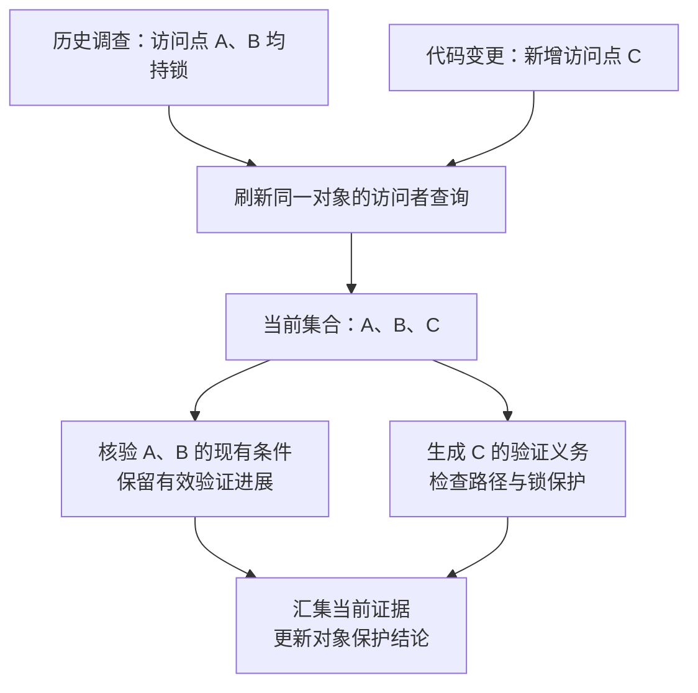

# Z-Scope 持续安全推理：让结论驱动增量验证，让调查投入跨版本积累

## 【摘要】

面向大型 C/C++ 代码仓高频提交中的重复分析成本，Z-Scope 提出由结论成立条件驱动的持续安全推理方案，通过成立条件表、查询范围订阅和剩余验证任务生成，使历史调查成果在当前证据支持下跨版本积累；已落地原型在 Range 单候选同版本三组对照中，相比同一调查范围的完全重扫，将模型调用从 **4 次降至 1 次、Token 减少 63.98%、调查耗时减少 33.98%**，完成 **3 项条件的本轮确认**并保持关键证据与调查终态一致，为扩大持续安全扫描覆盖、提升服务毛利及推广到其他证据约束型验证 Agent 提供基础。

## 【创新方案描述】

### 1. 核心洞察：决定增量成本的，是变化后还剩多少问题需要回答

大型 C/C++ 项目的安全调查通常要串联类型、调用关系、指针别名、资源生命周期与业务语义。一次结论背后，往往已经付出了多轮定位代码、选择工具、获取证据和验证假设的成本。代码持续演进时，这些已经完成的工作具有很高的复用价值。

技术难点在于，**代码变化、事实变化和结论变化，具有三种不同的粒度。** 一处头文件修改可能影响大量函数；其中一些程序事实会变化，而某个具体安全结论所依赖的条件仍然成立。更关键的是，**同一处事实变化，对不同结论会产生不同的验证要求。** 系统需要理解结论的成立方式，才能把跨层变化准确翻译成下一轮工作。

以“某个共享对象的全部访问均受锁保护”为例：上一版本已经检查了访问点 A、B，下一版本新增访问点 C。最有价值的增量动作，是刷新访问集合、核验 A 和 B 的既有条件，并集中调查 C 的访问路径与锁保护。这个过程把历史调查投入转化为可持续积累的验证进展。

业界研究已分别在计算调度、模型生成、工作流记忆和形式化验证上取得进展，面向持续安全调查的进一步突破点，是将这些能力连接到具体结论的成立条件：

| 技术路线 | 已有进展 | Z-Scope 进一步解决的问题 |
| --- | --- | --- |
| 函数级增量调度，如 [IceBear（FSE 2025）](https://conf.researchr.org/details/fse-2025/fse-2025-demonstrations/17/IceBear-A-Fine-Grained-Incremental-Scheduler-for-C-C-Static-Analyzers) | 将变更传播至受影响的 AST、函数等组件，减少重复检查 | 一个函数已进入重分析范围后，继续细分其中哪些验证条件可以沿用、哪些需要重新求解 |
| LLM 生成复用，如 [GenCache（NeurIPS 2025）](https://www.microsoft.com/en-us/research/publication/generative-caching-for-structurally-similar-prompts-and-responses/) | 复用结构相似请求的响应生成模式，并适配请求中的变量差异 | 将响应复用进一步连接到当前证据、对象范围和判定规则，维护结论的成立依据 |
| Agent 工作流记忆，如 [Agent Workflow Memory（ICML 2025）](https://proceedings.mlr.press/v267/wang25bx.html) | 从历史任务中提炼可复用工作流，指导后续 Agent 行动 | 为复用步骤关联具体结论、当前证据及完成条件，让流程经验转化为可接续的验证进展 |
| 增量程序验证，如 [UpProver](https://link.springer.com/article/10.1007/s10703-023-00423-0) | 在有界模型检查中验证、复用和修复 SMT 函数摘要 | 把条件检查与局部修复扩展到确定性检查器和 LLM 共同参与、包含业务语义与动态工具查询的调查过程 |

本方案提出的核心贡献是：**让同一个验证条件同时成为结论的依据、证据变化的订阅点和 Agent 子任务的完成标准。** 据此，将“哪些代码受影响”进一步求解为“哪些验证进展仍然成立、下一轮具体执行哪些任务”。一项主创新负责生成这些任务，两项支撑创新分别负责发现变化和执行续算。

### 2. 主创新：将结论成立条件转化为跨版本任务生成规则

**技术难点：把程序事实的变化，转换为结论成立条件的变化。**

一个安全结论可能同时依赖跨函数流转的对象、多段调用组成的路径、边界约束和业务前提。复用需要同时回答两个问题：历史条件在当前版本是否成立，以及当前结论是否产生了新的成立要求。不同类型的结论，对这两个问题有不同的求解规则。

| 结论的成立方式 | 需要维护的依据 | 版本变化后的任务生成规则 |
| --- | --- | --- |
| 存在型：存在一条可触发的越界或泄漏路径 | 具体对象、可行路径、触发条件组成的缺陷见证 | 用当前事实核验见证；见证变化时更新路径调查，继续搜索替代见证或确认修复 |
| 覆盖型：指定范围内的全部访问均受保护 | 当前访问集合、范围覆盖程度及每个成员的保护条件 | 刷新集合与覆盖范围，接续核验保留成员，为新增或变化成员生成保护检查任务 |

例如，同样新增访问点 C，对一个已有越界见证的结论，工作重心是确认该见证在当前版本仍然成立；对“全部访问均受保护”的结论，C 则直接带来一项新的保护检查。**变化如何传播，由结论的成立方式决定。** 这使复用进入结论内部的推理结构。

方案为结论建立结构化的“成立条件表”：每项条件关联分析对象与范围、证据查询、检查方法和完成标准，由此刻画**结论适用域**。每轮先根据当前事实、规则和分析范围生成候选与完整验证要求，再核验已有证据能够完成哪些条件；新增范围也参与本轮候选发现。对覆盖型结论，集合完整性和范围覆盖本身就是需要维护的条件。

> **本轮剩余验证任务 = 当前结论所需的验证义务 − 已由当前证据确认的义务。**

“验证义务”就是作出判断前需要回答的具体问题，例如某条路径是否可达、访问是否受到同一把锁保护。求解结果进一步转成 Agent 可执行的任务，每项任务明确四件事：**目标条件、已有当前证据、待补范围、完成标准。** LLM 据此选择调查动作，专门检查器确认相应条件，二者围绕同一份验证进展协作。

这里的研究贡献集中在“结论类型—查询范围—当前证据—后续任务”的联合映射。一个受影响函数内，已有证据支持的条件可以完成登记，新增和变化条件继续求解，计算投入因此贴近实际语义影响。

首版已经把这套规则接入实际调查：条件表由现有规则目录自动生成，状态覆盖待调查、证据复核就绪、已支持、已反驳和范围待补齐。对于跨版本保持稳定的证据，系统生成本轮条件复核任务；模型可以在同一次裁决中确认这些条件，程序随即登记属于当前构建的事实。对于新增成员或变化证据，系统直接生成补查任务。**复用由“少查一次资料”推进为“少组织一轮推理与事实登记”。**

[Conditional Model Checking（FSE 2012）](https://research-explorer.ista.ac.at/record/1384) 通过条件描述已完成的验证工作，并将其余状态空间交给后续验证器，为“保留进展、接续求解”提供了研究依据。Z-Scope 将这一思想用于版本变化中的安全结论维护，进一步连接程序对象、业务前提、工具证据与 Agent 调查。

### 3. 支撑创新一：订阅查询范围，让新增反证进入验证任务

**技术难点：对“全部访问均受保护”这类结论，新增成员本身就会改变验证范围。**

历史结论引用的事实通常是有限集合，而程序演进会持续产生新的调用者、别名、释放点和访问者。要捕获这些变化，依赖关系需要覆盖生成事实集合的查询，以及该查询对应的对象与范围。

方案将能够支持或改变结论的查询作为依赖单元，记录查询对象、范围、成员集合、空结果及覆盖程度。例如，对锁保护结论订阅“这个对象的访问者集合”，对资源生命周期结论订阅“相关退出路径与释放行为”。每轮刷新查询后，成员增删、事实变化和覆盖变化交给主创新中的任务生成规则，形成各自对应的验证动作。即使历史查询结果为空，后续新增成员也会进入这条更新链路。

下面以新增访问者为例说明设计机制：

**查询订阅输出“哪些对象、成员和范围发生变化”，条件求解输出“这些变化要求完成哪些验证”。** 范围扩大时加入新义务，成员删除时更新对应条件，支持证据变化时重新求解相关问题，使新增反证与历史证据变化都能影响当前结论。

[Maintaining Views Incrementally（SIGMOD 1993）](https://www.cs.umd.edu/projects/hermes/publications/abstracts/mvi.html) 研究了包含插入、删除、否定与递归的视图增量维护。这里借鉴其集合更新思想，将查询成员与覆盖范围连接到安全结论的验证进展。

### 4. 支撑创新二：把调查过程编排为可续算的证据计划

**技术难点：让跨版本调查成果真正转化为更少的模型工作。**

模型调查的开销还来自工具选择、上下文组织、事实登记以及多轮收敛。历史查询步骤具有复用价值，而每轮调查又需要将它们重新绑定到当前对象和证据。要取得收益，需要让查询结果直接服务于下一项验证任务。

方案将调查过程组织为“查询—事实—条件—裁决”的证据计划。新版本到来后，执行仍适用的查询步骤，取得并登记当前事实，再由检查器确认条件的完成状态；后续工具调用围绕剩余条件展开。一次调查的成功步骤和阶段性进展，由此成为下一轮的工作起点。

这一机制把“复用命中”连接到实际成本下降：查询计划保留可执行的工具参数，事实登记为后续推理提供明确引用，完成标准帮助 Agent 在证据齐备后收束调查。它同时减少重复选工具、重新解释证据和反复修正终态带来的消耗。

跨版本续算同时处理问题身份的连续性与证据归属的变化：调查计划按逻辑对象和验证目标定位，查询结果绑定本轮编译实例与证据范围。这样，历史上积累的调查方法可以持续使用，每轮判断又具有明确的当前依据。

三项创新形成明确分工：**查询订阅发现变化，成立条件决定任务，证据计划执行续算。** 条件既约束证据选择，也决定任务何时完成，从而把增量程序分析与验证 Agent 连接成可持续运行的推理过程。

### 5. Z-Scope 的实施基础与可推广性

Z-Scope 已贯通原生程序事实、分层摘要、候选管理、工具调查、证据核验和最终问题状态。实现这项创新所需的三个关键入口已经具备：带构建身份的程序对象与事实、模型实际执行的查询与事实引用、候选的当前裁决与报告状态。它们使条件维护能够接入实际扫描链路，并直接观察对证据、结论和成本的影响。

**当前已跑通“规则条件建表—查询范围刷新—剩余任务生成—本轮条件确认—当前裁决”的主创新闭环，并与已有分层摘要、初始结构化裁决及查询计划复用共同接入扫描主线。** 首版以规则目录中的见证条件与全路径释放、全访问保护等覆盖条件为基础，记录成员增删、空结果、分页及覆盖变化；当前证据支持的语义条件由本轮模型确认，最终程序证明与问题分流由现有检查器完成。扩展方向是丰富业务条件模板和领域查询适配，使更多问题类型沿用同一套任务生成机制。

这套思想适合推广到**基于当前证据、遵循明确约束、通过工具或检查器完成裁决的验证 Agent**。共同内核是“对象与范围—成立条件—证据查询—验证进展”；迁移时适配各领域的证据来源、判定规则和检查器。

| 可推广场景 | 持续变化的证据 | 可复用的验证进展 | 新一轮重点求解 |
| --- | --- | --- | --- |
| 软件回归验证 Agent | 代码、测试结果、依赖版本 | 已满足的行为条件及对应测试证据 | 变更引入的行为、受影响路径和新失败原因 |
| 配置变更验证 Agent | 服务配置、权限策略、依赖拓扑 | 已核验的访问约束和服务依赖条件 | 新配置对权限、连通性与保护条件的影响 |
| 数据质量验证 Agent | 表结构、数据批次、血缘关系 | 已确认的字段约束和转换规则 | 新批次、新字段及上游变更引入的质量义务 |

C/C++ 安全分析同时包含复杂依赖、跨版本身份和多轮证据调查，是这一内核的首发场景。通用部分负责维护条件与任务进展，领域适配部分负责解释证据与判定规则；这一职责划分使安全分析中的投入能够继续服务于其他验证产品。

## 【创意价值呈现】

### 1. 实测支撑：完全重扫、查询复用与条件续算的成本对照

2026-11-16，采用真实 native 事实提取和 `deepseek-v4-flash`，在 Range 的同一编译单元中，将 `_runtime_query_arena_usage` 的一个容量常量从 4096 改为 8192，继续调查 `_lifecycle_format_topic` 的局部数组写入。实验使用独立项目副本，目标函数的源码、行号和缺陷保持稳定，当前编译事实按修改后的版本建立。

**本次将完全重扫、仅查询复用、查询复用＋条件续算放入同一张表，分别衡量总收益与增量收益。** 三组使用相同修改版本、候选、基础任务、模型、工具和预算，在同一 WSL Linux 环境依次执行：

- **完全重扫（同一候选调查范围）：**从空的本地原生事实缓存与调查缓存开始，重建两个编译单元的事实，由模型重新选择查询、登记事实并完成调查。
- **仅查询复用：**使用已有原生事实缓存，从历史调查计划重放 4 个只读查询，再由模型组织事实与裁决。
- **查询复用＋条件续算：**从同一历史建档起点重放相同查询，将有效调查进展组织为成立条件，生成本轮剩余任务并完成当前确认。

| 样本指标 | 完全重扫（同一候选范围） | 仅查询复用 | 查询复用＋条件续算 |
| --- | ---: | ---: | ---: |
| 模型调用次数 | 4 | 3 | **1** |
| 总 Token | 35,649 | 39,444 | **12,840** |
| 调查耗时 | 36.708 秒 | 51.743 秒 | **24.233 秒** |
| 原生事实与任务准备 | 3.355 秒 | 2.469 秒 | 0.816 秒 |
| 准备＋调查 | 40.063 秒 | 54.212 秒 | **25.049 秒** |
| 本轮确认复用条件 | 0 项 | 0 项 | **3 项** |
| 当前已登记事实 | 4 条 | 2 条 | 3 条 |
| 调查终态 | verified / 完成 | verified / 完成 | verified / 完成 |

以完全重扫为基准，条件续算组的模型调用减少 **75.00%**、Token 减少 **63.98%**、调查耗时减少 **33.98%**；以已有查询复用为基准，Token 进一步减少 **67.45%**。前者体现持续验证相对每次从头调查的收益，后者体现成立条件与剩余任务机制带来的额外价值。

查询复用组本次在重放后又执行了 2 个只读查询，经历后续事实组织与模型交互，总 Token 比完全重扫高 10.65%；条件续算组在同样的 4 次查询重放后，一次模型响应即完成条件确认与裁决。这一结果把收益来源落实到了**调查任务的完成与收敛**：取回历史工作所需的证据，再将已有验证进展直接转化为当前任务的完成状态。

本轮确认的三个条件分别是：**写入值到达目标位置、数组下标越界、现有守卫不足以保护该写入**。三组均依据当前源码确认数组容量为 32、写入下标为 32，以及参数守卫对该下标没有约束。三组事实的拆分粒度不同，分别登记 4、2、3 条，具体见证与支撑引用一致地指向当前代码。条件续算组完成三个条件的本轮确认，剩余验证任务归零。

在固定模型响应、真实 native 双编译变体的主线对照中，局部修改后的候选、Finding、终态和关键证据与独立执行一致，修复后陈旧 Finding 残留为 0。针对性验证同时覆盖证据变化、范围成员增删、空集合新增成员、分页缺口，以及当前反证替换历史条件等行为。

**测量口径：**本表为同一候选范围、单次三组对照，覆盖原生事实准备与工具调查；项目级候选发现、初始裁决和报告另行计量。历史建档消耗 39,556 Token、43.954 秒调查时间，两种复用方式共享这一历史起点，建档成本单列摊销；完全重扫列来自修改版本上的独立冷启动实测。三组全部调用均取得提供方用量，模型服务的输入前缀缓存沿用相同设置，货币费用按输入、输出及缓存计价分别核算。完全重扫组终态说明出现缩略值，其四条登记事实与引用完整，一致性按具体见证及结构化终态核对；原始输出与校准记录保留在实验记录中。

此前同版本开关对照中，条件续算将 Token 从 20,537 降至 11,709（减少 42.99%），调查耗时从 14.793 秒增至 16.285 秒（增加 1.492 秒）。本次补齐完全重扫基线并重新执行三组，观察到了 Token 与耗时同时下降。两次观测共同展示调用、用量与延迟各自的实际变化，项目整体收益继续按任务分布、建档摊销和各阶段成本汇总评估。

前期 2026-11-11 的查询复用实验，在对应单候选样本中取得 Token 减少 56.84%、调查耗时减少 29.59%。两组实验分别衡量查询重放与条件续算，采用各自的同版本开关基准，展示从复用取证步骤到复用验证进展的实施过程。

[本轮实验及定位记录](2026-11-16-condition-reuse-comparison.md) · [本轮证据对照](../../artifacts/condition-reuse-20261116/range-20261116-194503/observed-comparison.json) · [前期查询复用实验](2026-11-11-range-query-reuse-comparison.md)

### 2. 商业逻辑：把重复调查支出转化为扫描容量和服务毛利

优先切入高频提交、持续维护多个版本、深度调查占比较高的 C/C++ 项目。这类客户的明确需求，是在既定预算与研发等待时间内，让更多提交获得有证据支撑的安全判断，并持续掌握历史问题的存续、修复和复发。

产品以项目持续验证服务交付：按维护项目数和验证频次提供订阅，提供当前问题状态、修复依据与版本变化解释。首次调查形成可接续的证据记录，后续版本沿用有效进展；连续验证次数越多，建档投入的摊销越充分。经营指标聚焦**单位有效验证成本**，即在约定范围内完成证据核验并形成当前裁决所需的交付费用。

成本下降有两条清晰的变现路径：在同等服务收入和交付量下，节省的模型与计算支出转化为毛利增量；在固定预算下，释放的容量支持更多提交和项目接入，推动订阅扩容。条件、查询与问题演变记录的积累，又为长期版本维护和续费提供持续价值。

**商业测算情景：**以原有扫描可变成本为基准，假设重复调查占 60%、该部分货币费用减少 30%、新增维护及首次建档摊销占 3%，三项均为测算输入，则单次扫描净成本下降为：

> **60% × 30% − 3% = 15%；固定预算可支持的有效扫描量约为原来的 1 ÷ 0.85 ≈ 1.18 倍。**

即每 100 元原有可变成本降至 85 元；同等交付量释放 15 元利润空间，或同预算增加约 17.6% 有效扫描容量。客户试点以实际模型计价、重复调查占比、维护成本、建档摊销及任务完成率替换这些输入，得到可直接用于订阅定价与扩容决策的收益结果。技术价值由此落实到“每完成一次有效验证花多少钱、每份预算服务多少项目”。

### 3. 目标用户与增长路径

| 目标用户 | 核心价值 | 产品与业务增长方向 |
| --- | --- | --- |
| 大型 C/C++ 研发平台与安全团队 | 在既定预算内提高提交覆盖与验证频次 | 按项目规模和验证频次提供企业订阅，通过项目接入和扩容提升收入 |
| 驱动、嵌入式及网络基础设施维护团队 | 多版本问题追踪、修复依据和复发分析 | 私有部署与长期维护服务，扩大长期版本维护场景的采用 |
| 托管安全扫描运营方 | 降低重复模型支出，提高有效调查吞吐 | 改善单位服务毛利，将释放的预算投入更多客户与项目 |
| 测试、配置及数据验证平台 | 为已有 Agent 增加跨版本证据与验证进展维护 | 提供验证内核与领域适配组件，扩展产品授权、集成合作与可服务市场 |

产品的长期积累包括两层：客户项目中的对象、证据与问题演变记录，支持持续交付；可复用的条件模板、任务生成规则与领域适配器，提高后续项目的接入和调查效率。Z-Scope 因而能够持续回答“问题为何仍成立、修复改变了哪项条件、下一步验证什么”，将一次调查的投入转化为后续版本的验证能力与长期服务收入。
