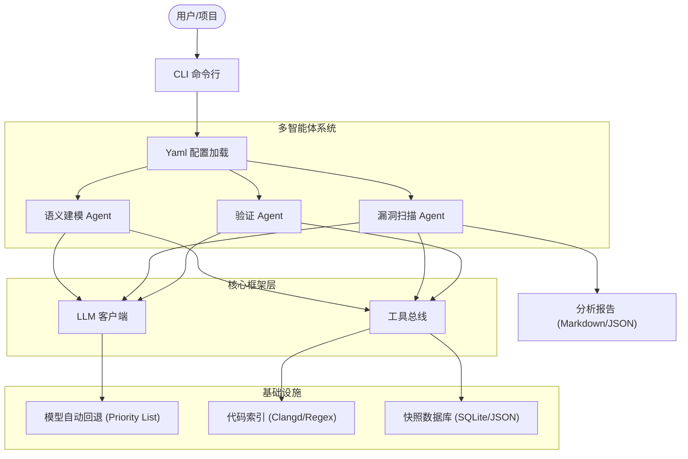

# Z-SCOPE

**Z-SCOPE** 是一款基于 **多智能体（Multi-Agent）** 协作的 C 项目深度静态分析工具。它通过模拟资深安全研究员的思考过程，利用大语言模型（LLM）对代码进行深度的语义建模与漏洞扫描，旨在精准发现内存安全、逻辑漏洞及跨文件资源管理问题。

## 核心特性

- **多智能体分治**：采用 `语义建模 Agent`、`漏洞扫描 Agent` 与 `验证 Agent` 独立协作，深度挖掘逻辑缺陷。
- **高性能 LSP 引擎**：原生支持 `clangd`，具备自适应索引预热、毫秒级符号解析及大规模工程（百万行+）的句柄复用能力。
- **健壮的错误隔离**：改进失败追踪逻辑，确保 Agent 异常或限流时任务状态准确，不遗漏任何潜在风险。
- **批量函数并行扫描**：支持多 worker 并发，共享代码索引与快照数据库，极大提升扫描吞吐量。
- **语义快照缓存**：升级为路径感知的复合主键（函数名+文件路径），精准区分同名函数，加速重复审计。
- **纯 YAML 驱动**：所有分析参数、LSP 路径及模型优先级均通过 `zscope.yaml` 统一定义。
- **全平台兼容**：完美支持 Windows (winget)、Linux (Bear) 及 macOS。

## 系统架构

Z-SCOPE 将公共框架能力（LLM 访问、模型回退、工具调用）与具体的分析逻辑解耦。



## 安装指南

需要 Python 3.9+。

```bash
# 克隆仓库
git clone https://github.com/zealousness/Z-Scope.git
cd Z-Scope

# 安装核心包
python -m pip install -e zscope
```

## 快速上手

### 1. 配置 `zscope.yaml`
在项目根目录编辑 `zscope.yaml`，支持配置模型优先级及并发扫描参数：

```yaml
llm:
  provider: openai
  base_url: http://localhost:11434/v1  # Ollama 示例
  models:
    - alibayram/Qwen3-30B-A3B-Instruct-2507:latest  # 本地高性能模型
  api_key: ollama
  temperature: 0.1
  max_tokens: 16384

project:
  root: .                                   # 分析根目录
  source_root: .                            # 源码根目录
  entry_functions_list: batch_scan.json     # 批量扫描模式 (包含多个函数)
  agents:
    - name: semantic_modeler
      enabled: true
    - name: vulnerability_analyzer
      task: "分析 C 语言代码中的内存安全、逻辑漏洞及并发风险。"
      enabled: true
    - name: validator_agent
      enabled: true                         # 开启结果二次验证

analysis:
  parallel_workers: 1      # 本地模型推荐设为 1，云端可设为 3+
  max_recursion_depth: 3
  snapshot_dir: .zscope_snapshots
  enable_snapshot_cache: true

indexing:
  backend: clangd          # 推荐后端
  clangd_path: "C:\\Program Files\\LLVM\\bin\\clangd.exe" # 可选：指定路径
  auto_prime: true         # 自动预热
  only_prime_priority: true # 仅预热入口相关文件 (防 OOM)
```

### 2. 配置代码索引 (Clangd)

Z-SCOPE 深度集成 `clangd` 实现高精度审计：

#### 高性能索引特性
- **Zero-Timeout Initialization**: 支持大规模项目初始化不超时，并提供实时进度反馈。
- **Smart Priming (智能预热)**：仅解析与审计目标相关的编译单元。
- **Double-Layer Search (双层搜索)**：LSP 与 Regex 协同工作，即使索引未完成也能立即开始分析。

#### 安装方式
- **Windows**: `winget install LLVM.LLVM` (推荐)
- **Linux**: `sudo apt install clangd`
- **macOS**: `brew install llvm`

#### 生成编译数据库 (`compile_commands.json`)
- **CMake**: `cmake -DCMAKE_EXPORT_COMPILE_COMMANDS=ON .`
- **Makefile**: 使用 `bear -- make`

### 3. 执行分析

```bash
# 自动加载当前目录 zscope.yaml
zscope --verbose
```

## 输出报告

分析完成后生成：
- `zscope_batch_report.md`: **审计汇总报告**，包含缺陷等级、根本原因分析及验证结论。
- `zscope_batch_report.json`: 结构化缺陷数据。
- `.zscope_snapshots/`: 持久化的代码语义指纹。

---

## 示例发现 (Cache Module)

对自研高速缓存模块扫描发现：
1. **[Critical] Use-After-Free**: AVL 树旋转与 LRU 淘汰逻辑未同步导致的悬空指针。
2. **[High] Buffer Overflow**: `cache_get` 忽略 `buffer_size` 的 `memcpy` 操作。
3. **[High] String Safe**: `strncpy` 导致的非 NULL 终止路径风险。

## 更新日志

### v0.1.2 (2026-02-02)
- **重大改进**：支持并行扫描模式下的组件共享（CodeIndex/SnapshotStore 复用）。
- **增强稳定性**：集成指数退避 (Exponential Backoff) 处理 HTTP 429 API 限流。
- **配置扩展**：支持 YAML 指定 `clangd_path`，解决 Windows 环境路径识别问题。
- **UI 优化**：批量扫描进度显示及 Agent 级联失败逻辑重构。

### v0.1.1
- 优化 JSON 提取策略，支持嵌套结构及截断恢复。
- 修复 Agent 模块中的 logger 导入异常。

### v0.1.0
- 初始版本：多智能体协作、语义建模缓存、模型自动降级。
