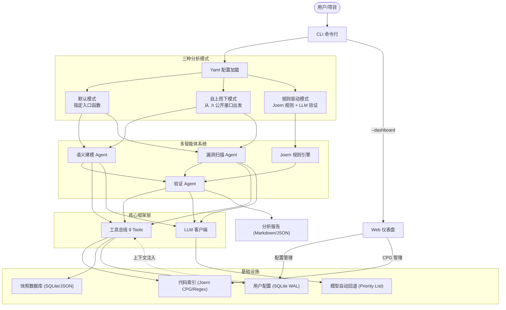

# Z-SCOPE

**Z-SCOPE** 是一款基于 **多智能体（Multi-Agent）** 协作的 C 项目深度静态分析工具。它通过模拟资深安全研究员的思考过程，利用大语言模型（LLM）对代码进行深度的语义建模与漏洞扫描，旨在精准发现内存安全、逻辑漏洞及跨文件资源管理问题。

## 核心特性

- **多智能体分治**：采用 `语义建模 Agent`、`漏洞扫描 Agent` 与 `验证 Agent` 独立协作，深度挖掘逻辑缺陷。
- **三种分析模式**：默认模式（指定入口函数）、自上而下模式（从 `.h` 公开接口出发）、规则驱动模式（Joern 内置规则 + LLM 验证）。
- **Joern CPG 引擎**：基于 Joern 代码属性图（Code Property Graph），提供精确的调用图、数据流追踪和类型查询能力。支持异步 CPG 构建。
- **用户辅助配置系统**：通过 WebUI 管理外部函数描述、配对函数、函数指针指向、函数设计意图等信息，自动注入分析上下文。
- **误报反馈闭环**：支持标记误报，下次扫描自动过滤已确认的误报。
- **Web 仪表盘**：Alpine.js + DaisyUI 构建的交互式界面，集成扫描结果查看、用户配置管理、CPG 状态监控和配置告警。
- **9 大审计工具**：函数源码获取、调用图分析、结构体查询、污点追踪、函数指针发现等。
- **批量函数并行扫描**：支持多 worker 并发，共享代码索引与快照数据库。
- **语义快照缓存**：路径感知的复合主键（函数名+文件路径），加速重复审计。
- **纯 YAML 驱动**：所有分析参数通过 `zscope.yaml` 统一定义。

## 系统架构



## 安装指南

需要 Python 3.9+ 和 Joern。

### 1. 安装 Joern

从 [Joern GitHub Releases](https://github.com/joernio/joern/releases) 下载 `joern-cli`：

```bash
# Linux / macOS
curl -L https://github.com/joernio/joern/releases/latest/download/joern-install.sh | bash
export PATH=$PATH:$HOME/bin/joern/joern-cli

# 验证安装
joern
```

### 2. 安装 Z-SCOPE

```bash
git clone https://github.com/zealousness/Z-Scope.git
cd Z-Scope
python -m pip install -e zscope
```

## 快速上手

### 1. 配置 `zscope.yaml`

```yaml
llm:
  provider: openai
  base_url: http://127.0.0.1:11434/v1
  models:
    - qwen3:latest
  api_key: ollama
  temperature: 0.1
  max_tokens: 16384

project:
  root: .
  source_root: .
  entry_function: main
  agents:
    - name: semantic_modeler
      enabled: true
    - name: vulnerability_analyzer
      task: "分析 C 语言代码中的内存安全、逻辑漏洞及并发风险。"
      enabled: true
    - name: validator_agent
      enabled: true

indexing:
  backend: joern
  joern_path: joern          # Joern CLI 路径
  joern_server_host: 127.0.0.1
  joern_server_port: 8080
  joern_heap_size: 8g        # JVM 堆大小
  import_timeout: 1800       # CPG 构建超时（秒）

analysis:
  max_recursion_depth: 3
  snapshot_dir: .zscope_snapshots
  enable_snapshot_cache: true
  parallel_workers: 1
```

### 2. 执行分析

```bash
# 默认模式：从指定入口函数开始分析
zscope

# 自上而下模式：从 .h 文件公开接口出发
zscope --mode topdown -c zscope.yaml

# 规则驱动模式：Joern 内置规则 + LLM 验证
zscope --mode ruledriven -c zscope.yaml

# 仅构建 CPG（异步就绪）
zscope --build-cpg -c zscope.yaml

# 启动 Web 仪表盘
zscope --dashboard
```

## 用户辅助配置

Joern 存在能力边界，Z-SCOPE 支持用户通过 Web 仪表盘补充以下信息，分析时自动注入上下文：

| 配置类型 | 说明 | 示例 |
|----------|------|------|
| 外部库函数描述 | 无法获取实现的外部函数的内存/并发行为 | `pthread_mutex_lock` 的锁语义 |
| 自定义配对函数 | 用户实现的 malloc/free、lock/unlock 等配对 | `my_alloc` ↔ `my_free` |
| 函数指针指向 | 函数指针的具体目标函数 | `handler_ptr` → `handle_read` |
| 函数设计意图 | 函数对调用者的约束和并发关系 | "此函数不会被并发调用" |
| compile_commands.json | 提供准确的宏定义和预处理分支 | 项目构建路径 |

## Web 仪表盘

```bash
zscope --dashboard
```

仪表盘提供三个主要页面：
- **扫描结果**：查看缺陷列表，支持验证状态标记和误报反馈
- **配置管理**：5 个子页签管理上述用户辅助配置 + CPG 构建控制
- **配置告警**：展示工具怀疑缺少的配置信息，引导用户补充

## 工具清单（9 个）

| # | 工具名 | 用途 |
|---|--------|------|
| 1 | `get_function_impl` | 获取函数源码 |
| 2 | `get_function_snapshot` | 语义缓存复用 |
| 3 | `list_known_functions` | 函数发现（正则搜索） |
| 4 | `get_file_snippet` | 读取上下文代码 |
| 5 | `get_callers` | 漏洞可达性分析 |
| 6 | `get_type_info` | 结构体/类型理解 |
| 7 | `get_call_graph` | 精确调用图 |
| 8 | `get_data_flow` | 污点追踪 |
| 9 | `find_function_pointers` | 回调/钩子发现 |

## 输出报告

分析完成后生成：
- `zscope_batch_report.md`: 审计汇总报告
- `zscope_batch_report.json`: 结构化缺陷数据
- `.zscope_snapshots/`: 持久化的代码语义指纹

## 更新日志

### v0.3.0 (2026-02-20)
- **三种分析模式**：新增自上而下模式（`--mode topdown`）和规则驱动模式（`--mode ruledriven`）。
- **用户配置系统**：SQLite 存储外部函数描述、配对函数、函数指针指向、函数设计意图，分析时自动注入上下文。
- **Joern 异步 CPG 构建**：后台线程构建 CPG，支持 `--build-cpg` 预构建和 Web 端触发。
- **规则引擎**：集成 Joern `run.scan.toJson` 内置规则、自定义 `.sc` 脚本、配对函数检查。
- **Web 仪表盘**：新增配置管理（5 子页签）、CPG 状态监控、误报标记、配置告警展示。
- **误报反馈闭环**：按 `(function, location, subcategory)` 匹配，报告生成前自动过滤。

### v0.2.0 (2026-02-18)
- **重大重构**：代码索引后端从 clangd LSP 迁移至 Joern CPG。
- **新增工具**：`get_callers`、`get_type_info`、`get_call_graph`、`get_data_flow`、`find_function_pointers`。
- **移除工具**：`get_symbol_definition`、`get_type_definition`、`get_hover_info`（LSP 依赖）。
- **依赖变更**：移除 `libclang`，新增 `cpgqls-client`。

### v0.1.2 (2026-02-02)
- 支持并行扫描模式下的组件共享。
- 集成指数退避处理 HTTP 429 API 限流。

### v0.1.0
- 初始版本：多智能体协作、语义建模缓存、模型自动降级。
