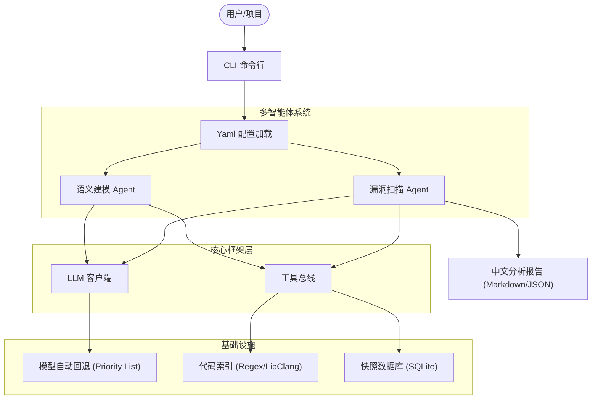

# Z-SCOPE

**Z-SCOPE** 是一款基于 **多智能体（Multi-Agent）** 协作的 C 项目深度静态分析工具。它通过模拟资深安全研究员的思考过程，利用大语言模型（LLM）对代码进行深度的语义建模与漏洞扫描，旨在精准发现内存安全、逻辑漏洞及跨文件资源管理问题。

## 核心特性

- **多智能体分治**：采用 `语义建模 Agent` 与 `漏洞扫描 Agent` 独立协作，保证分析深度与准确性。
- **高可用模型降级**：支持多模型优先级配置，当高参数模型（如 Qwen-480B）响应异常时，自动平滑切换至后续模型（如 Qwen-30B）。
- **语义快照缓存**：对函数行为进行语义指纹提取，代码微调不触发语义变化时，可利用缓存加速分析。
- **纯 YAML 驱动**：废弃繁琐的命令行参数，所有分析任务、智能体配比及 LLM 参数均通过 `zscope.yaml` 灵活定制。
- **全中文报告**：最终分析结论、漏洞描述及修复建议均以中文输出，降低阅读成本。

## 系统架构

Z-SCOPE 采用灵活的插件化架构，将公共框架能力（LLM 访问、模型降级、工具调用）与具体的分析逻辑解耦。



## 安装指南

需要 Python 3.9+。

```bash
# 克隆仓库
git clone https://github.com/zealousness/Z-Scope.git
cd Z-Scope

# 安装核心包
python -m pip install -e zscope
```

## 快速上手

### 1. 配置 `zscope.yaml`
在项目根目录创建或编辑配置文件，支持配置多个模型优先级：

```yaml
llm:
  provider: openai
  base_url: https://api.siliconflow.cn/v1
  models:
    - Qwen/Qwen3-Coder-480B-A35B-Instruct # 优先级 1
    - Qwen/Qwen3-Coder-30B-A3B-Instruct  # 优先级 2
  api_key: ${SILICON_FLOW_KEY}

project:
  root: ./my_c_project
  entry_function: main
  agents:
    - name: semantic_modeler
      enabled: true
    - name: vulnerability_analyzer
      task: "检查跨文件的内存分配与释放一致性"
      enabled: true
```

### 2. 执行分析

```bash
zscope --config zscope.yaml
```

## 输出结果

分析完成后，Z-SCOPE 将在项目目录下生成：
- `report.md`：**中文分析报告**，包含缺陷严重等级、根本原因分析及代码修复建议。
- `report.json`：全量序列化数据，便于平台集成。
- `.zscope_snapshots/`：存储函数的语义建模快照。
